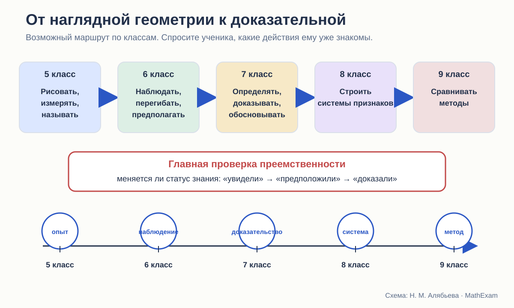
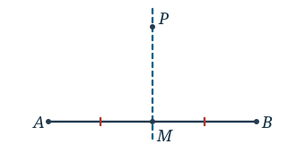
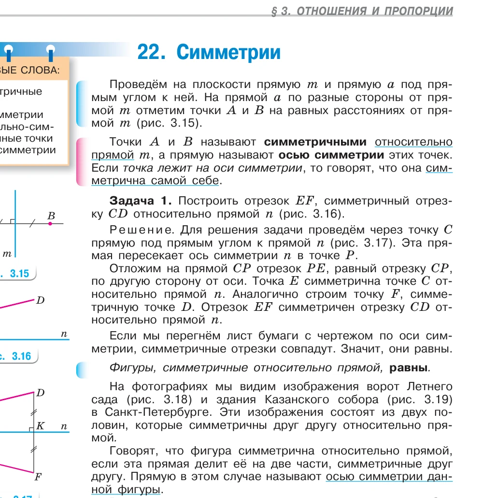

# Что ученик приносит в 7 класс

Как наглядная геометрия Виленкина готовит систематический курс — и чего от неё нельзя требовать.

<aside class="series-note good"><h3>Почему без 5–6 классов сравнение будет неполным</h3>
Учебник геометрии 7 класса всегда что-то считает уже известным. Поэтому я смотрю не только на то, как автор начинает новый курс, но и на тот опыт, с которым ребёнок к нему приходит.
</aside>

<figure class="series-figure infographic">

<figcaption>На каждом этапе меняется не только объём материала, но и статус знания: сначала ребёнок действует и наблюдает, затем формулирует гипотезу, а в систематическом курсе должен научиться доказывать.</figcaption>
</figure>

<section class="lesson-case" id="praktikum">
<h2>Что показывает бумажный сгиб</h2>
<figure class="series-figure practice-diagram">

</figure>

Поставьте на листе точки A и B, совместите их сгибанием и раскройте лист. Соедините A и B. Назовите M точку пересечения сгиба с AB. На сгибе возьмите ещё одну точку P, отличную от M. Соедините её с A и B.

Прежде чем снова сложить лист, покажите пальцем, куда попадёт каждый конец отрезка PA. После проверки закончите две фразы: «У меня на листе…» и «Я предполагаю, что для любой точки на сгибе…».

Разбор для учителя

P остаётся на месте, A попадает на B. Отрезок PA ложится на PB. Это даёт гипотезу: всякая точка сгиба равноудалена от A и B. Спросите, относится ли предположение к самой M. Здесь отрезки MA и MB лежат на одной прямой, а при складывании тоже совмещаются.

Если отражение уже известно как движение, равенство PA = PB следует из сохранения расстояний. В начале 7 класса можно пока оставить вопрос открытым. После изучения первого признака равенства треугольников к нему ведёт <a href="../12-kak-sobrat-stroinyi-kurs/">другой путь через серединный перпендикуляр</a>.

</section>

## В 7 классе геометрия начинается второй раз

Формально систематический курс геометрии начинается в 7 классе. Фактически ребёнок к этому моменту уже несколько лет имеет дело с геометрическими объектами. Переход из 5–6 классов в 7-й — это переход от наглядной геометрии к систематической планиметрии: те же отрезки и углы начинают жить по правилам доказательства.

В 5–6 классах детям предлагают измерять отрезки и углы, вычислять периметры и площади, строить точки на координатной плоскости. Знакомство с симметрией я разбираю на примере линии Виленкина. Какое из этих действий конкретный ученик может повторить и объяснить, удобно проверить прямо на листе.

Это не мелкие подготовительные сведения. Из них складывается первоначальная геометрическая интуиция. И если учебник 7 класса говорит «наложим фигуры», «проведём перпендикуляр», «возьмём точку внутри угла», ученик понимает эти слова не из определения, а из прежнего опыта.

Вопрос в другом: **достаточно ли этого опыта для той роли, которую ему теперь поручают?**

## Что именно даёт курс Виленкина

В используемом издании математики для 6 класса задания разделены на работу в классе, повторение и домашнюю работу. Отдельно отмечены устные, групповые и практические упражнения. Есть рубрики, посвящённые математической речи, рассуждению и наблюдению. Это важно: геометрический материал появляется не только в виде готовых формул, но и как деятельность.

Ребёнку предлагают:

- строить треугольники по заданным элементам;
- измерять стороны и углы;
- делать предположения о сумме углов треугольника;
- работать с окружностью, кругом, шаром;
- строить симметричные точки и фигуры;
- проверять результат перегибанием бумаги;
- находить оси и центры симметрии;
- применять координаты для описания симметрии.

С точки зрения подготовки к геометрии особенно ценны задания, где ответ не сообщается заранее, а возникает после действия: «измерьте», «сравните», «сделайте предположение», «проверьте на модели».

Так формируется привычка искать закономерность. Но пока это ещё не доказательная привычка.

<figure class="series-figure source-fragment">

<figcaption>Виленкин Н. Я. и др. Математика. 6 класс. Часть 1. § 3, п. 22 «Симметрии», с. 142. После построения симметричного отрезка предлагается перегнуть лист по оси симметрии: совпадение отрезков используется как наглядное обоснование их равенства.</figcaption>
</figure>

## Что стоит услышать при первом сгибе

По с. 142 видно, какое действие предлагают авторы. Оно допускает несколько разных объяснений со стороны ребёнка. Один может сказать «я сложил правильно», другой укажет, что у двух отрезков совпали оба конца. Во втором ответе уже есть мысль о соответствии точек. Её можно использовать в доказательстве гораздо позже.

Поэтому при повторном сгибании я бы сначала предложила закрыть рукой одну из букв и восстановить её по рассказу соседа. Вопрос «куда перейдёт A?» требует назвать точку. Вопрос «одинаковые ли отрезки?» допускает удачную догадку.

## Что ученик знает, а что только видел

При анализе преемственности важно не ставить знак равенства между разными уровнями владения.

| Уровень | Что это означает |
|---|---|
| Видел | узнаёт изображение или слово |
| Выполнял | может повторить действие по инструкции |
| Называет | воспроизводит термин и простое определение |
| Применяет | решает прямую задачу |
| Объясняет | связывает действие со свойством |
| Доказывает | выводит общее утверждение из принятых оснований |

Шестиклассник мог многократно видеть симметрию и строить симметричные точки. Это ещё не означает, что он знает свойства осевой симметрии как теоремы. Он мог измерить углы треугольника и получить сумму, близкую к 180°. Это ещё не доказательство теоремы о сумме углов.

## Как выбрать следующее задание

Эти три ответа на одну задачу подсказывают учителю разное продолжение. Это возможные реплики для разбора на уроке.

<dl>
<dt><strong>«Отрезки примерно одинаковые. Я измерил».</strong></dt>
<dd>Полезно оставить обе длины в тетради с указанием точности. Затем взять другую точку P, ничего пока не измерять и по сгибу предсказать результат. На этом шаге достаточно сформулировать предположение.</dd>
<dt><strong>«Они равны, потому что A попадает на B».</strong></dt>
<dd>Предложите показать второй конец отрезка PA. Одного соответствия A и B мало. Важно, что точка P лежит на сгибе и остаётся на месте.</dd>
<dt><strong>«Я могу взять P где угодно».</strong></dt>
<dd>Спросите, включает ли это саму A. Если взять P = A, одно расстояние равно нулю, а другое равно AB. Ребёнок уточняет своё предположение: P должна лежать на линии сгиба. Даже до систематического курса он может проверить границу собственного утверждения.</dd>
</dl>

## Что делают три автора на старте

### Атанасян

Введение напоминает знакомые фигуры и практические умения. Затем достаточно быстро появляются сравнение отрезков и углов, равенство фигур через наложение, измерение и первые теоремы. Переход мягкий: новые идеи вырастают из привычных действий.

Слабое место такого подхода — риск оставить физическое действие в роли неоговорённого основания.

### Погорелов

Погорелов начинает строить язык основных свойств почти сразу. Порядок точек, полуплоскости, откладывание отрезков и углов, существование равного треугольника входят в систему исходных положений. Для преемственности это более резкий переход, зато правила доказательства предъявлены отчётливее.

### Мерзляк

Мерзляк сначала идёт от знакомых фигур и простых свойств, а затем специально останавливается на вопросе: на чём вообще держатся первые доказанные теоремы? Так появляется отдельный параграф об аксиомах. Переход от опыта к дедукции сделан заметным, хотя ранние определения равных отрезков и углов всё ещё опираются на наложение.

## Что оставить в тетради до следующего урока

Рядом с рисунком достаточно двух строк. Первая относится к опыту: при складывании по одной и той же линии точки A и B совместились, P осталась на месте. Во второй запишем предположение про расстояния и подчеркнём слова «для любой точки P линии сгиба».

Полезно вернуть ученику именно этот лист, когда появится доказательство свойства серединного перпендикуляра. Тогда можно спросить, где в доказательстве используется каждое из двух условий: прямая проходит через середину AB и перпендикулярна AB. Так у сохранённого рисунка появляется вторая работа.

<section class="source-list">
<h2>Какие издания сравниваются</h2>
<ul><li><a href="https://media.prosv.ru/content/item/12884/" rel="noopener">Л. С. Атанасян и др. «Математика. Геометрия. 7–9 классы. Базовый уровень»</a>. 14-е переработанное издание, 2023. Печатное издание — ISBN 978-5-09-102538-5, по ссылке — электронная форма 2023 года.</li><li>А. В. Погорелов. «Геометрия. 7–9 классы». Просвещение, 11-е стереотипное издание, 2022. ISBN 978-5-09-087755-8.</li><li><a href="https://prosv.ru/catalog/geometriya-merzlyak-a-g-7-9-bazovii/" rel="noopener">А. Г. Мерзляк, В. Б. Полонский, М. С. Якир. «Геометрия. 7, 8, 9 классы»</a>. Сравнивается базовая линия.</li><li><a href="https://prosv.ru/product/matematika-5-klass-uchebnik-v-2-ch-chast-101/" rel="noopener">Н. Я. Виленкин и др. «Математика. 5 класс»</a> и <a href="https://prosv.ru/product/matematika-6-klass-uchebnik-v-2-ch-chast-101/" rel="noopener">«Математика. 6 класс»</a>. Эти книги рассматриваются как предыстория систематического курса геометрии.</li></ul>

Ссылки ведут на официальные страницы издательства. Фрагменты страниц приведены в объёме, необходимом для методического и критического анализа; права на учебники и их оформление принадлежат авторам и издательствам.

</section>
