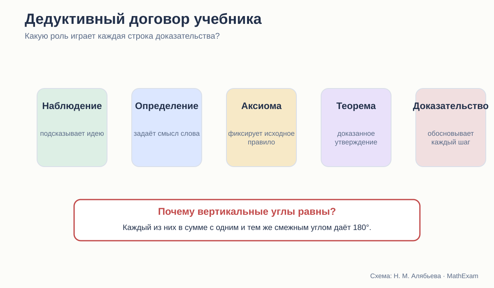
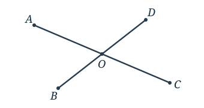
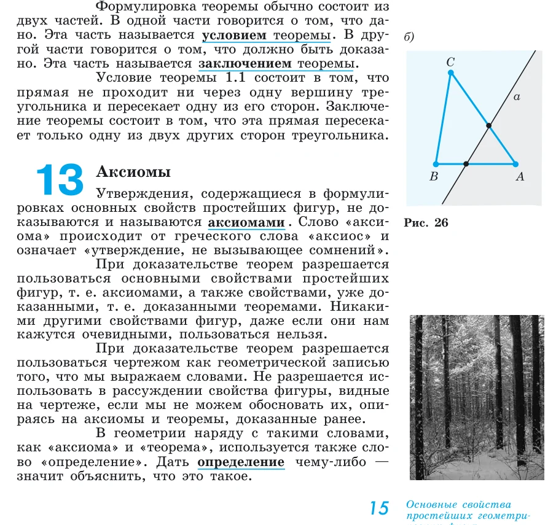
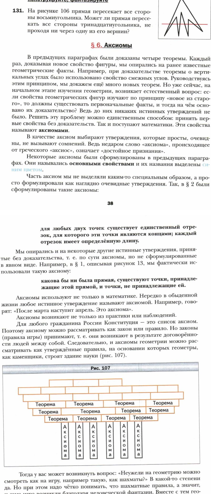

# Определение, аксиома, теорема: правила игры в школьной планиметрии

Три способа объяснить школьнику правила доказательной геометрии.

<aside class="series-note warning"><h3>Главный вопрос статьи</h3>
Когда ученик читает доказательство, он должен понимать не только ход рассуждения, но и право автора сделать каждый шаг. Для этого учебник обязан объяснить, какие утверждения принимаются без доказательства и чем они отличаются от определений и теорем.
</aside>

<figure class="series-figure infographic">

<figcaption>Наблюдение, определение, аксиома, теорема и доказательство выполняют разные функции. Сбой начинается, когда одна роль незаметно подменяет другую.</figcaption>
</figure>

<section class="lesson-case" id="praktikum">
<h2>Откуда следует равенство вертикальных углов</h2>
<figure class="series-figure practice-diagram">

</figure>

Прямые AC и BD пересекаются в O. Точка O лежит между A и C, а также между B и D. Требуется обосновать, почему ∠AOB = ∠COD, если уже известно свойство смежных углов.

Предложите подчеркнуть в условии слова, из которых следует, что OA и OC — противоположные лучи. Теперь найдите угол, смежный сразу с обоими углами из заключения. Закройте рисунок и запишите две суммы.

Разбор для учителя

Угол BOC подходит дважды. В первой паре общая сторона OB, а OA и OC противоположны. Во второй общая сторона OC, а OB и OD противоположны. Поэтому ∠AOB + ∠BOC = 180° и ∠BOC + ∠COD = 180°. После вычитания ∠BOC получаем ∠AOB = ∠COD.

У записи «углы равны, потому что они вертикальные» две разные роли. В задаче на вычисление она годится, когда теорема уже доказана. В нашем упражнении требуется доказать саму теорему. Здесь слово «вертикальные» даёт сведения о лучах, а равенство углов ещё надо получить. Полезный отклик на такую запись: «Какие именно лучи противоположны? Начни с этой строки».

</section>

## Геометрия начинается не с точки

На первой странице систематического курса обычно появляются точка и прямая. Но с точки зрения логики геометрия начинается ещё раньше — с ответа на вопрос:

> Какие правила рассуждения здесь действуют?

В арифметике школьник много лет пользовался знакомыми свойствами действий, не особенно задумываясь об их месте в системе. В геометрии это быстро перестаёт работать. Из рисунка можно предположить равенство углов, но нельзя ссылаться на него без основания. Через две различные точки проходит ровно одна прямая. В рассматриваемом курсе это исходное свойство. Определение треугольника объясняет, что называть треугольником, но не утверждает новую теорему.

Если учебник не разводит эти роли, ученик усваивает очень неприятную привычку: всё напечатанное жирным кажется ему «правилом», а разница между определением, свойством и признаком исчезает.

## Погорелов: правила объявлены в начале

У Погорелова первый параграф называется «Основные свойства простейших геометрических фигур». В нём последовательно задаются свойства принадлежности точек и прямых, порядок точек на прямой, измерение отрезков и углов, откладывание фигур, существование треугольника в заданном положении, параллельность.

После первых примеров автор отдельно вводит понятия условия и заключения теоремы, а затем аксиомы.

<figure class="series-figure source-fragment">

<figcaption>А. В. Погорелов. Геометрия. 7–9 классы, с. 15. Автор прямо пишет: при доказательстве можно пользоваться аксиомами и ранее доказанными теоремами; свойства, только видимые на чертеже, использовать нельзя.</figcaption>
</figure>

На с. 15 у правила есть конкретное следствие. Чтобы назвать углы AOB и BOC смежными, ученик вправе взять противоположность лучей OA и OC из условия. Их положение на рисунке помогает выбрать углы, однако в записи требуется назвать исходное условие. Такой короткий разбор придаёт смысл словам об аксиомах и теоремах уже на первой неделе.

## Мерзляк: вопрос об основаниях появляется после первых теорем

Мерзляк выбирает более разговорный маршрут. Сначала вводятся простейшие фигуры, доказываются первые теоремы о пересекающихся прямых, смежных и вертикальных углах. Затем авторы останавливаются и задают естественный вопрос: если всякий новый факт выводится из прежнего, где начало цепочки?

<figure class="series-figure source-fragment">

<figcaption>А. Г. Мерзляк, В. Б. Полонский, М. С. Якир. Геометрия. 7 класс, с. 38–39. Аксиомы объясняются как исходные правила, на которых строится здание теории.</figcaption>
</figure>

Порядок иной: на с. 38–39 у читателя уже есть пример рассуждения, к которому можно вернуться. Я бы попросила открыть вышедшее ранее доказательство о вертикальных углах и цветом выделить свойство смежных углов, а затем поискать, откуда известно оно само. Такая работа с двумя страницами — моё предложение к уроку.

## Атанасян: переход через привычное действие

У Атанасяна введение строится иначе. Автор напоминает известные фигуры, измерения и практические умения. В начальных параграфах появляются прямые, отрезки, углы, наложение, измерение. Понятия теоремы и доказательства подробно входят в курс рядом с первым признаком равенства треугольников.

При таком порядке разговаривать о доказательстве можно на материале уже знакомой конфигурации двух углов.

Но математический договор здесь менее заметен. Часть исходных положений представлена как понятные свойства, часть — через практическое действие, часть — как нечто уже известное. Учителю приходится самому удерживать границу:

- это определение;
- это опытное объяснение;
- это свойство, которое мы принимаем;
- это теорема, которую сейчас доказываем.

Если учитель делает эту работу, курс идёт естественно. При самостоятельном чтении граница может размыться.

## Определение не доказывают

Знание определения уже позволяет делать выводы. Вопрос в том, какие именно сведения в него включили.

Возьмём параллелограмм. Определение сообщает, какие четырёхугольники мы будем называть параллелограммами. Из него непосредственно следует параллельность соответствующих сторон, поскольку обе пары параллельных сторон входят в определение.

А равенство противоположных сторон — уже теорема. Чтобы получить его, требуется доказательство.

Затем появляются признаки параллелограмма. Они решают обратную задачу: позволяют по другим свойствам установить, что данный четырёхугольник принадлежит классу параллелограммов.

Удобно свериться с такой памяткой. «Свойство» и «признак» указывают, как направлено рассуждение. «Теорема» говорит о том, что утверждение доказано. Поэтому один и тот же признак может быть теоремой.

| Элемент | Какой вопрос решает |
|---|---|
| Определение | Что мы называем этим объектом? |
| Свойство | Что верно для всякого объекта этого класса? |
| Признак | Как распознать объект по другим данным? |
| Аксиома | Какое исходное утверждение принимаем без доказательства? |
| Теорема | Какой новый вывод устанавливаем? |
| Следствие | Что непосредственно получаем из уже доказанного? |

## Что значит «аксиома очевидна»

И Погорелов, и Мерзляк связывают аксиомы с опытом и наглядной убедительностью. Это естественно для школы, но слово «очевидно» требует осторожности.

Аксиома не становится аксиомой потому, что её никто не сумел доказать или потому, что рисунок выглядит убедительно. Внутри конкретного курса она является исходным положением, из которого строится теория.

Для школьника достаточно более простого объяснения:

> Мы выбираем небольшой набор правил, принимаем их без доказательства и далее строго следим, чтобы каждое новое утверждение выводилось только из них и уже доказанных теорем.

Такой язык не требует обсуждать независимость и непротиворечивость аксиоматической системы на университетском уровне. Но он сохраняет главное: доказательство не начинается из воздуха.

## Скрытые аксиомы: всегда ли это плохо

Не всякая скрытая предпосылка делает курс плохим. Иногда автор сознательно не перегружает 7 класс формализмом. Например, возможность наложить фигуру в нужном положении может временно восприниматься интуитивно.

Проблема начинается в трёх случаях:

1. скрытая предпосылка используется как решающий шаг доказательства;
2. позднее учебник вводит другой смысл того же понятия, но не связывает его с прежним;
3. ученик получает противоречивые сигналы: «рисунку верить нельзя», но «мысленно перегнём рисунок» принимается без объяснения.

Поэтому в дальнейшем я буду отмечать не только наличие скрытого основания, но и его судьбу:

- сформулировано ли оно позже;
- доказана ли связь со старым употреблением;
- меняется ли после этого смысл ранних доказательств.

## Что изменится, если убрать одно условие

Для последней минуты урока попросите оставить A, O, B и C на месте, а луч OD сдвинуть в сторону от продолжения OB так, чтобы он по-прежнему находился по другую сторону прямой AC от точки B. Какая из двух сумм ещё обязана равняться 180°?

Первая сумма останется прежней: лучи OA и OC противоположны. Для второй исчезло основание: теперь у углов BOC и COD только общая сторона, а лучи OB и OD уже не противоположны. Ученик, который нашёл именно эту потерянную строку, различил условие и вывод без пересказа их определений.

В учебниках для этого разговора есть разные точки входа. У Погорелова можно вернуться к правилам доказательства на с. 15, у Мерзляка — к вопросу об основаниях на с. 38–39, у Атанасяна — к переходу от знакомых фигур к теореме в главе «Треугольники». Изменение условия и разбор двух сумм предложены здесь для урока.

<section class="source-list">
<h2>Какие издания сравниваются</h2>
<ul><li><a href="https://media.prosv.ru/content/item/12884/" rel="noopener">Л. С. Атанасян и др. «Математика. Геометрия. 7–9 классы. Базовый уровень»</a>. 14-е переработанное издание, 2023. Печатное издание — ISBN 978-5-09-102538-5, по ссылке — электронная форма 2023 года.</li><li>А. В. Погорелов. «Геометрия. 7–9 классы». Просвещение, 11-е стереотипное издание, 2022. ISBN 978-5-09-087755-8.</li><li><a href="https://prosv.ru/catalog/geometriya-merzlyak-a-g-7-9-bazovii/" rel="noopener">А. Г. Мерзляк, В. Б. Полонский, М. С. Якир. «Геометрия. 7, 8, 9 классы»</a>. Сравнивается базовая линия.</li></ul>

Ссылки ведут на официальные страницы издательства. Фрагменты страниц приведены в объёме, необходимом для методического и критического анализа; права на учебники и их оформление принадлежат авторам и издательствам.

</section>
