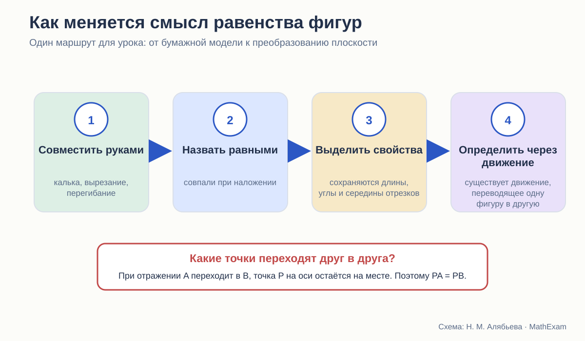
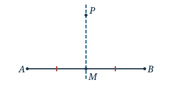
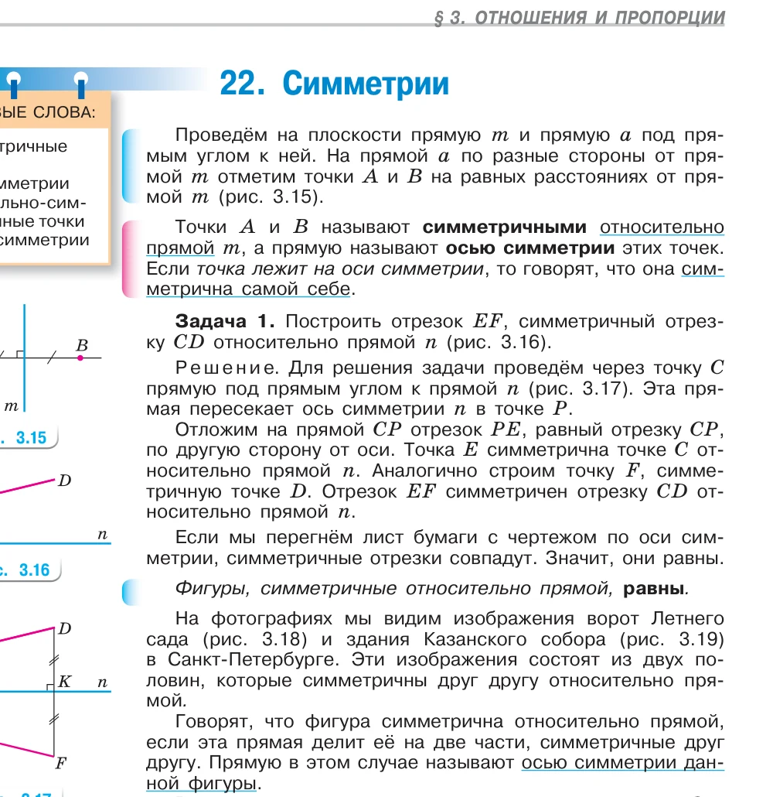
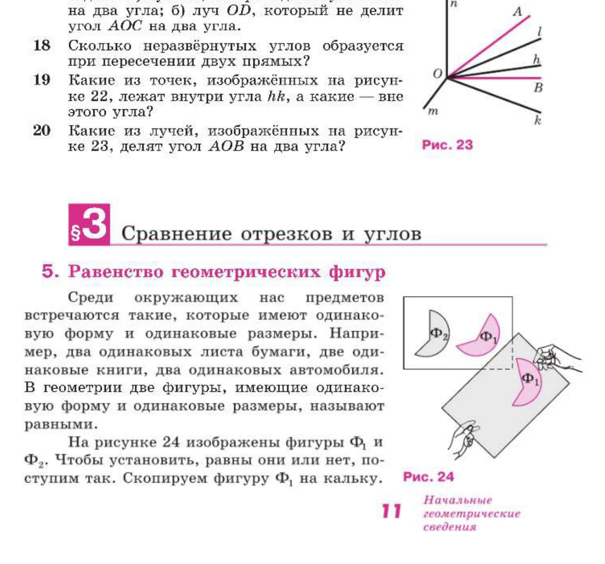
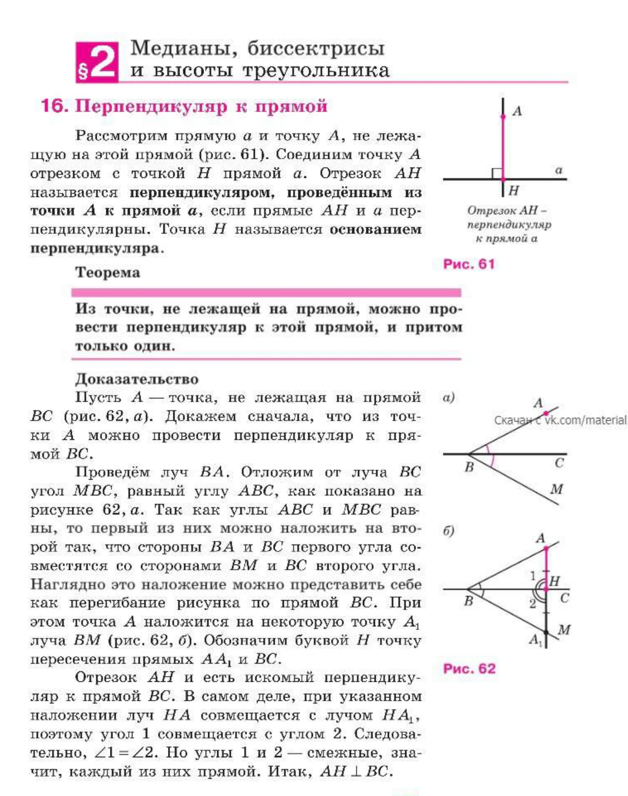
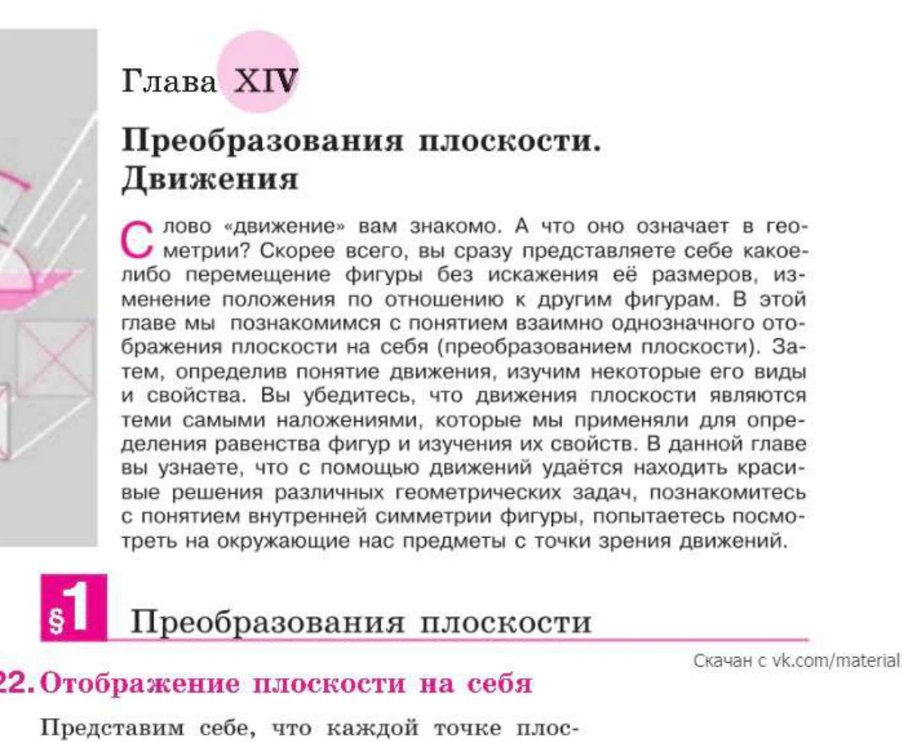
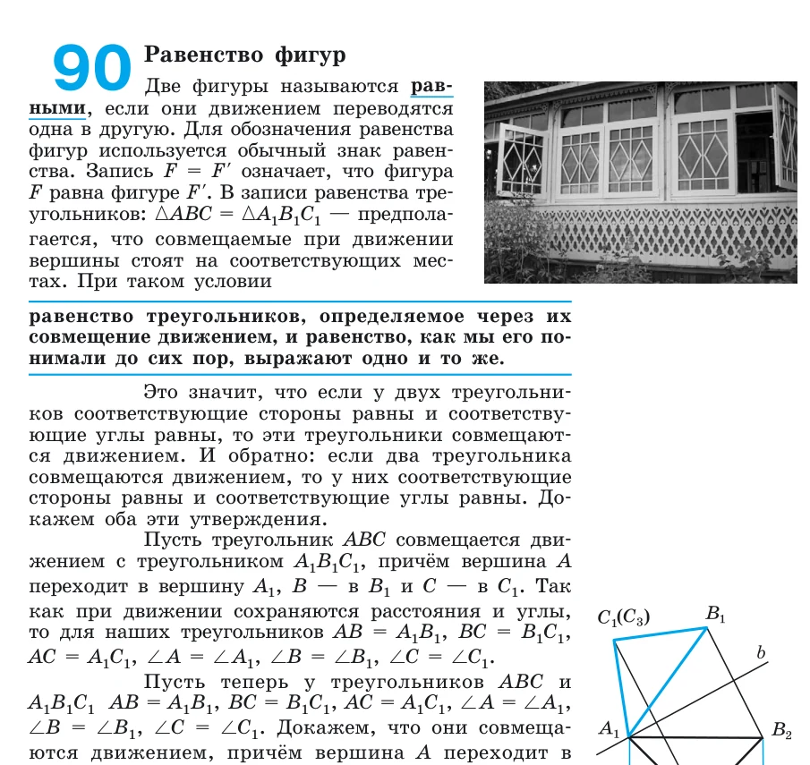
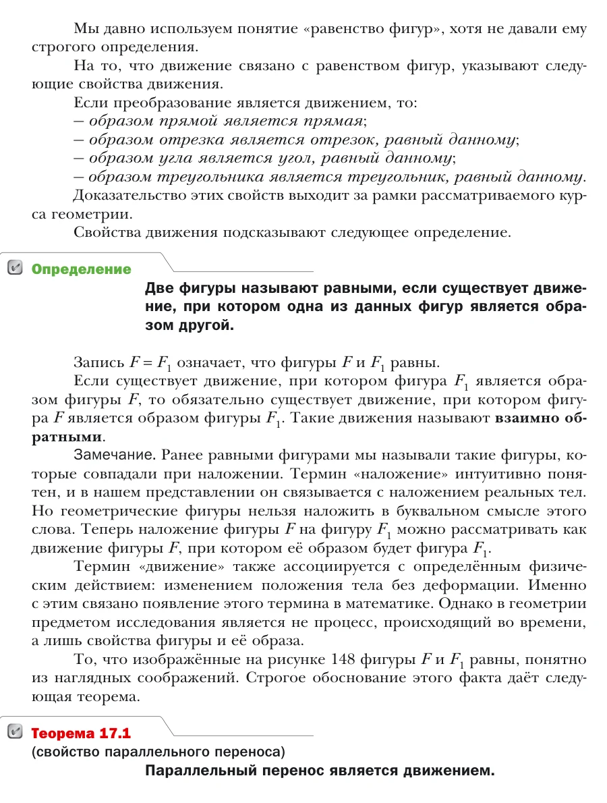

# Наложение, перегибание и движение

Как меняется смысл равенства фигур от бумажной модели до преобразования плоскости.

<aside class="series-note warning"><h3>Почему это не частный терминологический спор</h3>
Через понятие равенства фигур проходят признаки равенства треугольников, свойства симметрии, построения и поздняя теория движений. Если смысл слова меняется, нужно проверить всю цепочку.
</aside>

<figure class="series-figure infographic">

<figcaption>От физического совмещения к движению плоскости. Поздняя формализация допустима, если учебник явно связывает новый язык с прежним.</figcaption>
</figure>

<section class="lesson-case" id="praktikum">
<h2>Что сохраняется при отражении</h2>
<figure class="series-figure practice-diagram">

</figure>

При сгибании A совмещается с B. Точки P и M лежат на сгибе, M — середина AB. Проведите PA и PB. Чтобы узнать, во что перейдёт отрезок PA при отражении относительно линии сгиба, сначала укажите образ каждого его конца.

Разбор для учителя

P остаётся на месте, A переходит в B. Если уже установлено, что отражение сохраняет расстояния, отсюда следует PA = PB. А если ученик говорит лишь «у них общий конец P», попросите сравнить произвольные отрезки, проведённые из одной точки. Для равенства существенно, что концы соответствуют друг другу при <em>одном и том же</em> движении.

<strong>Измените одну точку.</strong> Возьмите Q вне сгиба, отметьте её зеркальный образ Q′ и соедините Q с A. Образом отрезка QA будет Q′B. Движение даёт QA = Q′B. Замена Q′ на Q в этой записи потребовала бы отдельного основания. Так становится видно, зачем в исходном доказательстве понадобилось условие о положении P.

<figure class="series-figure practice-diagram">
<svg xmlns="http://www.w3.org/2000/svg" viewBox="0 0 340 168" width="340" height="168" style="max-width:100%;height:auto" role="img" aria-label="A и B симметричны относительно вертикальной оси. Вне оси взяты зеркальные точки Q и Q′. Отрезки QA и Q′B соединяют соответствующие точки.">
<g fill="none" stroke="#243b50" stroke-width="2.4"><path d="M56 125 H284"/><path d="M170 12 V145" stroke="#216282" stroke-dasharray="5 5"/><path d="M56 125 L102 38 M284 125 L238 38"/><path d="M102 38 H238" stroke="#788694" stroke-dasharray="3 5" stroke-width="1.4"/></g>
<g fill="#243b50"><circle cx="56" cy="125" r="3"/><circle cx="284" cy="125" r="3"/><circle cx="102" cy="38" r="3"/><circle cx="238" cy="38" r="3"/></g>
<g fill="#243b50" font-family="Georgia, serif" font-size="18"><text x="39" y="147">A</text><text x="286" y="147">B</text><text x="84" y="32">Q</text><text x="242" y="32">Q′</text></g>
</svg>
<figcaption>Можно закрыть правый отрезок листком и попросить ученика построить его, отмечая образы обоих концов левого отрезка.</figcaption>
</figure>

</section>

## Одно слово — несколько разных смыслов

Совместить два бумажных треугольника, назвать равные стороны и указать движение, переводящее одну фигуру в другую, — три разных задания. В первом ребёнку помогает калька. Во втором приходится выписать соответствующие вершины. В третьем надо сказать, что происходит с каждой точкой фигуры и почему сохраняются расстояния.

Я прослежу одну связь: каким языком книга вводит равенство в начале курса и как возвращается к нему, когда появляется определение движения.

## Виленкин: сначала физический опыт

В 6 классе симметричные отрезки предлагается проверить перегибанием листа. При сгибе они совпадают, и это служит убедительным для ребёнка подтверждением равенства.

<figure class="series-figure source-fragment">

<figcaption>Н. Я. Виленкин и др. Математика. 6 класс. Часть 1, с. 142. Здесь перегибание выполняет роль опыта: ученик видит совпадение и связывает его с равенством.</figcaption>
</figure>

Этот пример объясняет, на какой опыт может опереться учитель, если класс работал с таким заданием. Убедиться, что конкретный ученик помнит идею совмещения, помогает вопрос об образе второго конца отрезка в практикуме выше.

## Атанасян: наложение становится определением

В начале курса Атанасяна равенство геометрических фигур вводится через совмещение. Для проверки предлагается скопировать одну фигуру на кальку и наложить её на другую. Затем тем же способом сравниваются отрезки и углы.

<figure class="series-figure source-fragment">

<figcaption>Л. С. Атанасян и др. Геометрия. 7–9 классы, с. 11–13. Наглядная операция с калькой становится основой определения равенства фигур.</figcaption>
</figure>

Это понятный переход от опыта Виленкина. Ученик не должен сначала осваивать язык отображений плоскости: он уже знает, что значит совместить две формы.

Однако теперь наложение используется не только для наблюдения. Оно входит в определения, а вскоре — и в доказательства. Значит, от него требуются свойства:

- фигуру можно разместить в нужном положении;
- расстояния при этом не меняются;
- лучи и углы переходят в лучи и углы;
- порядок точек сохраняется;
- если совпали все три соответствующие вершины треугольников, совпадут и соединяющие их стороны.

В ранней части курса эти свойства не собраны в отдельную теорию. Они воспринимаются как естественные свойства физического перемещения.

## Наложение в доказательстве

Самый заметный пример — первый признак равенства треугольников. Треугольник предлагается наложить на другой так, чтобы совпали вершина и стороны заданного угла. Равенство сторон обеспечивает совпадение остальных вершин.

Логическая идея верна: если существует сохраняющее расстояния преобразование, которое переводит заданные элементы в соответствующие элементы, треугольники совпадут.

Но школьный текст говорит не о преобразовании, а о наложении. Поэтому доказательство фактически опирается на неявное понимание движения.

Ещё выразительнее доказательство существования перпендикуляра из точки к прямой. Наложение предлагается представить как мысленное перегибание рисунка.

<figure class="series-figure source-fragment">

<figcaption>Л. С. Атанасян и др. Геометрия. 7–9 классы, с. 33. Перегибание уже не просто практическая проверка, а образ ключевого шага доказательства существования перпендикуляра.</figcaption>
</figure>

У этого рисунка стоит задержаться на точке пересечения сгиба и отрезка, соединяющего точку с её образом. Два смежных угла при пересечении совмещаются. Равные смежные углы — прямые. Это последний шаг доказательства существования перпендикуляра, и ученик может восстановить его сам. Для единственности перпендикуляра нужен ещё отдельный довод.

## Поздний ответ Атанасяна

В 9 классе, в главе «Преобразования плоскости. Движения», автор прямо связывает движения с теми самыми наложениями, которые использовались раньше для определения равенства и изучения свойств фигур.

<figure class="series-figure source-fragment">

<figcaption>Л. С. Атанасян и др. Геометрия. 7–9 классы, с. 313. Введение главы прямо говорит, что движения плоскости являются теми же наложениями, применявшимися ранее.</figcaption>
</figure>

Для девятиклассника это повод вновь открыть с. 33. В младшем классе вопрос звучал так: какие два угла совместятся? Теперь можно спросить, какие точки неподвижны при осевой симметрии и во что перейдут стороны углов. Поздняя глава даёт язык для перечитывания того же доказательства.

## Погорелов: сначала равенство элементов

Погорелов в начале курса определяет равные отрезки через равенство длин, равные углы — через равенство градусных мер, а равные треугольники — через равенство соответствующих сторон и углов.

Это принципиально другой выбор. Равенство треугольников не определяется через физическое наложение. Вместо этого в систему основных свойств входит существование треугольника, равного данному и расположенного заданным образом.

Так автор получает возможность доказывать признаки равенства, не обращаясь к кальке или бумажному сгибу. Он строит равный треугольник в нужном положении по аксиоме, а затем показывает совпадение вершин.

Позднее, после введения движений, Погорелов определяет равенство произвольных фигур через возможность перевести одну в другую движением и отдельно доказывает согласованность этого определения с прежним пониманием равенства треугольников.

<figure class="series-figure source-fragment">

<figcaption>А. В. Погорелов. Геометрия. 7–9 классы, с. 133. Автор не просто даёт новое определение, а формулирует задачу доказать его эквивалентность прежнему определению равенства треугольников.</figcaption>
</figure>

С точки зрения логической прозрачности это сильный ход. Старое понятие не исчезает бесследно; связь между двумя языками становится теоремой.

## Как к наложению возвращаются в 9 классе у Мерзляка

В 7 классе Мерзляк, как и Атанасян, определяет равные отрезки и углы через возможность совместить их наложением. Равные треугольники также связываются с совпадением при наложении. Одновременно вводится «основное свойство равенства треугольников»: для данного треугольника и луча существует равный треугольник в заданном положении.

В 9 классе авторы возвращаются к проблеме очень прямо:

<figure class="series-figure source-fragment">

<figcaption>А. Г. Мерзляк, В. Б. Полонский, М. С. Якир. Геометрия. 9 класс, с. 152. Авторы отмечают, что строгого определения раньше не давали, и объясняют наложение как движение фигуры.</figcaption>
</figure>

На этой странице полезно задержаться у слова «движение». По определению достаточно указать движение, которое переводит одну фигуру в другую. Назвать конкретное отражение таким движением можно, когда уже известно сохранение расстояний при отражении. Это и есть недостающая строка между бумажным сгибом и доказательством PA = PB в нашем примере.

## Три модели одной идеи

| Авторская линия | Раннее понимание равенства | Поздняя формализация | Вопрос к тексту |
|---|---|---|---|
| Атанасян | совпадение при наложении | движения объявляются теми же наложениями | какие элементы совмещены и какое свойство разрешает следующий шаг? |
| Погорелов | равенство сторон и углов; аксиома существования равного треугольника | равенство фигур через движение с доказательством согласованности | где к существованию равной копии добавляется вывод о совпадении вершин? |
| Мерзляк | совпадение при наложении + основное свойство равенства треугольников | прямое переопределение через движение | какое свойство конкретного преобразования уже известно? |

## Можно ли пользоваться наложением в школе

Да. Запрещать слово «наложение» было бы педагогической ошибкой. Оно даёт сильный образ конгруэнтности и связывает геометрию с действием.

Но в стройном курсе надо развести три уровня.

### Уровень 1. Физическая модель

Калька, вырезанная фигура, сгиб бумаги. Модель помогает увидеть совпадение.

### Уровень 2. Исходное допущение курса

Мы считаем возможным перемещать фигуру без деформации и принимаем, что такое перемещение сохраняет нужные отношения. Если курс использует это до формальной теории движений, следует сказать об этом прямо.

### Уровень 3. Математическое определение

Движение плоскости — отображение плоскости на себя, сохраняющее расстояние между любыми двумя точками. Равные фигуры — фигуры, одна из которых переводится в другую движением. Теперь свойства можно доказывать в точном языке.

Без второго уровня возникает иллюзия, что бумажный опыт сам доказывает теорему. Без первого курс теряет наглядную опору. Без третьего слово «наложение» навсегда остаётся метафорой.

## Что предложить при повторном чтении

Я бы взяла в 9 класс рисунок из 7-го и попросила подписать всего три вещи: точку, её образ и свойство, достаточное для равенства двух расстояний. Если на рисунке со сгибом ученик получил QA = Q′B, спросите, в какой исходной задаче можно было опустить штрих. Ответ «там точка P лежала на оси» связывает ранний опыт с определением движения точнее, чем общий пересказ главы.

<section class="source-list">
<h2>Какие издания сравниваются</h2>
<ul><li><a href="https://media.prosv.ru/content/item/12884/" rel="noopener">Л. С. Атанасян и др. «Математика. Геометрия. 7–9 классы. Базовый уровень»</a>. 14-е переработанное издание, 2023. Печатное издание — ISBN 978-5-09-102538-5, по ссылке — электронная форма 2023 года.</li><li>А. В. Погорелов. «Геометрия. 7–9 классы». Просвещение, 11-е стереотипное издание, 2022. ISBN 978-5-09-087755-8.</li><li><a href="https://prosv.ru/catalog/geometriya-merzlyak-a-g-7-9-bazovii/" rel="noopener">А. Г. Мерзляк, В. Б. Полонский, М. С. Якир. «Геометрия. 7, 8, 9 классы»</a>. Сравнивается базовая линия.</li><li><a href="https://prosv.ru/product/matematika-5-klass-uchebnik-v-2-ch-chast-101/" rel="noopener">Н. Я. Виленкин и др. «Математика. 5 класс»</a> и <a href="https://prosv.ru/product/matematika-6-klass-uchebnik-v-2-ch-chast-101/" rel="noopener">«Математика. 6 класс»</a>. Эти книги рассматриваются как предыстория систематического курса геометрии.</li></ul>

Ссылки ведут на официальные страницы издательства. Фрагменты страниц приведены в объёме, необходимом для методического и критического анализа; права на учебники и их оформление принадлежат авторам и издательствам.

</section>
