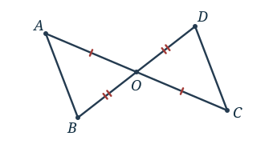
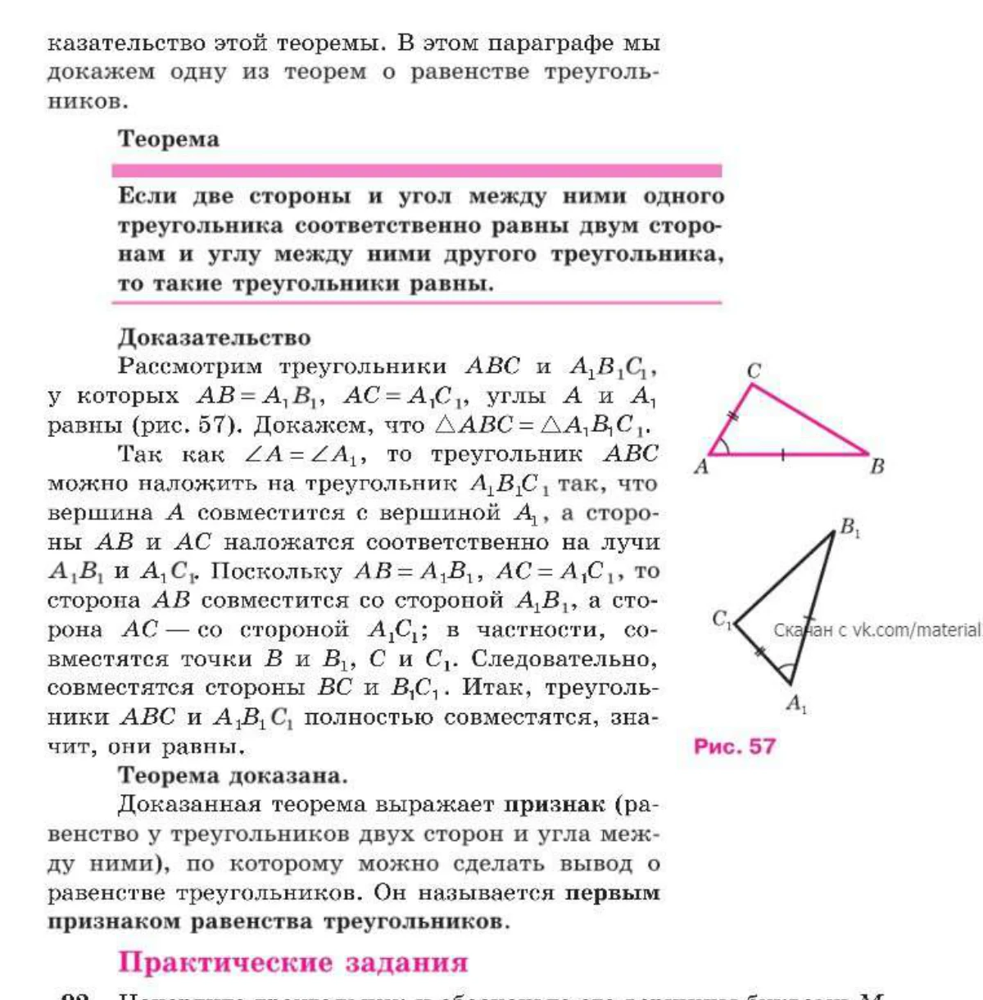
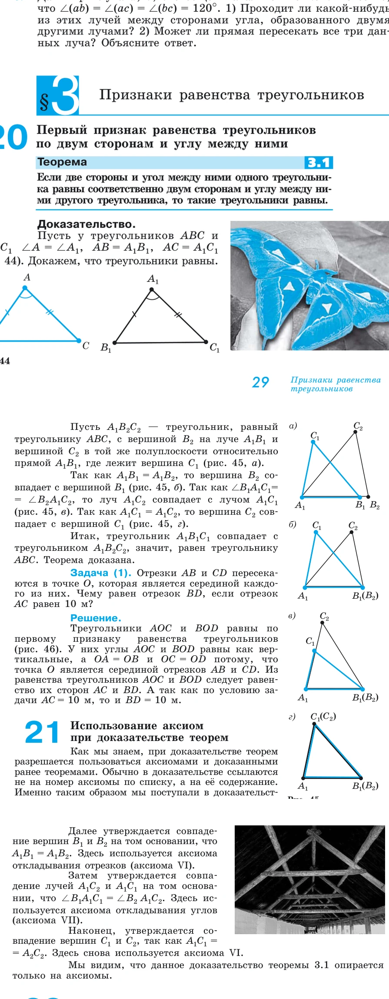
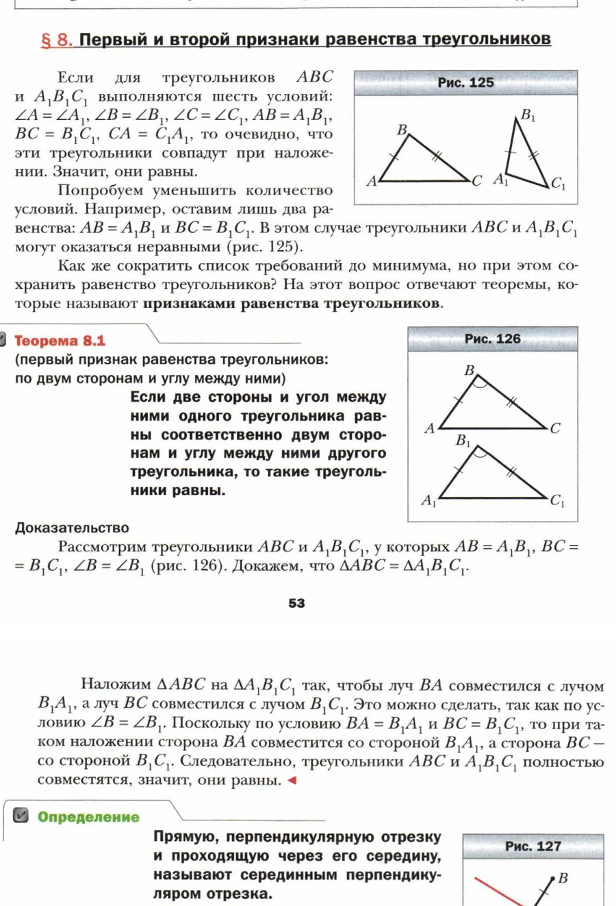
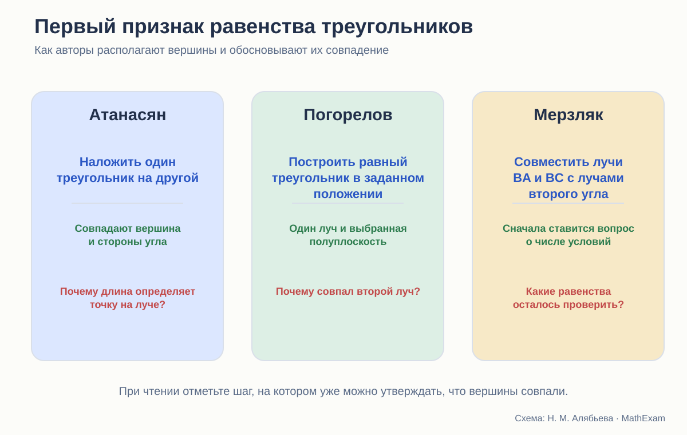

# Первый признак равенства треугольников

Как две стороны и угол между ними определяют треугольник. Читаем три доказательства и проверяем, почему совпадают лучи и их точки.

<section class="lesson-case" id="praktikum">
<h2>Первый признак на пересекающихся прямых</h2>
<figure class="series-figure practice-diagram">

</figure>

Отрезки AC и BD пересекаются в O. Дано AO = CO и BO = DO.

В моей задаче для урока нужно установить AB = CD. Предложите сперва назвать вершины двух треугольников в соответствующем порядке. Какой угол заключён между отмеченными сторонами каждого треугольника?

Разбор для учителя

Треугольникам AOB и COD соответствуют A и C, O и O, B и D. Углы AOB и COD равны как вертикальные. Две пары отмеченных сторон и угол между ними дают равенство треугольников по первому признаку. Теперь можно заключить, что AB = CD. Углы при A и C для применения признака не даны.

Если в записи появилось ∠BAO = ∠DCO, попросите показать вершины этих углов. Их равенство получится позднее как следствие равенства треугольников. Первому признаку здесь нужны углы с вершиной O.

</section>

## Что закрепляет вершины

Если у двух треугольников попарно равны две стороны и углы между этими сторонами, треугольники равны. Почему в формулировке так важно слово «между»? Положим на стол две полоски, соединим их концы в точке A и раздвинем свободные концы. Длины AB и AC сохранятся. Чтобы задать положение C относительно AB, нужно ещё указать направление луча AC. Вместе с длиной AC это определит на луче и саму точку C.

Ученик может возразить, что такой же угол можно отложить и по другую сторону от AB. Он прав. Два рисунка будут зеркальными. Когда в доказательстве сопоставляют вершины двух заданных треугольников, полезно спросить, как автор выбрал сторону от прямой. Именно на этот небольшой шаг я смотрю у трёх авторов.

## Как совмещают стороны у Атанасяна

<figure class="series-figure source-fragment">

<figcaption>Л. С. Атанасян и др. Геометрия. 7–9 классы, с. 31. Треугольник ABC предлагается наложить на A₁B₁C₁ так, чтобы вершина A совместилась с A₁, а стороны AB и AC — с соответствующими лучами.</figcaption>
</figure>

В главе II, § 1, вершину A совмещают с A₁, а стороны угла — с соответствующими лучами. На луче A₁B₁ имеется только одна точка на расстоянии AB от начала. Поскольку AB = A₁B₁, это B₁. Так же определяется C₁ на другом луче. После совпадения трёх вершин совпадают и соединяющие их отрезки.

В тексте идея наложения дана целиком. При чтении я остановилась бы на слове «луч». Если оставить только «на прямой», на заданном положительном расстоянии от A₁ окажутся уже две точки. Так ученик может сам объяснить одно слово доказательства.

## Для чего Погорелову третий треугольник

<figure class="series-figure source-fragment">

<figcaption>А. В. Погорелов. Геометрия. 7–9 классы, с. 29–31. Сначала строится треугольник, равный ABC и расположенный относительно луча A₁B₁; затем совпадение вершин выводится из аксиом откладывания отрезков и углов.</figcaption>
</figure>

У Погорелова равенство треугольников означает равенство всех соответствующих сторон и углов. В § 3, пп. 20–21, рядом стоят доказательство первого признака и разбор использованных аксиом. Обозначим вершины копии A₁, B₂, C₂. Важно различать копию, существование которой разрешает аксиома, и второй треугольник A₁B₁C₁, предъявленный в условии.

1. Поместим копию ABC так, чтобы B₂ находилась на луче A₁B₁, а C₂ лежала в той полуплоскости от прямой A₁B₁, где находится C₁.
2. На луче A₁B₁ отложены равные отрезки A₁B₂ и A₁B₁, поэтому B₂ совпадает с B₁.
3. От того же луча в выбранную полуплоскость отложен угол, равный ∠B₁A₁C₁. По единственности откладывания угла луч A₁C₂ совпадает с A₁C₁.
4. На общем луче равны A₁C₂ и A₁C₁. Их концы совпадают. Значит, копия оказалась ровно тем треугольником A₁B₁C₁, равенство которого с ABC требовалось доказать.

Если ученик спрашивает, зачем ввести B₂, когда на рисунке уже есть B₁, стоит закрыть вторую строку. Пока установлено только то, что B₂ лежит на нужном луче. Равенство длин как раз и позволяет отождествить две точки.

## Как вопрос о числе условий поставлен у Мерзляка

<figure class="series-figure source-fragment">

<figcaption>А. Г. Мерзляк, В. Б. Полонский, М. С. Якир. Геометрия. 7 класс, с. 53–54. После обсуждения минимального набора условий доказательство снова строится через наложение треугольников.</figcaption>
</figure>

В базовом учебнике 7 класса, п. 8, авторы начинают с вопроса о том, сколько равенств придётся проверять. В доказательстве совмещают лучи, выходящие из B. Затем на основании равенства сторон устанавливают, что совпали их концы. Чуть дальше, в теореме 8.2, этот ход работает уже с другим рисунком.

Точка X лежит на серединном перпендикуляре к AB, M — середина AB. При X ≠ M треугольники AMX и BMX равны по двум сторонам и углу между ними. Поэтому XA = XB. А что, если X оказалась самой M? Треугольники исчезают, но нужное равенство следует из определения середины. Задержаться на этом случае стоит хотя бы потому, что без него в слове «каждая» осталась бы оговорка.

<figure class="series-figure infographic">

<figcaption>Теорема одна и та же, но авторы по-разному отвечают на вопрос, почему один треугольник можно расположить относительно другого нужным образом.</figcaption>
</figure>

## Что я прошу объяснить после чтения

В задаче с точкой O в начале статьи положение треугольников уже задано. Я прошу обозначить равные углы, записать треугольники в соответствующем порядке и только затем указать равные стороны AB и CD. Если ученик называет AB = CD одним из условий, ему полезно закрыть вопрос задачи ладонью и снова прочитать данные. Если он правильно выбирает три условия, но спрашивает, почему их хватает, пора вернуться к двум лучам с началом A₁. Это разные затруднения и разные места для подсказки.

<section class="source-list">
<h2>Какие издания сравниваются</h2>
<ul><li><a href="https://media.prosv.ru/content/item/12884/" rel="noopener">Л. С. Атанасян и др. «Математика. Геометрия. 7–9 классы. Базовый уровень»</a>. 14-е переработанное издание, 2023. Печатное издание — ISBN 978-5-09-102538-5, по ссылке — электронная форма 2023 года.</li><li>А. В. Погорелов. «Геометрия. 7–9 классы». Просвещение, 11-е стереотипное издание, 2022. ISBN 978-5-09-087755-8.</li><li><a href="https://prosv.ru/catalog/geometriya-merzlyak-a-g-7-9-bazovii/" rel="noopener">А. Г. Мерзляк, В. Б. Полонский, М. С. Якир. «Геометрия. 7, 8, 9 классы»</a>. Сравнивается базовая линия. Номера пунктов, теорем и упражнений 7 класса даны по изданию «Вентана-Граф», 2015.</li><li><a href="https://events.prosv.ru/uploads/2021/10/additions/RZeLWiMGnxFTfpMVZeshuNDJSf9GG1cV50cwMjhp.pdf" rel="noopener">Т. А. Бурмистрова (сост.). Геометрия. Сборник примерных рабочих программ. 7–9 классы</a>. Просвещение, 2020, с. 14–15 и 24–26. Здесь можно сверить порядок тем у Атанасяна и Погорелова.</li></ul>

Ссылки ведут на официальные страницы издательства. Фрагменты страниц приведены в объёме, необходимом для методического и критического анализа; права на учебники и их оформление принадлежат авторам и издательствам.

</section>
