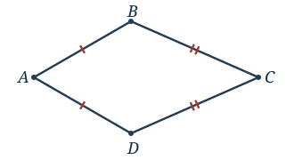
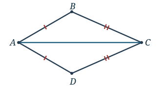
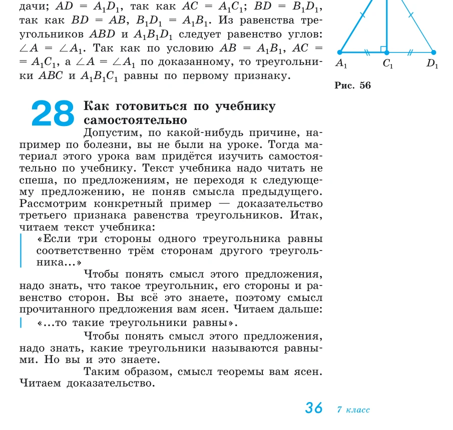
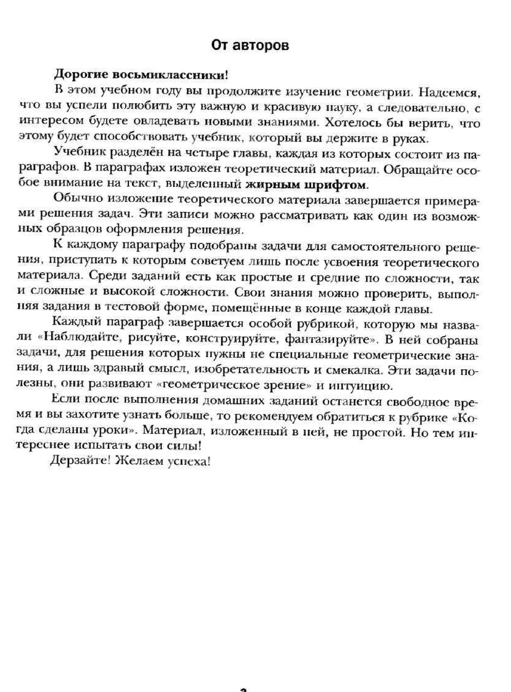
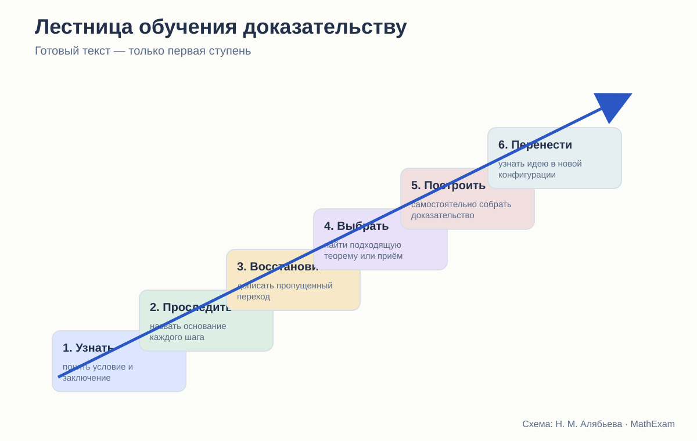

# Как учебники планиметрии учат доказывать

Две диагонали дают два доказательства. Сопоставляем решения с порядком теорем у Атанасяна, Погорелова и Мерзляка.

<section class="lesson-case" id="praktikum">
<h2>Зачем проводить именно эту диагональ</h2>
<figure class="series-figure practice-diagram">

</figure>

В выпуклом четырёхугольнике ABCD даны AB = AD и BC = DC. Требуется доказать ∠ABC = ∠ADC. Я предлагаю эту задачу, когда хочу услышать, откуда у ученика взялась его первая линия. Обе диагонали ведут к цели.

До построения полезно договориться, чего мы от него ждём. Если провести AC, какие треугольники можно будет сравнить? Если провести BD, что произойдёт с двумя углами, о которых спрашивается?

Разбор для учителя. Ученик выбрал AC

<figure class="series-figure practice-diagram">

</figure>

У треугольников ABC и ADC стороны AB и AD равны по условию, BC и DC тоже. Диагональ AC даёт третью пару, потому что эта сторона общая. По третьему признаку треугольники равны, и их соответствующие углы при B и D равны.

Ученик выбрал BD

<figure class="series-figure practice-diagram">
<svg xmlns="http://www.w3.org/2000/svg" viewBox="0 0 340 180" width="340" height="180" style="max-width:100%;height:auto" role="img" aria-labelledby="diagonal-bd-title">
<title id="diagonal-bd-title">Диагональ BD делит углы при B и D. Слева и справа от неё расположены два равнобедренных треугольника с общим основанием BD.</title>
<g fill="none" stroke="#243b50" stroke-width="2.4" stroke-linejoin="round"><path d="M38 87 147 24 290 87 147 150Z"/><path d="M147 24V150" stroke="#216282"/></g>
<g stroke="#a33a35" stroke-width="2.4"><path d="M90.5 52l4 6.9m-4 63.1 4-6.9M214.1 58l3.2-7.4m2.3 9.8 3.3-7.4m-5.5 70.4-3.3-7.4m8.8 5-3.3-7.4"/></g>
<g fill="#122f42" font-family="Georgia,serif" font-style="italic" font-size="18"><text x="20" y="93">A</text><text x="141" y="19">B</text><text x="297" y="93">C</text><text x="141" y="173">D</text></g>
</svg>
<figcaption>Общее основание BD делит каждый из искомых углов на две части.</figcaption>
</figure>

Из AB = AD в треугольнике ABD следует ∠ABD = ∠BDA. Из BC = DC в треугольнике BCD следует ∠DBC = ∠BDC. В выпуклом четырёхугольнике диагональ проходит внутри обоих углов. Складывая равные части, получаем ∠ABC = ∠ADC.

</section>

## Когда предложить каждое решение

У Атанасяна свойства равнобедренного треугольника входят в главу II, § 2. Третий признак равенства треугольников появляется в § 3. У Погорелова равнобедренному треугольнику посвящён п. 23, третий признак разбирается в п. 27. У Мерзляка в базовой книге 7 класса это соответственно пп. 9 и 11. Во всех трёх линиях можно дать задачу дважды. В первый раз детям уже доступен ход через BD. Позднее можно вернуться к тому же рисунку и поискать решение через AC.

Фраза «я провёл BD» ещё мало говорит о ходе мысли. «Получились два равнобедренных треугольника» — начало решения. Следующий мой вопрос будет о том, где у каждого основание. Если ученик сам покажет на рисунке четыре угла и сложит их попарно, идея построения уже его.

## Что дают три учебника для такой работы

<figure class="series-figure source-fragment">

<figcaption>А. В. Погорелов. Геометрия. 7–9 классы, с. 36. Доказательство рассматривается не как сплошной текст для заучивания, а как последовательность смысловых шагов.</figcaption>
</figure>

У Погорелова после третьего признака есть разбор чтения доказательства по предложениям. Предлагаю попробовать этот способ на первой записи выше. Прикрываем строку о равенстве треугольников. Можно ли перейти от трёх пар равных сторон сразу к равенству углов? Ученик должен назвать признак и указать соответствие B и D. Так обнаруживается пропущенный переход даже в коротком решении.

У Атанасяна, в главе II при доказательстве свойства углов равнобедренного треугольника, из вершины к основанию проводят биссектрису. Попробуйте остановить чтение перед этим шагом. В равнобедренном треугольнике ABC с AB = AC уже есть пара равных сторон. Отрезок из A к точке D на BC даст общую сторону. Как нужно выбрать D, чтобы для первого признака появились ещё и два равных угла между этими сторонами? Так у фразы «проведём биссектрису» появляется причина.

<figure class="series-figure source-fragment">

<figcaption>А. Г. Мерзляк, В. Б. Полонский, М. С. Якир. Геометрия. 8 класс. Теория завершается примерами решений, после чего предлагаются самостоятельные задачи разных уровней.</figcaption>
</figure>

В предисловии к базовому учебнику Мерзляка для 8 класса разобраны обозначения упражнений и назначение образцов решения. В книге 7 класса, п. 12, авторы отдельно возвращаются к дополнительному построению из доказательства теоремы 10.4. На уроке это удобный повод задать вопрос ученику, который аккуратно переписал доказательство с AC. Какую строку пришлось бы вычеркнуть, если провести BD? Обе пары равных сторон сохранятся. Изменятся треугольники, в которых они лежат.

<figure class="series-figure infographic">

<figcaption>Воспроизвести запись, найти пропущенное основание и выбрать первое построение можно проверить разными заданиями.</figcaption>
</figure>

## Сколько помощи дать до первого шага

Я начинаю с пустого четырёхугольника с засечками. Когда ученик останавливается, первой подсказкой служит просьба обвести два искомых угла. Следующая подсказка зависит от того, что он увидел. Если он ищет равные треугольники, предложу найти общую сторону. Если заметил равнобедренные, попрошу провести их основание. Готовый разбор стоит открыть после выбора диагонали.

Для следующей самостоятельной задачи оставьте тот же чертёж и измените вопрос. Докажите, что AC делит угол BAD пополам. После проведения AC третий признак даёт ∠BAC = ∠DAC. Здесь легко увидеть, научился ли ученик выбирать из равенства тех же треугольников именно те углы, которые требуются теперь.

<section class="source-list">
<h2>Какие издания сравниваются</h2>
<ul><li><a href="https://media.prosv.ru/content/item/12884/" rel="noopener">Л. С. Атанасян и др. «Математика. Геометрия. 7–9 классы. Базовый уровень»</a>. 14-е переработанное издание, 2023. Печатное издание — ISBN 978-5-09-102538-5, по ссылке — электронная форма 2023 года.</li><li>А. В. Погорелов. «Геометрия. 7–9 классы». Просвещение, 11-е стереотипное издание, 2022. ISBN 978-5-09-087755-8.</li><li><a href="https://prosv.ru/catalog/geometriya-merzlyak-a-g-7-9-bazovii/" rel="noopener">А. Г. Мерзляк, В. Б. Полонский, М. С. Якир. «Геометрия. 7, 8, 9 классы»</a>. Сравнивается базовая линия. Номера пунктов, теорем и упражнений 7 класса даны по изданию «Вентана-Граф», 2015.</li><li><a href="https://media.prosv.ru/content/item/10521/" rel="noopener">А. Г. Мерзляк, В. М. Поляков. «Геометрия. 9 класс. Углублённый уровень»</a>. Электронная форма, 2023. ISBN 978-5-09-108125-1. Книга входит в комплект для 7–9 классов.</li><li><a href="https://events.prosv.ru/uploads/2021/10/additions/RZeLWiMGnxFTfpMVZeshuNDJSf9GG1cV50cwMjhp.pdf" rel="noopener">Т. А. Бурмистрова (сост.). Геометрия. Сборник примерных рабочих программ. 7–9 классы</a>. Просвещение, 2020, с. 14–15 и 24–26. Здесь можно сверить порядок тем у Атанасяна и Погорелова.</li></ul>

Ссылки ведут на официальные страницы издательства. Фрагменты страниц приведены в объёме, необходимом для методического и критического анализа; права на учебники и их оформление принадлежат авторам и издательствам.

</section>
