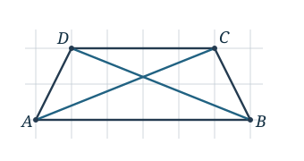
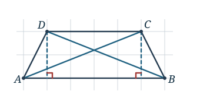
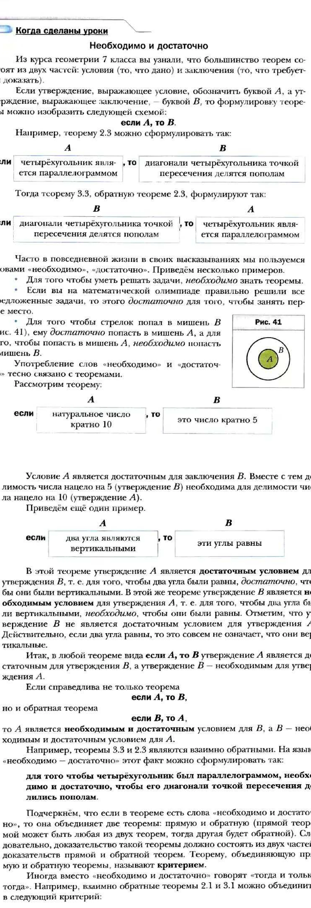
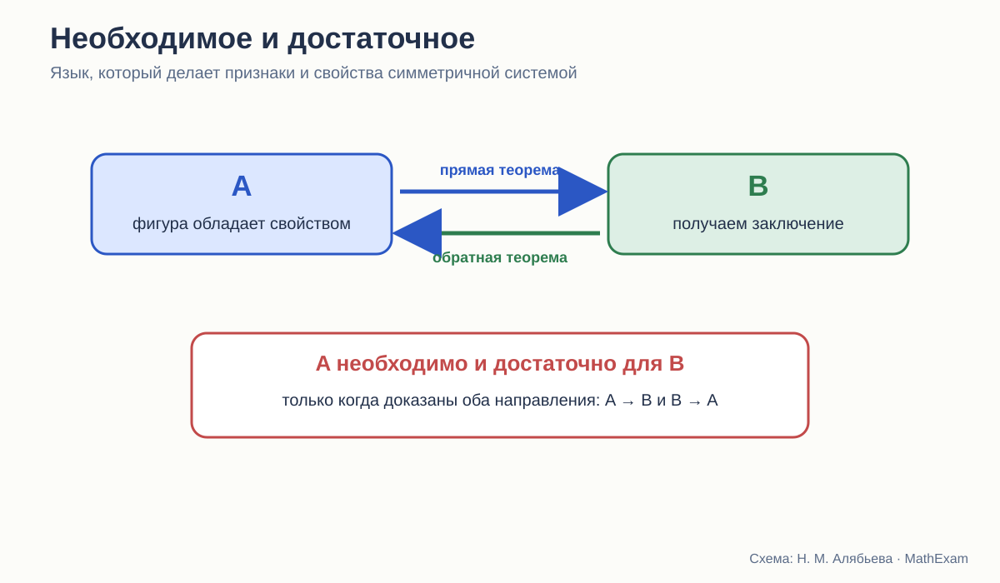

# Необходимо и достаточно

Равные диагонали у трапеции и параллелограмма. Как три учебника учат различать свойство, признак и обратное утверждение.

<section class="lesson-case" id="praktikum">
<h2>Достаточно ли равенства диагоналей</h2>
<figure class="series-figure practice-diagram">

</figure>

Для моей задачи на клетчатой бумаге возьмём точки A(0; 0), B(6; 0), C(5; 2), D(1; 2).

Диагонали прямоугольника равны. Ученик повернул утверждение и записал: «Если AC = BD, то ABCD — прямоугольник». Проверьте это на рисунке.

Разбор для учителя

<figure class="series-figure practice-diagram">

</figure>

Опустите из C и D перпендикуляры на AB. От A до C — пять клеток вправо и две вверх. От B до D — пять влево и две вверх. У прямоугольных треугольников с этими диагоналями в роли гипотенуз попарно равны катеты, поэтому AC = BD. AB = 6, а CD = 4. У прямоугольника противоположные стороны равны. Прямоугольность влечёт равенство диагоналей. Обратное утверждение опровергает этот четырёхугольник.

</section>

## Что изменится, если заранее дан параллелограмм

<figure class="series-figure practice-diagram">
<svg xmlns="http://www.w3.org/2000/svg" width="340" height="180" style="max-width:100%;height:auto" viewBox="0 0 340 180" role="img" aria-labelledby="rect-diags">
<title id="rect-diags">В параллелограмме ABCD проведены равные диагонали AC и BD. Треугольники ABC и BAD имеют общую сторону AB.</title>
<g fill="none" stroke="#243b50" stroke-width="2.4"><path d="M60 100 208 26 239 88 91 162Z"/><path d="M60 100 239 88M208 26 91 162" stroke="#216282"/></g>
<g fill="#122f42" font-family="Georgia,serif" font-style="italic" font-size="18"><text x="40" y="104">A</text><text x="208" y="20">B</text><text x="245" y="94">C</text><text x="81" y="178">D</text></g>
</svg>
<figcaption>Для второй задачи известно ещё одно условие. Противоположные стороны фигуры параллельны.</figcaption>
</figure>

Пусть ABCD — параллелограмм и AC = BD. Сравним треугольники ABC и BAD. Сторона AB общая, BC = AD как противоположные стороны параллелограмма, AC = BD по условию. По третьему признаку треугольники равны. Поэтому ∠ABC = ∠BAD. Эти соседние углы параллелограмма в сумме дают 180°, значит, каждый равен 90°. Остальные углы равны им как противоположные. Получили прямоугольник.

В прямую сторону треугольники ABC и BAD в прямоугольнике равны уже по первому признаку. Сторона AB общая, BC = AD, а углы ABC и BAD между соответствующими сторонами прямые. Отсюда AC = BD. Теперь можно предложить две фразы для завершения. «Среди всех выпуклых четырёхугольников равенство диагоналей для прямоугольника…» — необходимо, но недостаточно. «Среди параллелограммов равенство диагоналей для прямоугольника…» — необходимо и достаточно. Стоит вернуться к первому чертежу и найти точную строку, которая перестала работать. В нашей равнобедренной трапеции BC = AD, поэтому треугольники ABC и BAD действительно равны. Но соседние углы при A и B здесь оба острые. Их сумма меньше 180°. Именно для шага о сумме углов потребовалась параллельность AD и BC.

## Где ученику встречаются оба направления

У Погорелова разговор об обратной теореме входит уже в § 3 книги 7–9 классов. В п. 23 разбираются свойства равнобедренного треугольника, п. 24 посвящён обратной теореме. От равных сторон к углам при основании и от равных углов к противоположным сторонам — два перехода, у каждого своё доказательство.

У Мерзляка эта работа тоже начинается в 7 классе. В базовом издании 2015 года теорема 8.2 говорит о точке серединного перпендикуляра к отрезку, а теорема 11.2 возвращает на эту прямую точку, равноудалённую от концов отрезка. В п. 12 авторы сопоставляют формулировки. В № 269–270 нужно найти условие и заключение, различить свойство и признак. В № 271–272 ученик сам строит обратное утверждение и проверяет его истинность. Позже, в теореме 19.1, оба направления понадобятся снова, чтобы описать геометрическое место точек.

<figure class="series-figure source-fragment">

<figcaption>А. Г. Мерзляк, В. Б. Полонский, М. С. Якир. Геометрия. 8 класс, с. 27–28. Теоремы записываются в виде A → B, затем объясняются обратное утверждение, необходимое и достаточное условия, критерий и выражение «тогда и только тогда».</figcaption>
</figure>

В 8 классе Мерзляк возвращается к вопросу на материале параллелограммов. Здесь прежние действия получают общий язык необходимых и достаточных условий. В 7 классе ученик уже мог проверить ложное обращение. Например, два угла могут давать в сумме 180° и иметь разные вершины. Смежными они тогда быть не могут.

У Атанасяна удобно сопоставить § 1 и § 3 главы III. В начале главы равенство накрест лежащих углов позволяет установить параллельность прямых. В конце, когда параллельность уже дана, свойства параллельных прямых позволяют вывести равенство углов. На одном рисунке можно стереть засечки у углов, отметить параллельность и спросить, как должна измениться первая строка решения.

<figure class="series-figure infographic">

<figcaption>Прямая теорема даёт A → B, обратная — B → A. Только вместе они позволяют сказать «необходимо и достаточно».</figcaption>
</figure>

## Как услышать логическую ошибку

Я прошу произнести вывод целиком, особенно первое слово после «если». Фраза «у прямоугольника диагонали равны» сама по себе безупречна. Если в тетради известно только AC = BD и ребёнок уже написал «значит, это прямоугольник», прошу назвать класс фигур и найти именно то утверждение, которое позволяет сделать такой шаг. Показать на клетках одну подходящую трапецию достаточно для опровержения первого вывода. Во второй задаче надо обосновать вывод для любого параллелограмма с равными диагоналями. В этих двух работах разная цена одного рисунка.

<section class="source-list">
<h2>Какие издания сравниваются</h2>
<ul><li><a href="https://media.prosv.ru/content/item/12884/" rel="noopener">Л. С. Атанасян и др. «Математика. Геометрия. 7–9 классы. Базовый уровень»</a>. 14-е переработанное издание, 2023. Печатное издание — ISBN 978-5-09-102538-5, по ссылке — электронная форма 2023 года.</li><li>А. В. Погорелов. «Геометрия. 7–9 классы». Просвещение, 11-е стереотипное издание, 2022. ISBN 978-5-09-087755-8.</li><li><a href="https://prosv.ru/catalog/geometriya-merzlyak-a-g-7-9-bazovii/" rel="noopener">А. Г. Мерзляк, В. Б. Полонский, М. С. Якир. «Геометрия. 7, 8, 9 классы»</a>. Сравнивается базовая линия. Номера пунктов, теорем и упражнений 7 класса даны по изданию «Вентана-Граф», 2015.</li><li><a href="https://events.prosv.ru/uploads/2021/10/additions/RZeLWiMGnxFTfpMVZeshuNDJSf9GG1cV50cwMjhp.pdf" rel="noopener">Т. А. Бурмистрова (сост.). Геометрия. Сборник примерных рабочих программ. 7–9 классы</a>. Просвещение, 2020, с. 14–15 и 24–26. Здесь можно сверить порядок тем у Атанасяна и Погорелова.</li></ul>

Ссылки ведут на официальные страницы издательства. Фрагменты страниц приведены в объёме, необходимом для методического и критического анализа; права на учебники и их оформление принадлежат авторам и издательствам.

</section>
