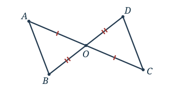
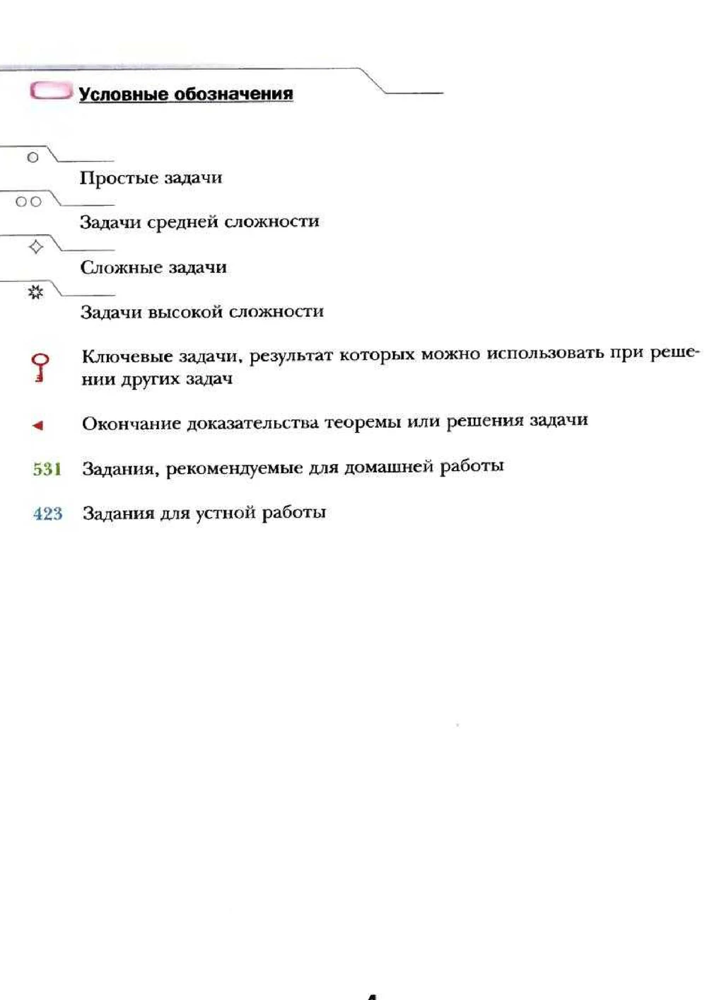
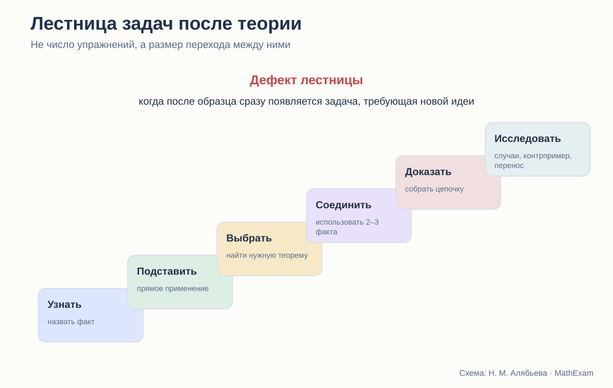

# Система задач по планиметрии: как теория превращается в умение

Один чертёж для вычисления, доказательства и контрпримера. Какие задачи можно предложить сразу, а к каким вернуться через несколько тем.

<section class="lesson-case" id="praktikum">
<h2>Три вопроса для одной конфигурации</h2>
<figure class="series-figure practice-diagram">

</figure>

Отрезки AC и BD пересекаются в точке O. Даны AO = CO и BO = DO. Вот как я развернула бы этот рисунок в серию задач для семиклассника.

<ol>
<li>AB = 7 см. Найдите CD и покажите на чертеже, откуда взялся ответ.</li>
<li>Закройте число 7. Какая часть рассуждения сохранится целиком? Запишите доказательство равенства AB и CD.</li>
<li>Сотрите вторую пару засечек. По-прежнему даны AO = CO и равенство вертикальных углов. Какой строки теперь не хватает в доказательстве по первому признаку?</li>
</ol>

Разбор для учителя

В первых двух вопросах ∠AOB = ∠COD как вертикальные. Эти углы заключены между попарно равными сторонами. Поэтому треугольники AOB и COD равны по первому признаку, AB = CD. Только теперь в первой задаче появляется ответ 7 см. Во второй решающая строка та же.

В третьей задаче осталось одно равенство сторон вместо двух. Ученик может точно назвать пропущенную посылку BO = DO. Пока он нашёл пробел в доказательстве. Чтобы сделать более сильный вывод — со стёртой засечкой равенство AB = CD может нарушиться, — понадобится пример, в котором оно действительно нарушено.

</section>

## Один и тот же чертёж через несколько тем

Я оставила бы на обороте карточки задание для возвращения после неравенства треугольника. Постройте равносторонний AOB со стороной 1. На продолжении AO за O отметьте C так, чтобы OC = 1, на продолжении BO за O отметьте D так, чтобы OD = 3. Данные из третьего вопроса сохранены. Из OC + CD > OD получаем CD > 2, тогда как AB = 1. Ответ ученика теперь опирается на контрпример.

Кому в первый день удалось лишь назвать недостающее условие, тот выполнил именно то, что требовалось на этом этапе. И наоборот, «по первому признаку не получается» ещё недостаточно, если сегодня на доске уже стоит вопрос «всегда ли AB = CD?». Сложность выросла за счёт нового требования к ответу, хотя почти весь рисунок остался прежним.

## Как увидеть такую последовательность в учебниках

В главе II курса Атанасяна первый признак стоит перед свойствами равнобедренного треугольника. В доказательстве свойства углов при основании появляются общая сторона и равные углы, полученные с помощью биссектрисы. Этот переход стоит сопоставить с нашей первой карточкой. Там обе пары равных сторон уже отмечены на рисунке. Здесь подходящий отрезок надо сначала провести. Если ученик правильно выбрал признак, но не начал построение, подсказка «что можно провести из вершины?» сохраняет за ним существенную часть работы.

У Погорелова внутри § 3 первый признак и разбор использованных аксиом идут подряд, пп. 20 и 21. После работы с парой треугольников можно дать два разных поручения. Одному ученику предложить назвать три условия признака, другому — объяснить, почему в доказательстве совпали концы двух отрезков. Первый применяет установленную теорему, второй разбирает её основание. Одинаковый рисунок допускает обе задачи.

<figure class="series-figure source-fragment">

<figcaption>А. Г. Мерзляк, В. Б. Полонский, М. С. Якир. Геометрия. 8 класс. Читатель заранее видит предполагаемую сложность, ключевые задачи и рекомендуемый формат работы.</figcaption>
</figure>

В базовой линии Мерзляка условные значки помогают найти тип упражнения. Проверить, возвращается ли идея, можно точнее, проследив её через конкретные номера. В учебнике 7 класса (издание 2015 года) теорема 8.2 устанавливает свойство серединного перпендикуляра, а 11.2 даёт обратный ход. Упражнения 269–270 предлагают разобраться, что в этих теоремах дано и что получено. Наконец, в теореме 19.1 авторы ссылаются на оба результата, доказывая утверждение о геометрическом месте точек. В этой подборке можно прямо указать, где ранее разобранное утверждение стало инструментом.

<figure class="series-figure infographic">

<figcaption>Одна и та же теорема может понадобиться для вычисления, обоснования вывода и проверки изменённого условия.</figcaption>
</figure>

## Что записать рядом с выбранным номером

Для подготовки урока мне хватает одной короткой пометки к каждому заданию. К исходному чертежу я запишу «найти угол между отмеченными сторонами», ко второму вопросу — «обойтись без чисел», к третьему — «обнаружить недостающую посылку». Если пометки к пяти соседним номерам одинаковы, это может быть полезной тренировкой одного действия. Чтобы проверить следующий шаг, я меняю сам вопрос.

Возвращаясь через несколько тем к рисунку с точкой O, можно убрать название признака и попросить ученика решить, хватит ли данных. Тогда станет видно, выбирает ли он основание сам. По такой работе уже можно решить, стоит ли дать ещё один пример на распознавание или пора перевернуть карточку и построить контрпример.

<section class="source-list">
<h2>Какие издания сравниваются</h2>
<ul><li><a href="https://media.prosv.ru/content/item/12884/" rel="noopener">Л. С. Атанасян и др. «Математика. Геометрия. 7–9 классы. Базовый уровень»</a>. 14-е переработанное издание, 2023. Печатное издание — ISBN 978-5-09-102538-5, по ссылке — электронная форма 2023 года.</li><li>А. В. Погорелов. «Геометрия. 7–9 классы». Просвещение, 11-е стереотипное издание, 2022. ISBN 978-5-09-087755-8.</li><li><a href="https://prosv.ru/catalog/geometriya-merzlyak-a-g-7-9-bazovii/" rel="noopener">А. Г. Мерзляк, В. Б. Полонский, М. С. Якир. «Геометрия. 7, 8, 9 классы»</a>. Сравнивается базовая линия. Номера пунктов, теорем и упражнений 7 класса даны по изданию «Вентана-Граф», 2015.</li><li><a href="https://media.prosv.ru/content/item/10521/" rel="noopener">А. Г. Мерзляк, В. М. Поляков. «Геометрия. 9 класс. Углублённый уровень»</a>. Электронная форма, 2023. ISBN 978-5-09-108125-1. Книга входит в комплект для 7–9 классов.</li><li><a href="https://events.prosv.ru/uploads/2021/10/additions/RZeLWiMGnxFTfpMVZeshuNDJSf9GG1cV50cwMjhp.pdf" rel="noopener">Т. А. Бурмистрова (сост.). Геометрия. Сборник примерных рабочих программ. 7–9 классы</a>. Просвещение, 2020, с. 14–15 и 24–26. Здесь можно сверить порядок тем у Атанасяна и Погорелова.</li></ul>

Ссылки ведут на официальные страницы издательства. Фрагменты страниц приведены в объёме, необходимом для методического и критического анализа; права на учебники и их оформление принадлежат авторам и издательствам.

</section>
