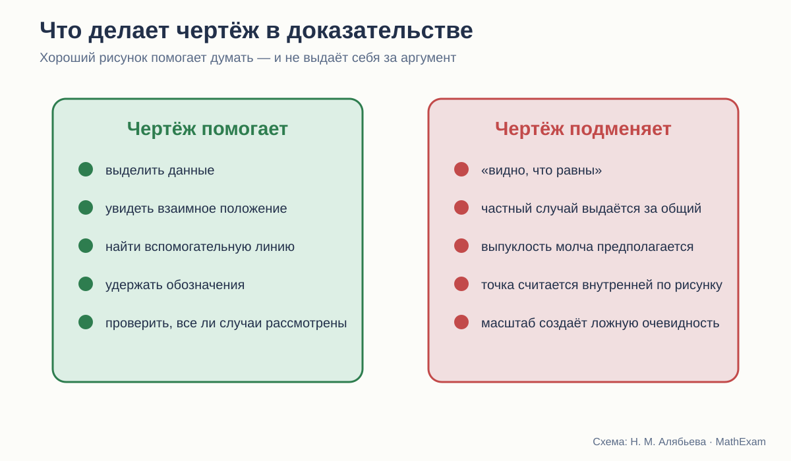
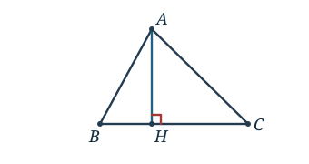
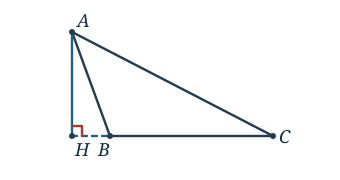
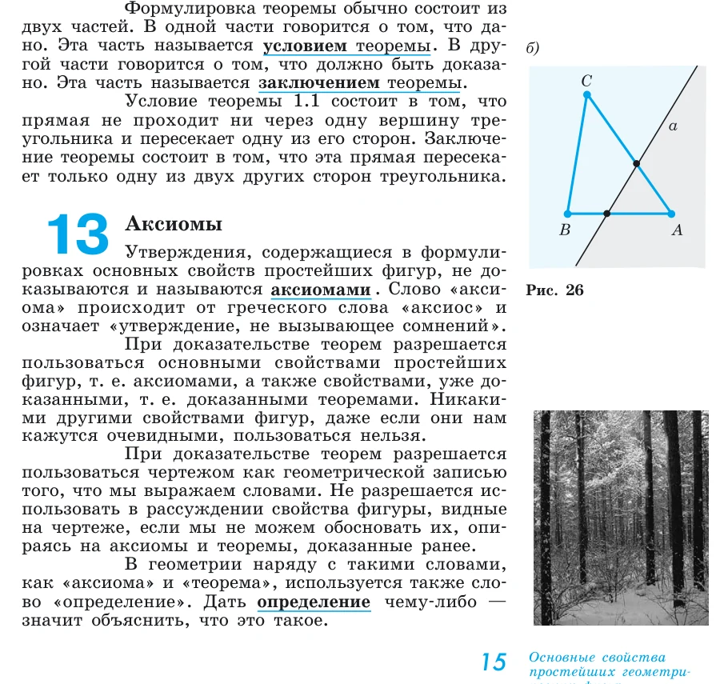

# Чертёж в планиметрии: помощник или источник ложной очевидности

На двух чертежах высоты разбираем, что следует из условия и когда нужно продлить сторону треугольника.

<aside class="series-note warning"><h3>Правило, которое стоит произносить вслух</h3>
Чертёж может подсказать, что доказывать и как доказывать. Но факт, который только выглядит верным на рисунке, ещё не вошёл в доказательство.
</aside>

<figure class="series-figure infographic">

<figcaption>Один и тот же рисунок способен быть языком задачи или источником незаконной посылки.</figcaption>
</figure>

<section class="lesson-case" id="praktikum">
<h2>Куда попало основание высоты</h2>
<figure class="series-figure practice-diagram">

</figure>

Через вершину A проведён перпендикуляр AH к прямой BC. На первом рисунке H лежит между B и C.

Передвиньте A влево так, чтобы угол ABC стал тупым. Пусть ученик снова проведёт высоту к BC, сохранив B и C на местах. Нужно ли продлевать сторону? Где появится значок прямого угла?

Разбор для учителя

<figure class="series-figure practice-diagram">

</figure>

Продлите BC за B. Основание H окажется на продолжении, а квадрат прямого угла останется у H. Если A расположена точно над B и AB перпендикулярна BC, то H совпадает с B. Во всех трёх случаях AH перпендикулярна одной и той же прямой BC. Так запись высоты работает и тогда, когда привычный внутренний отрезок исчезает.

</section>

## Почему понадобилось продлить сторону

На втором рисунке есть отрезки AB и BC, а высота из A со стороной BC не встречается. Что именно нужно продлить? Предложите закончить фразу из определения высоты: «Перпендикуляр из вершины к…». Если ученик говорит «к отрезку», попросите показать точку на отрезке BC, в которой получился бы прямой угол. Такой точки здесь нет. В определении речь идёт о прямой, содержащей противоположную сторону.

Добавим к прежнему условию одно число: ∠ABC = 120°. Место H следует теперь и из вычисления. Если H лежит на луче BC и отличается от B, угол ABH равен 120°. В прямоугольном треугольнике ABH такой угол невозможен. Совпадение H с B дало бы ∠ABC = 90°. Остаётся продолжение за B. Теперь ∠ABH и ∠ABC смежные, откуда ∠ABH = 60°, а ∠BAH = 30°. Цифры 60° и 30° появляются на рисунке лишь после этих двух вычитаний.

## Где проходит граница между рисунком и доказательством

В начале учебника Погорелова есть точное указание, что разрешено брать с чертежа. Чертёж может записывать условие. Новое свойство требует основания. В примере с высотой квадрат у H записывает перпендикулярность, которую мы построили. Положение H по отношению к B требует отдельного рассуждения, если оно не дано в условии.

<figure class="series-figure source-fragment">

<figcaption>А. В. Погорелов. Геометрия. 7–9 классы, с. 15. Автор специально запрещает ссылаться на свойства, которые лишь кажутся очевидными по рисунку.</figcaption>
</figure>

Для сопоставления можно открыть главу II, § 2 учебника Атанасяна и пункт 7 книги Мерзляка, Полонского и Якира для 7 класса (2015). В обоих местах вводятся линии треугольника. С одним и тем же определением удобно проделать маленький опыт: закрыть иллюстрацию, прочитать определение и построить высоту в двух разных треугольниках. Рисунки выше — мой пример такого чтения. По расположению одной иллюстрации нельзя судить, как учебник в целом учит работать с чертежом.

## Какие отметки появляются по ходу решения

Я предлагаю рисовать в два прохода. Сначала ученик обозначает точки, проводит нужные прямые и подписывает вершины. Затем ставит только те значки, для которых уже есть основание. Штрихи на равных отрезках могут передавать условие; значок прямого угла у H появляется потому, что проведён перпендикуляр. Величина нового угла появляется после расчёта. Одинаковый вопрос на каждом шаге — «Откуда это известно?» — помогает решить, пора ли делать отметку.

Если H оказывается за B, продление удобно провести пунктиром. Такой штрих сообщает, где закончилась сторона треугольника; сам по себе пунктир ничего не доказывает. Именно поэтому на доске я бы сначала оставила один треугольник, попросила указать, чего не хватает, и только потом достроила прямую.

## Проверка на новом положении

Поверните лист и задайте ∠ACB = 110°. Теперь место для продолжения нужно выбрать у другой вершины. Попросите провести высоту из A к прямой BC и найти угол ACH. Ответ 70° принимается вместе с объяснением: лучи CH и CB противоположны, поэтому углы ACH и ACB смежные. Ученик, который продлил прямую за C и правильно назвал лучи, перенёс рассуждение на новый рисунок.

В динамической модели полезно довести C до положения, где ∠ACB = 90°. Тогда H и C совпадут, луч CH уже нельзя построить. Сама высота из A при этом существует и совпадает с AC. Именно на такой границе лучше всего видно, какие слова в доказательстве относятся к определению, а какие — к положению точек.

<section class="source-list">
<h2>Какие издания сравниваются</h2>
<ul><li><a href="https://media.prosv.ru/content/item/12884/" rel="noopener">Л. С. Атанасян и др. «Математика. Геометрия. 7–9 классы. Базовый уровень»</a>. 14-е переработанное издание, 2023. Печатное издание — ISBN 978-5-09-102538-5, по ссылке — электронная форма 2023 года.</li><li>А. В. Погорелов. «Геометрия. 7–9 классы». Просвещение, 11-е стереотипное издание, 2022. ISBN 978-5-09-087755-8.</li><li><a href="https://prosv.ru/catalog/geometriya-merzlyak-a-g-7-9-bazovii/" rel="noopener">А. Г. Мерзляк, В. Б. Полонский, М. С. Якир. «Геометрия. 7, 8, 9 классы»</a>. Сравнивается базовая линия.</li><li>А. Г. Мерзляк, В. Б. Полонский, М. С. Якир. «Геометрия. 7 класс». Вентана-Граф, 2015. Глава 2, пп. 7–12.</li></ul>

Ссылки ведут на официальные страницы издательства. Фрагменты страниц приведены в объёме, необходимом для методического и критического анализа; права на учебники и их оформление принадлежат авторам и издательствам.

</section>
