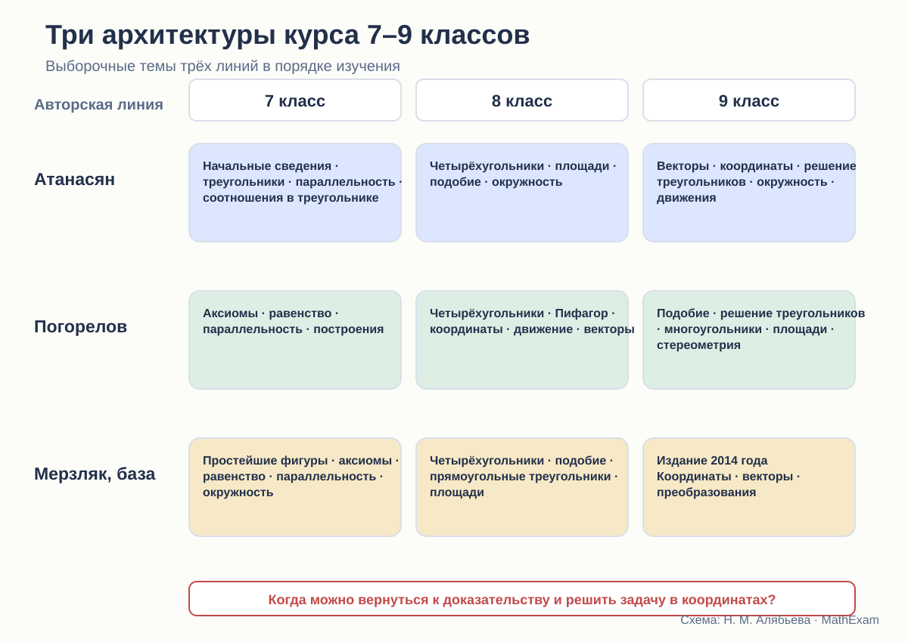
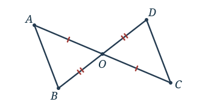

# Три архитектуры школьного курса планиметрии

Когда ученик уже может доказать параллельность? Сравним порядок тем в трёх учебниках и решим одну задачу двумя способами.

<aside class="series-note good"><h3>Что меняет порядок тем</h3>
Ученик уже доказал равенство двух углов. Можно ли на этом основании записать, что прямые параллельны? Ответ зависит от того, какой признак класс успел изучить.
</aside>

<figure class="series-figure infographic">

<figcaption>Схема даёт обзор крупных тем в изданиях цикла. Ниже сопоставлены конкретные параграфы; при работе с другим годом выпуска стоит сверить оглавление.</figcaption>
</figure>

<section class="lesson-case" id="praktikum">
<h2>Когда класс готов доказывать параллельность</h2>
<figure class="series-figure practice-diagram">

</figure>

Отрезки AC и BD лежат на разных прямых и пересекаются в точке O, которая делит каждый из них пополам. Соединены A с B и C с D.

В каком месте курса уже можно доказать AB ∥ CD? Предложите составить цепочку из трёх знакомых результатов и назвать тот, которого классу пока не хватает.

Разбор для учителя

Вертикальные углы при O равны. По двум сторонам и углу между ними треугольники AOB и COD равны, поэтому ∠BAO = ∠DCO. При секущей AC это накрест лежащие углы для прямых AB и CD. Признак параллельности завершает доказательство. Если пройден лишь первый признак равенства треугольников, разумная промежуточная цель — равенство углов.

</section>

## В какой момент можно закончить доказательство

В задаче выше первый признак равенства треугольников даёт равенство углов. Чтобы из них вывести параллельность AB и CD, нужен ещё один результат. После темы «Равенство треугольников» вполне уместно остановиться раньше. Условие задачи остаётся тем же, меняется вопрос учителя: «Какие стороны и углы мы уже вправе отметить?»

В главе II учебника Атанасяна первый признак появляется в § 1, затем в § 2 рассматриваются линии треугольника и свойства равнобедренного треугольника, а второй и третий признаки собраны в § 3. Для конца нашего решения надо открыть следующую главу, о параллельных прямых. У Погорелова существование треугольника, равного данному, обсуждается ещё в § 1, п. 10. Первый признак и разбор его доказательства стоят рядом (§ 3, пп. 20–21). В базовом учебнике Мерзляка, Полонского и Якира (7 класс, 2015) в п. 8 разобраны сразу два признака. Но ни наличие второго признака, ни количество пройденных пунктов не снимают вопрос о последнем шаге: почему равенство именно этих углов влечёт параллельность?

## Координаты дают второй способ прочитать тот же рисунок

Вернёмся к пересекающимся отрезкам после знакомства с координатами вектора. Можно оставить чертёж как есть и принять общую середину O за начало координат. Пусть A имеет координаты (a, b), а B — (c, d). Середина AC совпадает с началом координат, поэтому C имеет координаты (−a, −b). По той же причине D имеет координаты (−c, −d).

Вычтем координаты начала каждого вектора из координат конца. У вектора AB получим (c − a, d − b). У вектора DC получим (−a + c, −b + d). Это один и тот же ненулевой вектор. Следовательно, длины AB и DC равны, а прямые AB и DC имеют одно направление. Их прямые различны: если бы они совпали, точки A, B, C лежали бы на одной прямой, тогда как прямые AC и BD по условию различны и пересекаются в O. Получаем AB ∥ CD.

Эти два решения хорошо дать на разных уроках. В первом ученик объясняет, зачем понадобились вертикальные и накрест лежащие углы. Во втором — почему выгодно поместить начало координат именно в O и почему для сравнения нужен порядок букв DC. Если поменять его на CD, получатся противоположные векторы. Сам вывод о параллельности сохранится.

## Когда возвращаться к задаче

<table>
<thead><tr><th scope="col">Линия</th><th scope="col">Где искать повод вернуться</th></tr></thead>
<tbody>
<tr><th scope="row">Атанасян и др.</th><td>За главой о векторах следует глава X о методе координат. Уже известный результат о двух параллельных прямых можно восстановить вычитанием координат.</td></tr>
<tr><th scope="row">Погорелов</th><td>В примерном планировании 8 класса декартовы координаты, движение и векторы следуют в § 8–10. После § 10 удобно поставить рядом синтетическое и координатно-векторное решения.</td></tr>
<tr><th scope="row">Мерзляк, Полонский, Якир</th><td>В книге для 9 класса (2014) формула координат середины отрезка вводится в гл. 3, § 8, а координаты вектора — в гл. 4, § 13. Ученик может связать эти два результата на одном рисунке.</td></tr>
</tbody>
</table>

Размещение глав говорит, какие средства к этому моменту введены. Чтобы узнать, связал ли их ученик, дайте тот же чертёж без названия метода. Пусть он выберет начало координат, запишет одну пару векторов или одну пару равных углов и пояснит выбор. Его первая содержательная строка скажет о связи тем больше, чем пересказ двух соседних параграфов.

## Как читать общую схему курса

При сравнении 7–9 классов полезно отличать первое знакомство с идеей от появления метода. Семиклассник может наложить два треугольника гораздо раньше, чем объяснит наложение языком движений плоскости. А девятиклассник может знать формулу расстояния и всё ещё не догадаться выбрать удобное начало координат. Схема в начале статьи показывает крупные темы. Конкретная задача даёт место, где можно проверить переход от одной к другой.

У меня из этого получается простое решение для планирования. На странице с каждой новой темой я оставила бы знакомый рисунок из предыдущего года с новым вопросом к нему. Сначала ученик обосновал параллельность равными углами. Теперь тот же рисунок помогает ему объяснить, почему противоположные координаты концов отрезка означают, что середина лежит в начале координат.

<section class="source-list">
<h2>Какие издания сравниваются</h2>
<ul><li><a href="https://media.prosv.ru/content/item/12884/" rel="noopener">Л. С. Атанасян и др. «Математика. Геометрия. 7–9 классы. Базовый уровень»</a>. 14-е переработанное издание, 2023. Печатное издание — ISBN 978-5-09-102538-5, по ссылке — электронная форма 2023 года.</li><li>А. В. Погорелов. «Геометрия. 7–9 классы». Просвещение, 11-е стереотипное издание, 2022. ISBN 978-5-09-087755-8.</li><li><a href="https://prosv.ru/catalog/geometriya-merzlyak-a-g-7-9-bazovii/" rel="noopener">А. Г. Мерзляк, В. Б. Полонский, М. С. Якир. «Геометрия. 7, 8, 9 классы»</a>. Сравнивается базовая линия.</li><li><a href="https://events.prosv.ru/uploads/2021/10/additions/RZeLWiMGnxFTfpMVZeshuNDJSf9GG1cV50cwMjhp.pdf" rel="noopener">Т. А. Бурмистрова (сост.). «Геометрия. Сборник примерных рабочих программ. 7–9 классы»</a>. Просвещение, 2020. Порядок тем по линиям Атанасяна и Погорелова приведён в разделе тематического планирования.</li><li>А. Г. Мерзляк, В. Б. Полонский, М. С. Якир. «Геометрия. 7 класс». Вентана-Граф, 2015. Глава 2, пп. 7–12.</li><li>А. Г. Мерзляк, В. Б. Полонский, М. С. Якир. «Геометрия. 9 класс». Вентана-Граф, 2014. Главы 3–4 о координатах и векторах.</li></ul>

Ссылки ведут на официальные страницы издательства. Фрагменты страниц приведены в объёме, необходимом для методического и критического анализа; права на учебники и их оформление принадлежат авторам и издательствам.

</section>
