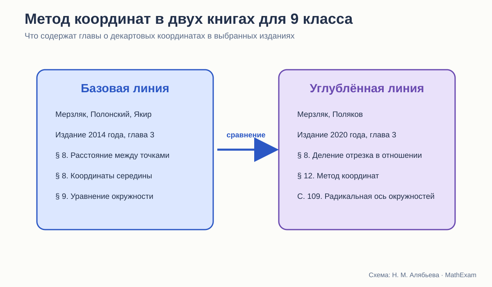
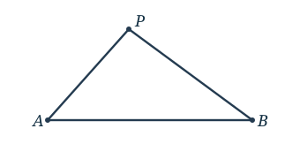

# Базовый и углублённый Мерзляк

От формулы расстояния до радикальной оси двух окружностей. Что добавляет углублённая книга Мерзляка и Полякова к знакомой задаче.

<aside class="series-note good"><h3>Какие книги открыты</h3>
В базовой линии соавторы А. Г. Мерзляка — В. Б. Полонский и М. С. Якир, в углублённой — В. М. Поляков. Для сравнения возьмём главы о координатах в 9 классе.
</aside>

<figure class="series-figure infographic">

<figcaption>У общей темы могут быть разные продолжения. Один пример из глав о координатах разобран ниже.</figcaption>
</figure>

<section class="lesson-case" id="praktikum">
<h2>Одна задача для двух уровней</h2>
<figure class="series-figure practice-diagram">

</figure>

A и B — две различные точки. Для произвольной точки P сравниваем расстояния PA и PB.

Базовый вопрос: где находятся все точки с PA = PB? Для углубления задайте A(−3; 0), B(3; 0) и попросите отыскать все P, у которых PA² − PB² = 24. Что стало с прежней прямой?

Разбор для учителя

Базовый ответ — серединный перпендикуляр к AB, в этих координатах x = 0. Пусть P(x; y). Тогда PA² − PB² = (x + 3)² + y² − (x − 3)² − y² = 12x. Для разности 24 получаем x = 2 при любом y. Новая прямая параллельна прежней. Для разности k условие меняется на x = k/12, и прежняя задача возвращается при k = 0.

</section>

## Две книги и один вопрос к ним

У этих учебников разные соавторы. Базовую книгу для 9 класса написали А. Г. Мерзляк, В. Б. Полонский и М. С. Якир. Углублённую — А. Г. Мерзляк и В. М. Поляков. Для сравнения я беру небольшой фрагмент двух изданий: что можно сделать с формулой расстояния между точками.

В базовом издании 2014 года в главе 3 рядом стоят § 8 о расстоянии и середине отрезка и § 9 об уравнении фигуры и окружности. У Мерзляка и Полякова (углублённое издание 2020 года) в главе 3 после § 12 о методе координат помещён дополнительный текст о радикальной оси двух окружностей, с. 109. В списке изданий приведена также электронная форма 2023 года. Номер страницы относится к изданию 2020-го.

Это даёт конкретный вопрос для урока. Формула расстояния уже знакома. Если в одном условии встретились расстояния до двух разных центров, что можно узнать о положении точки? Задача выше и её продолжение ниже составлены для этой статьи. Их можно решить по книгам обоих коллективов.

## Зачем в разности стоят квадраты

Если ученик получил x = 2, попросите его отметить две различные точки с этой абсциссой. Например, для (2, 0) квадраты расстояний до A и B равны 25 и 1. Для (2, 4) они равны 41 и 17. Их разность опять 24. Но разность самих расстояний у первой точки равна 4, а у второй — √41 − √17. Это разные числа. Надпись «квадраты» в условии отвечает за форму ответа: при вычитании двух квадратов расстояний исчезло слагаемое y².

И ещё один вопрос нужен всем ученикам. Пока мы умеем вывести x = 2 из условия, мы знаем только, где искать подходящие точки. Почему подходит вся прямая? Полученное тождество PA² − PB² = 12x верно для любых x и y. Поэтому любая точка с x = 2 действительно даёт 24. Здесь можно закончить базовую часть занятия.

## Что прибавляет углубление

<figure class="series-figure practice-diagram">
<svg width="324" height="214" viewBox="0 0 324 214" style="max-width:100%;height:auto" role="img" aria-labelledby="rad-title rad-desc" xmlns="http://www.w3.org/2000/svg">
<title id="rad-title">Две касающиеся окружности и прямая равных степеней</title>
<desc id="rad-desc">Окружности с центрами A и B касаются в T. Вертикальная прямая проходит через T. Ещё одна её точка P лежит вне обеих окружностей.</desc>
<g fill="none" stroke="#284458" stroke-width="2"><circle cx="112" cy="107" r="90"/><circle cx="220" cy="107" r="18"/><path d="M112 107H220" stroke-dasharray="5 4"/><path d="M202 8V202" stroke="#176678" stroke-width="3"/></g>
<g fill="#27394a"><circle cx="112" cy="107" r="3"/><circle cx="220" cy="107" r="3"/><circle cx="202" cy="107" r="3"/><circle cx="202" cy="35" r="3"/></g>
<g fill="#203444" font-family="Georgia,serif" font-size="18"><text x="99" y="128">A</text><text x="224" y="101">B</text><text x="185" y="128">T</text><text x="211" y="39">P</text></g></svg>
<figcaption>Центры A и B отстоят на 6 единиц. Равенство степеней выполняется и в точке касания T, и выше неё, в точке P.</figcaption>
</figure>

Возьмём окружности радиусов 5 и 1 с теми же центрами A и B. Степень точки P относительно первой окружности равна PA² − 25, относительно второй — PB² − 1. Когда степени равны? После переноса чисел получаем прежнее условие PA² − PB² = 24. Мы уже знаем все его решения. Прямая x = 2 и есть радикальная ось этих окружностей.

На рисунке окружности касаются в T(2, 0), поскольку расстояние между центрами равно сумме радиусов. Первая догадка может быть такой: «Искомое место — точка касания». У T обе степени действительно равны нулю. Но у точки P(2, 4) обе степени равны 16. Теперь у ученика есть и опровержение догадки, и объяснение, почему в ответ попадает целая прямая.

Стоит спросить, что случится, если радиусы обеих окружностей станут равными. При разных центрах разность квадратов радиусов тогда равна нулю. Искомые точки удовлетворяют PA² = PB², и мы возвращаемся к серединному перпендикуляру. Так новое понятие объясняет знакомый частный случай.

## Что спросить на следующем уроке

Для общей самостоятельной работы я бы оставила один вопрос: почему из x = 2 следуют сразу бесконечно многие решения? Ответ «потому что y произволен» должен сопровождаться подстановкой в исходное условие. Для продолжения можно предложить две окружности с прежними центрами и радиусами 2 и 1. Они не пересекаются, так как 6 > 2 + 1. Тем не менее равенство степеней имеет решения: 12x = 4 − 1, то есть x = 1/4 при любом y. Теперь ученик может объяснить и прямую на рисунке, и случай, в котором общих точек у окружностей вовсе нет.

Этот фрагмент позволяет судить о конкретном различии двух книг: в углублённой после координат появляется дополнительный объект и повод исследовать его. Об объёме помощи остальным ученикам решение принимает учитель. Для разговора о двух направлениях доказательства достаточно уже первого уравнения.

<section class="source-list">
<h2>Какие издания сравниваются</h2>
<ul><li><a href="https://media.prosv.ru/content/item/12884/" rel="noopener">Л. С. Атанасян и др. «Математика. Геометрия. 7–9 классы. Базовый уровень»</a>. 14-е переработанное издание, 2023. Печатное издание — ISBN 978-5-09-102538-5, по ссылке — электронная форма 2023 года.</li><li>А. В. Погорелов. «Геометрия. 7–9 классы». Просвещение, 11-е стереотипное издание, 2022. ISBN 978-5-09-087755-8.</li><li><a href="https://prosv.ru/catalog/geometriya-merzlyak-a-g-7-9-bazovii/" rel="noopener">А. Г. Мерзляк, В. Б. Полонский, М. С. Якир. «Геометрия. 7, 8, 9 классы»</a>. Сравнивается базовая линия.</li><li><a href="https://media.prosv.ru/content/item/10521/" rel="noopener">А. Г. Мерзляк, В. М. Поляков. «Геометрия. 9 класс. Углублённый уровень»</a>. Электронная форма, 2023. ISBN 978-5-09-108125-1. Книга входит в комплект для 7–9 классов.</li><li>А. Г. Мерзляк, В. Б. Полонский, М. С. Якир. «Геометрия. 9 класс». Вентана-Граф, 2014. Главы 3–4 о координатах и векторах.</li><li><a href="https://cdn.rosuchebnik.ru/v2/VEN000000000437843/PDF/VEN000000000437843.pdf" rel="noopener">А. Г. Мерзляк, В. М. Поляков. «Геометрия. 9 класс». Издательский фрагмент</a>. Вентана-Граф, 2020, 2-е стереотипное издание, ISBN 978-5-360-11408-6. В полном издании см. дополнительный материал после § 12, с. 109.</li></ul>

Ссылки ведут на официальные страницы издательства. Фрагменты страниц приведены в объёме, необходимом для методического и критического анализа; права на учебники и их оформление принадлежат авторам и издательствам.

</section>
