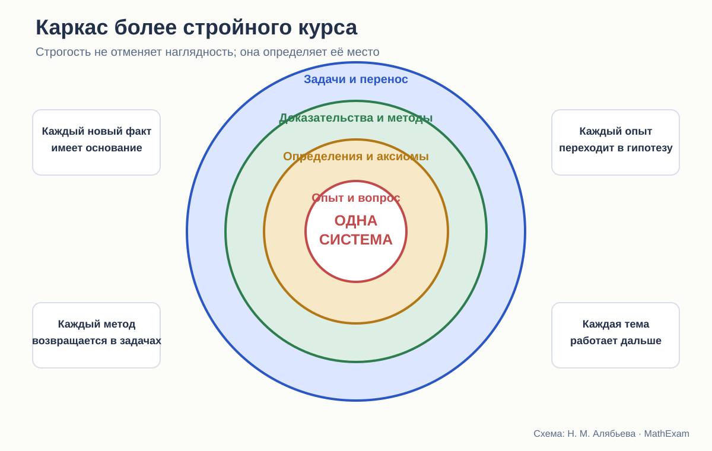
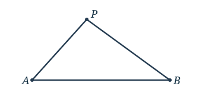
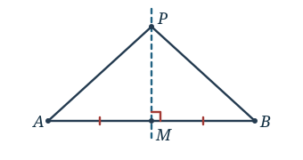

# Как собрать более стройный курс школьной планиметрии

Как связать три урока одной идеей: от равноудалённых точек до построения центра описанной окружности.

<aside class="series-note good"><h3>Зачем возвращаться к знакомому рисунку</h3>
Сначала семиклассник ищет точки, равноудалённые от двух данных. В следующий раз те же рассуждения должны помочь ему выбрать центр окружности через три точки.
</aside>

<figure class="series-figure infographic">

<figcaption>Чтобы проверить связь тем, вернёмся к одному построению на разных уроках.</figcaption>
</figure>

<section class="lesson-case" id="praktikum">
<h2>Какие точки равноудалены от A и B</h2>
<figure class="series-figure practice-diagram">

</figure>

На плоскости отмечены различные точки A и B. Точка P служит пробной.

Сначала предложите отметить три точки, равноудалённые от A и B. Затем попросите описать все такие точки. Какие два утверждения нужно доказать, чтобы получить полный ответ?

Разбор для учителя

<figure class="series-figure practice-diagram">

</figure>

Обозначим середину AB буквой M. Пусть P лежит на перпендикуляре к AB через M и отличается от M. Треугольники PMA и PMB равны по двум сторонам и углу между ними, откуда PA = PB. Обратно, пусть PA = PB. На прямой AB этим свойством обладает лишь M. Если P вне этой прямой, проведём PM. Треугольники PMA и PMB равны по трём сторонам, поэтому смежные углы PMA и PMB равны и каждый составляет 90°. Значит, P лежит на серединном перпендикуляре. Сама M принадлежит ему и удовлетворяет MA = MB. Оба направления проверены.

</section>

## С чего я бы начала разговор о стройности

В практикуме мы хотим получить все точки с данным свойством. Значит, предстоят две разные работы. Сначала надо доказать, что любая точка построенной прямой годится. Затем — что при поиске решений мы ничего не потеряли. Ученик может выполнить первую работу безукоризненно и всё-таки ответить лишь на половину вопроса.

Здесь и нужна аккуратная проверка рисунка. Если P лежит на прямой AB вне отрезка AB, одно из расстояний до A и B больше другого на AB. Внутри отрезка равными их делает только середина M. У самой середины MA = MB следует из определения. Это объясняет, зачем в разборе отдельно рассмотрена M: треугольники, которыми решалась основная задача, в этом положении исчезают.

Поэтому проверять стройность курса я бы начала с одной из уже написанных учеником строк. «Все точки этой прямой подходят» — хороший промежуточный итог. «Всякая подходящая точка лежит на этой прямой» — второй вывод, и для него нужно своё доказательство. Если ученик научился замечать, какой строки ему недостаёт, порядок уроков уже принёс ощутимую пользу.

## Когда одно и то же задание можно дать классу

До урока полезно выписать на полях доказательства его основания. Первый признак равенства треугольников обосновывает одно направление. Для обратного в выбранном решении используется третий признак. В главе II у Атанасяна это разные параграфы (§ 1 и § 3), у Погорелова — разные пункты § 3 (пп. 20 и 27), в базовой книге Мерзляка для 7 класса (2015) — пп. 8 и 11. Наличие слова «перпендикуляр» в теме пройденного урока ещё не говорит, что доступен весь этот способ решения.

У трёх линий здесь есть разные подсказки для учителя. У Атанасяна стоит обратить внимание на раздел между первым и остальными признаками: в этом промежутке можно доказать часть утверждения и оставить обратную задачу открытой. У Погорелова за первым признаком следует специальный разбор использованных оснований (п. 21). Этот вопрос можно перенести на новый чертёж. У Мерзляка свойствам равнобедренного треугольника и его признакам отведены соседние пункты (9 и 10). Такая пара удобна, чтобы спросить, что произошло при перестановке условия и заключения. Это три разных решения, которые я могу взять со страниц учебников на один урок.

## На следующем уроке исчезает название теоремы

Даны три различные точки A, B и C, не лежащие на одной прямой. Найдите точку, равноудалённую от всех трёх. Оставьте на доске три точки и дайте ученику время выбрать первое построение. Если нужна подсказка, достаточно спросить, где может быть точка O, для которой OA = OB. Появляется серединный перпендикуляр к AB. Равенство OA = OC даёт повод провести вторую прямую.

<figure class="series-figure practice-diagram">
<svg width="310" height="178" viewBox="0 0 310 178" style="max-width:100%;height:auto" role="img" aria-labelledby="tower-title tower-desc" xmlns="http://www.w3.org/2000/svg">
<title id="tower-title">Серединные перпендикуляры к двум сторонам треугольника</title>
<desc id="tower-desc">Над отрезком AB и левее его середины расположена C. Пунктирные серединные перпендикуляры к AB и AC встречаются в O вне треугольника.</desc>
<g fill="none" stroke="#283e50" stroke-width="2"><path d="M40 108L240 108L78 51Z"/><path d="M140 26V165M19 52.833L187 164.833" stroke="#216581" stroke-dasharray="5 4"/><path d="M140 101H147V108" stroke="#923d32"/></g>
<g fill="#243a48"><circle cx="40" cy="108" r="3"/><circle cx="240" cy="108" r="3"/><circle cx="78" cy="51" r="3"/><circle cx="140" cy="133.5" r="3"/></g>
<g fill="#213548" font-family="Georgia,serif" font-size="18"><text x="24" y="121">A</text><text x="247" y="112">B</text><text x="72" y="43">C</text><text x="146" y="137">O</text></g></svg>
<figcaption>Дополнительные прямые возникают из двух требований к O. У выбранного тупоугольного треугольника их пересечение лежит снаружи.</figcaption>
</figure>

Прямые AB и AC пересекаются под ненулевым углом. Их серединные перпендикуляры не могут быть параллельны или совпадать: тогда AB и AC как перпендикуляры к одному направлению были бы параллельны либо совпали бы. Значит, построенные прямые имеют единственную общую точку O. Для неё OA = OB и OA = OC, следовательно, OB = OC. Третий серединный перпендикуляр тоже пройдёт через O, но для построения точки O он уже не нужен.

Попросите посмотреть на рисунок ещё раз. Ученик мог ожидать, что O обязательно попадёт внутрь треугольника. Здесь O оказалась снаружи. Ни одна строка доказательства при этом не изменилась. Позже, на уроке об описанной окружности, тот же рисунок можно вернуть с вопросом «Где поставить ножку циркуля и какой раствор взять?» Ответ проверяется тремя равными расстояниями.

## Что оставить в тетради

Я бы оставила три соседних рисунка: две данные точки, серединный перпендикуляр с обоснованием и три точки без вспомогательных линий для самостоятельной работы. На первом ученик формулирует предположение. На втором подписывает доказательство в обе стороны и отдельно проверяет M. На третьем сам решает, когда провести ещё одну прямую. На доске и в тренажёре дополнительное построение должно появляться в тот момент, когда возникла причина его сделать.

Для последней проверки расположите три разные точки на одной прямой и снова попросите найти равноудалённую точку плоскости. Серединные перпендикуляры к AB и AC теперь параллельны и различны: они перпендикулярны одной прямой и проходят через различные середины. Решений нет. Именно условие о трёх точках, не лежащих на одной прямой, обеспечивало существование центра в предыдущей задаче.

## Как перенести этот опыт на курс 7–9 классов

В 7 классе основная работа — самому выбрать треугольники и назвать основание каждой отметки. В 8 классе знакомая идея возвращается в окружности или четырёхугольнике, где теорема уже не названа в заголовке. После введения координат в своей линии учебника можно получить серединный перпендикуляр ещё раз, составив уравнение PA² = PB². Во всех трёх случаях требуется узнать прежнее условие в другой записи и решить, каким способом его использовать.

Поэтому в планировании я бы для нескольких ключевых теорем отмечала два занятия: когда ученик впервые разбирает доказательство и когда сам должен догадаться его применить. Между ними можно менять порядок упражнений, количество подсказок и сложность чертежа. Решение о том, что стоит изменить в курсе, тогда опирается на конкретное место в ученической работе: что он уже может построить, обосновать и перенести в незнакомую задачу.

<section class="source-list">
<h2>Какие издания сравниваются</h2>
<ul><li><a href="https://media.prosv.ru/content/item/12884/" rel="noopener">Л. С. Атанасян и др. «Математика. Геометрия. 7–9 классы. Базовый уровень»</a>. 14-е переработанное издание, 2023. Печатное издание — ISBN 978-5-09-102538-5, по ссылке — электронная форма 2023 года.</li><li>А. В. Погорелов. «Геометрия. 7–9 классы». Просвещение, 11-е стереотипное издание, 2022. ISBN 978-5-09-087755-8.</li><li><a href="https://prosv.ru/catalog/geometriya-merzlyak-a-g-7-9-bazovii/" rel="noopener">А. Г. Мерзляк, В. Б. Полонский, М. С. Якир. «Геометрия. 7, 8, 9 классы»</a>. Сравнивается базовая линия.</li><li><a href="https://media.prosv.ru/content/item/10521/" rel="noopener">А. Г. Мерзляк, В. М. Поляков. «Геометрия. 9 класс. Углублённый уровень»</a>. Электронная форма, 2023. ISBN 978-5-09-108125-1. Книга входит в комплект для 7–9 классов.</li><li><a href="https://prosv.ru/product/matematika-5-klass-uchebnik-v-2-ch-chast-101/" rel="noopener">Н. Я. Виленкин и др. «Математика. 5 класс»</a> и <a href="https://prosv.ru/product/matematika-6-klass-uchebnik-v-2-ch-chast-101/" rel="noopener">«Математика. 6 класс»</a>. Эти книги рассматриваются как предыстория систематического курса геометрии.</li><li><a href="https://events.prosv.ru/uploads/2021/10/additions/RZeLWiMGnxFTfpMVZeshuNDJSf9GG1cV50cwMjhp.pdf" rel="noopener">Т. А. Бурмистрова (сост.). «Геометрия. Сборник примерных рабочих программ. 7–9 классы»</a>. Просвещение, 2020. Порядок тем по линиям Атанасяна и Погорелова приведён в разделе тематического планирования.</li><li>А. Г. Мерзляк, В. Б. Полонский, М. С. Якир. «Геометрия. 7 класс». Вентана-Граф, 2015. Глава 2, пп. 7–12.</li></ul>

Ссылки ведут на официальные страницы издательства. Фрагменты страниц приведены в объёме, необходимом для методического и критического анализа; права на учебники и их оформление принадлежат авторам и издательствам.

</section>
