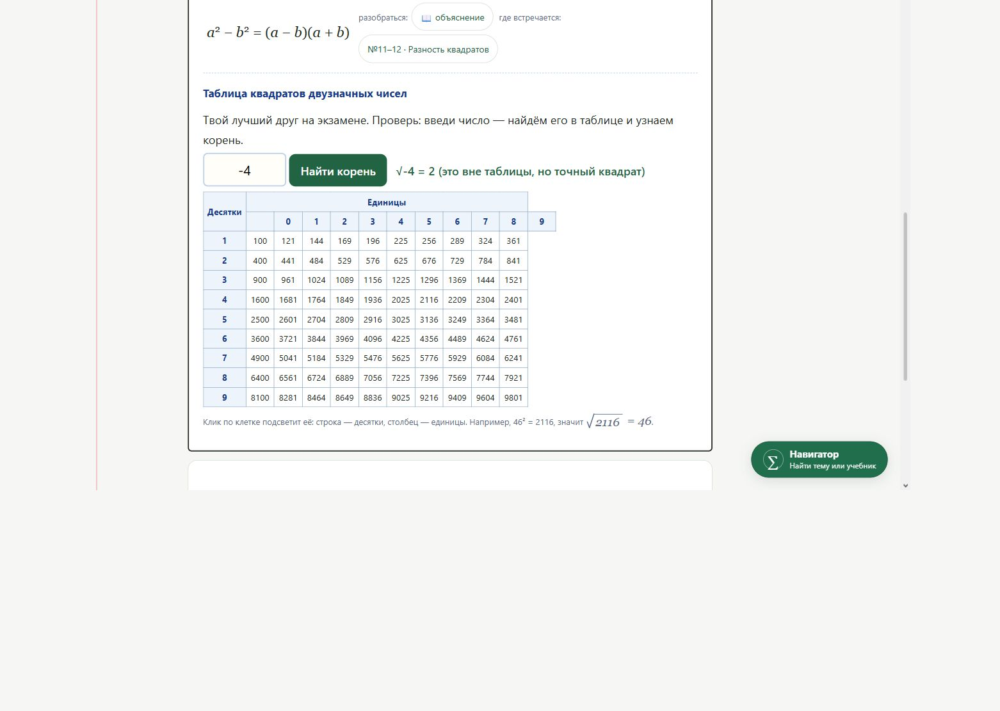
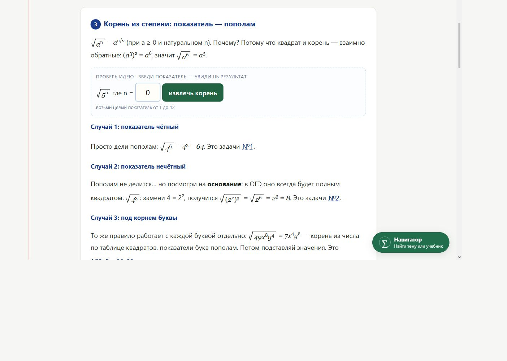
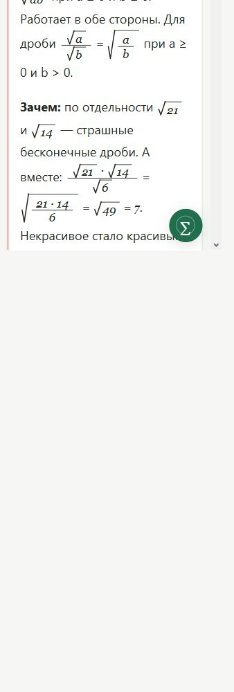
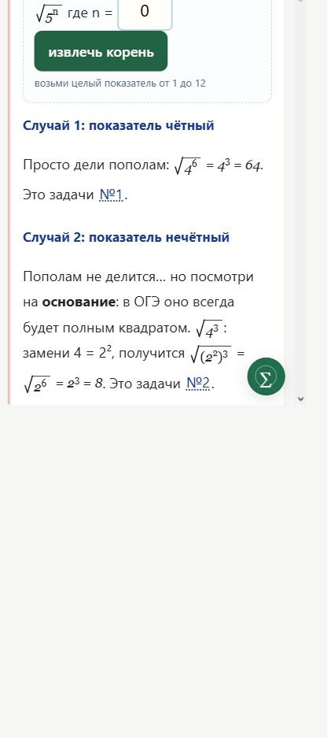

# Независимая приёмка ОГЭ №8 — 9 ноября 2026

**Вывод: исходный урок не принят.** Условия трёх формул верны, но справочник
показывает ложное равенство `√−4 = 2`. Исправления подготовлены отдельно, без выпуска.

## Версия и публикация

[PR #485](https://github.com/ladynata-cloud/math-exam-fipi/pull/485) уже объединён
9 ноября в 03:20:51 по Новосибирску. Проверены исходный head `6be6bdd95530401953870f85f1358b6426f0b97f`,
итоговый head `911511ffbfa27331313c10cb68ab40c7319c7073`, merge
`8c35bb0e41808c5baf19942cedd124659f8bab5c` и локальная основа
`ee7c501abc2f293d923d892a4b3dcc5ac4b798f7`.
Файл урока одинаков в этих версиях и в полученном публичном HTML:
SHA-256 `8ace32a9b021ed5c6597b1ae990539936b245d8bea0ff15f7a36255aa48f897b`.
[Pages run](https://github.com/ladynata-cloud/math-exam-fipi/actions/runs/42519657978)
завершился успешно 03:22:34. В рамках этой приёмки merge/deploy не выполнялись.

## Математика и воспроизведение

| Проверка | Результат исходной версии | Исправление |
|---|---|---|
| √a·√b=√ab, a≥0, b≥0 | Верно | Условие сохранено |
| √a/√b=√(a/b), a≥0, b>0 | Верно | Условие сохранено |
| √(aⁿ)=a^(n/2), a≥0, натуральное n | Верно | Добавлено √(x²)=\|x\| и √((-3)²)=3 |
| √21·√14/√6=7; √(4⁶)=64; √(4³)=8 | Верно | Сохранены |
| √(49x⁸y⁴)=7x⁴y² | Верно для всех действительных x,y | Сохранено |
| Справочник → −4 → «Найти корень» | **Зелёное «√−4=2»**, подтверждено в Opera | Отрицательные аргументы запрещены с объяснением |
| Справочник → −100 | Код подменяет отрицательный аргумент положительным | Обработчик проверяет знак до извлечения; тест |
| Учимся → объединялка → 0 и 4 | «введи два натуральных числа», Opera | Ноль разрешён, 0·4 и 0·0 проверены |
| Объединялка → −1 и −1 | Общая просьба о натуральных числах, Opera | Объяснение: оба корня должны существовать |
| Нулевой знаменатель | В p4 только условие b>0 без причины | √4/√0 и √0/√0 не определены; √0/√4=0 допустимо |
| «В ОГЭ основание всегда полный квадрат» | Необоснованная гарантия | Ограничено задачами №2 данного банка |
| «Любое число в нулевой степени…» | Не хватает исключения нуля | «Любое ненулевое число…» |
| Произведение 2 и 4 | «так и останется √8» вводит в заблуждение | Уточнено, что корень иногда можно упростить |

Контрпример теперь дан непосредственно в уроке: √((-1)·(-1))=1,
но √−1·√−1 в действительных числах не определено. Положительного произведения
недостаточно. Ограничение объединялки целыми 0…10000 явно отделено от
математического свойства, которое справедливо и для неотрицательных дробей.

## Фактическое браузерное испытание исходной версии

Использовалась подключённая Opera, пользовательские нажатия кнопок и ввод,
снимки экрана и чтение отображаемого DOM. Это не проверка только исходника.
При существующем масштабе браузера 90% размеры адаптированы и подтверждены
через `innerWidth/innerHeight`: **1280×900, 320×900, 390×844 CSS px**.
Это проверка узкого окна настольного движка, не физического телефона/Safari.

- Открыты «Темы, режимы и результаты» → «Учимся» и «Справочник», переходы п.3/п.4.
- При 1280×900 воспроизведён ошибочный √−4; условия, дроби и показатели визуально читаются.
- При 320×900 проверены объединение 32 и 2 → 8, показатели n=3 и n=0; формулы переносятся.
- При 390×844 просмотрен p3 и сообщение о недопустимом n=0.
- Кнопка случайной пары работала; в журнале страницы не было ошибок JS.
- Горизонтального переполнения документа в измеренных состояниях нет:
  clientWidth=scrollWidth 1264, 304 и 374 соответственно (остальное — полоса прокрутки).
- Длинный урок требует вертикальной прокрутки. Плавающая кнопка навигатора занимает
  нижний правый угол узкого экрана; скрытый ею фрагмент можно вывести выше прокруткой.

## Сопоставление с Actions PR #485

Все восемь workflow успешны на обоих указанных head. Старые неуспешные запуски
не относятся к этим проверенным ревизиям.

| Workflow | Исходный head | Итоговый head |
|---|---|---|
| Public SEO and sitemap | [42516871793](https://github.com/ladynata-cloud/math-exam-fipi/actions/runs/42516871793) | [42518650304](https://github.com/ladynata-cloud/math-exam-fipi/actions/runs/42518650304) |
| OGE learner entrances and returns | [42516871821](https://github.com/ladynata-cloud/math-exam-fipi/actions/runs/42516871821) | [42518650312](https://github.com/ladynata-cloud/math-exam-fipi/actions/runs/42518650312) |
| OGE exam variants and reasoning | [42516871867](https://github.com/ladynata-cloud/math-exam-fipi/actions/runs/42516871867) | [42518650299](https://github.com/ladynata-cloud/math-exam-fipi/actions/runs/42518650299) |
| Fixed book editions — integrity and isolation | [42516871823](https://github.com/ladynata-cloud/math-exam-fipi/actions/runs/42516871823) | [42518650321](https://github.com/ladynata-cloud/math-exam-fipi/actions/runs/42518650321) |
| Public navigator visibility | [42516871920](https://github.com/ladynata-cloud/math-exam-fipi/actions/runs/42516871920) | [42518650389](https://github.com/ladynata-cloud/math-exam-fipi/actions/runs/42518650389) |
| OGE course minimal interface | [42516871827](https://github.com/ladynata-cloud/math-exam-fipi/actions/runs/42516871827) | [42518650262](https://github.com/ladynata-cloud/math-exam-fipi/actions/runs/42518650262) |
| OGE whole-course shared practice | [42516871802](https://github.com/ladynata-cloud/math-exam-fipi/actions/runs/42516871802) | [42518650256](https://github.com/ladynata-cloud/math-exam-fipi/actions/runs/42518650256) |
| EGE base — virtual classroom | [42516871874](https://github.com/ladynata-cloud/math-exam-fipi/actions/runs/42516871874) | [42518650305](https://github.com/ladynata-cloud/math-exam-fipi/actions/runs/42518650305) |

В CI есть реальные тесты Chromium: начальный тренировочный экран при 320/360/1280,
подсказки, возвраты, события двух окон. Однако они не вводят отрицательные числа
в справочник и не испытывают p3/p4. Исходный профильный тест (3/3) проверяет текст
исходника, отдельные Math.sqrt и строгую нормализацию; пример с Infinity/NaN
не проверяет сообщение ученику при делении на ноль.
Доказательства: [math job](https://github.com/ladynata-cloud/math-exam-fipi/actions/runs/42518650256/job/128847097612),
[Chromium minimal job](https://github.com/ladynata-cloud/math-exam-fipi/actions/runs/42518650262/job/128847097819),
[native events job](https://github.com/ladynata-cloud/math-exam-fipi/actions/runs/42518650256/job/128847097951).

## Проверки исправлений и границы заключения

- Локальный общий прогон: **57/57 PASS** (алгебра, доказательства, 3 прежних
  проверки корней и 8 новых). Привязка навигатора: **5/5 PASS**, сохранность
  навигатора: **4/4 PASS**, `git diff --check`: PASS. Отдельный полный прогон
  исторических входов/возвратов и статусы нового CI фиксируются в Draft PR.
- Новые регрессии исполняют реальные parser/arithmetic/handlers в Node VM, а отдельный
  JSDOM-тест загружает всю страницу с локальными адаптерами и нажимает настоящие кнопки.
  Проверяются отрицательные целые/дроби, −100, нули, 1/0 и 0/0, пределы модели,
  очистка старого ответа и подсветки, отсутствие ошибок JS и ложного учебного зачёта.
- Исходные три проверки сохранены. Новые восемь проверок подключены к Actions.
- Нормализация содержит только точные текущие/исторические фрагменты. Восстановленная
  страница обязана совпасть с исходным SHA-256 выше; старые полные хеши движков не заменены.
- Независимое повторное математическое/техническое ревью не выявило блокеров в исправлениях.
- **Исправленная страница ещё не прошла визуальную браузерную приёмку.** Открытие
  локального HTML через data URL отклонено политикой браузера; обход не предпринимался.
  Проверки Node/JSDOM не названы браузерными. Для выпуска требуется просмотр исправленного
  p3/p4 и поиска корня в разрешённом предпросмотре, CI нового Draft PR и отдельное разрешение владельца.
- Реальный ученик, физический телефон, Safari и исчерпывающее решение всех 160 задач
  не проверялись. Сохранность остальных заданий контролируется историческими хешами и существующими тестами.

Итог: двухфрагментный патч #485 математически верен, однако полный урок не прошёл
приёмку из-за воспроизведённой ошибки справочника. Новый Draft исправляет обнаруженные
проблемы и остаётся без merge/deploy.
