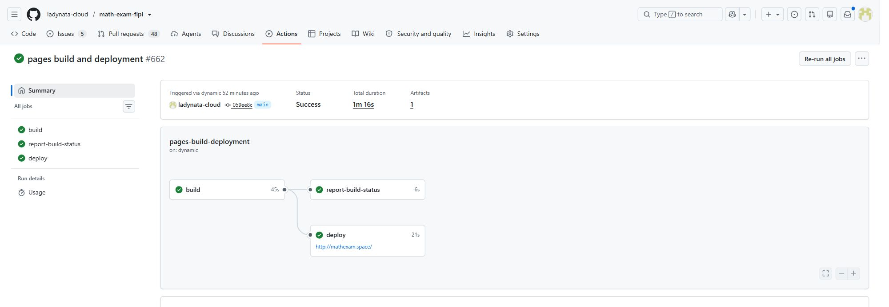

# PR375 production release — 2026-11-02 (Asia/Novosibirsk)

PR375 is merged and deployed to Pages, the existing cabinet application and the separate assistant application. This is an **offline release**: no live learner inference or paid pupil pilot was enabled.

## Result

The assistant now supports a follow-up about the original mathematical task and up to three previous exchanges. The grade 6 Vilenkin NOD/NOK profile uses existing mathematics and hints. Context is bounded to 3500 UTF-8 bytes, 60 process-local entries and a fixed 15-minute lifetime; account/session/settings/profile/task binding, fresh external acknowledgement, teacher control, assessment/privacy checks and durable usage/replay controls remain.

[Task](https://github.com/ladynata-cloud/math-exam-fipi/blob/059ee8c9f5baeb0b333c96d9b8516edb570666b2/docs/tasks/MATHEXAM_ASSISTANT_GRADE6_DIALOGUE_V1.md) · [Revalidation](https://github.com/ladynata-cloud/math-exam-fipi/blob/059ee8c9f5baeb0b333c96d9b8516edb570666b2/docs/reports/MATHEXAM_ASSISTANT_DIALOGUE_REVALIDATION_20261102.md) · [PR375](https://github.com/ladynata-cloud/math-exam-fipi/pull/375)

## Executive status

```text
Task: MATHEXAM_ASSISTANT_GRADE6_DIALOGUE_V1
PR: ladynata-cloud/math-exam-fipi#375 — merged
Base: 6b9c327f2ca438cb7e7620ef302876de467fac19
Head: 8c7c3db3a308da61619b63b129e7333292406cd6
Production merge: 059ee8c9f5baeb0b333c96d9b8516edb570666b2
Gate: MATHEXAM_ASSISTANT_DIALOGUE_RELEASED_OFFLINE_OK
Tests: 540 local unit/DOM tests; relevant browser/source gates; 18 head workflows; 9 postmerge workflows including Pages all successful
Failures: no remaining product, test or deployment failure
Not run: new independent review (explicit current-task owner exception); live paid model evaluation; real pupil pilot
Scope deviations: no product-scope deviation; dedicated assistant repository received exactly four released runtime files
Recommendation: retain the verified offline deployment; treat live activation and PR399 as separate work
Next user decision: none required for this completed release

Authorized base: 6b9c327f2ca438cb7e7620ef302876de467fac19
Actual current main: 059ee8c9f5baeb0b333c96d9b8516edb570666b2 after this release
Base drift detected: none before merge; current main is the expected authorized squash result
Authorization valid/invalid: valid, including the task-specific review exception
Virtual merge result: clean; tree d8ad93a976e3bd4ade9cc8161b43f0fc7175e463
Rerun gates: 18 exact-head workflows rechecked; 9 postmerge workflows; served assets; both live health endpoints; deployment versions
New owner authorization required: no for this release
```

## Authorization and review exception

The owner authorized this release and then replied “я разешаю” to the explicit request to release PR375 without a new independent review on the basis of completed checks. This is a task-specific owner exception, **not** an independent review verdict and not permission to waive reviews for PR399 or future work.

A real Anthropic review attempt for the exact base/head ran once in [workflow 41336928818](https://github.com/ladynata-cloud/math-exam-fipi/actions/runs/41336928818), and the provider rejected it with HTTP 400 for insufficient credit. No review answer or verdict was returned. Copilot did not produce a verdict. No credit purchase, repeated paid attempt, disabled test or branch-protection override was used. [Immutable attempted-review record](https://github.com/ladynata-cloud/math-exam-fipi/blob/1fc3543bdaeb849bfd0fb7a429bae10995a76071/docs/reports/ASSISTANT_PR375_RELEASE_ATTEMPT_20261102.md).

## Merge identity

- Squash merge at 2026-11-01 18:42:23 UTC.
- Sole parent is the authorized base; the complete merge tree equals the verified head tree.
- Parent-to-merge changed-file set: 28 files, with no extra file.
- Stable patch ID: `86df1950edaf7e3197bb7c676eb12dbcfe9cf1d5`, equal before and after merge.
- Main was queried directly again after deployment and still points to the released commit.
- Published Vilenkin navigation/LCM, geometry provenance, finance content and all unrelated upstream work remain preserved.
- PR399 OpenAI adapter remains a separate Draft and is not merged or enabled here.

## Deployment

| Surface | Released identity | Verification |
| --- | --- | --- |
| Pages | GitHub `059ee8c9f5baeb0b333c96d9b8516edb570666b2` | [Run 41337980680](https://github.com/ladynata-cloud/math-exam-fipi/actions/runs/41337980680): build, status and deploy all successful |
| Cabinet | Amvera package `84be27de6fc3d0af9febfa315c0c34152aad6dac` | Versions UI: build successful, stored, currently used; one running replica |
| Assistant | Amvera package `79465769a2881f1f54a536b19eb8b4634a5d4483` | Versions UI: build successful, stored, currently used; one running replica |

The cabinet's normal GitHub integration delivered the frontend. Its existing hosting wrapper/configuration was not overwritten.

The assistant's dedicated repository was first verified clean at `69afae86d08c0e6c3041a29646e1845704951f43`. All 12 existing source blobs matched the previously released baseline. Four files were fetched from the immutable GitHub release over normally verified HTTPS and checked by SHA-256 before writing. Staged names and Git blob IDs were checked exactly; the remote base was checked before committing; a normal fast-forward push and clean worktree were confirmed. The new package has the old package as its sole parent and exactly 4 changed paths (107 additions, 10 deletions).

Browser file transfer timed out. Delivery was completed through the existing application's built-in IDE and authenticated deployment Git repository. No new credentials, inference setting, hosting configuration, persistent volume, learner record or quota was changed.

| Assistant source file | Bytes | SHA-256 |
| --- | ---: | --- |
| `assistant-service/src/cabinet-bridge.js` | 9911 | `a6bcbc1f8f8954dec34a241beef15087c660b2051d07a3907b2c7e55c65a7e50` |
| `assistant-service/src/cabinet-topics.js` | 67793 | `3e2bdc676539bb483448c4cba1cad85ea81b8bc877b8c7b6bf315d05729bf85e` |
| `assistant-service/src/dialogue.js` | 4073 | `ea0acb12a82091348dcfd45d879fbf2bf8e88f6273a39fbed399f0ee6597745f` |
| `assistant-service/src/tutor.js` | 32858 | `43636be521d226fec08a4b2f740db57eb9ade029c6a146992ca233318f6184aa` |

## Post-deployment checks

- `https://mathexam-assistant-ladynata.msk1.amvera.tech/healthz`: HTTP 200, `ok:true`, service `mathexam-assistant`, mode `offline`.
- `https://mathexam-board-ladynata.msk1.amvera.tech/health`: HTTP 200, registry loaded, progress store ready, persistence confirmed, no registry/store error.
- A preliminary request to the cabinet's unsupported `/healthz` returned 404; its documented `/health` route above passed.
- `learning/index.html`, `learning/assistant.js` and `learning/assistant.css` each matched the released bytes on both `mathexam.space` and the cabinet origin (6/6, HTTP 200, no redirect).
- No real learner session was opened for testing, no external model call was made, and no paid pedagogical quality result is claimed.
- No rollback was needed. The previous assistant package remains available; its persistent data was retained.

## CI evidence

### Exact PR head — 18 successful workflows

- [College functions trainer](https://github.com/ladynata-cloud/math-exam-fipi/actions/runs/41332820950): success.
- [Public SEO and sitemap](https://github.com/ladynata-cloud/math-exam-fipi/actions/runs/41332820841): success.
- [Peterson cabinet and on-demand helper](https://github.com/ladynata-cloud/math-exam-fipi/actions/runs/41332820845): success.
- [Basic EGE 11 and 13 shared board](https://github.com/ladynata-cloud/math-exam-fipi/actions/runs/41332820854): success.
- [Merzlyak cabinet and shared board](https://github.com/ladynata-cloud/math-exam-fipi/actions/runs/41332820849): success.
- [OGE basics — contextual help and task-first screens](https://github.com/ladynata-cloud/math-exam-fipi/actions/runs/41332820853): success.
- [Cabinet school course navigation](https://github.com/ladynata-cloud/math-exam-fipi/actions/runs/41332820821): success.
- [Individual board — writing tools](https://github.com/ladynata-cloud/math-exam-fipi/actions/runs/41332820935): success.
- [Atanasyan first steps — source, work and cabinet](https://github.com/ladynata-cloud/math-exam-fipi/actions/runs/41332820834): success.
- [Grade 6 NOK and NOD trainers](https://github.com/ladynata-cloud/math-exam-fipi/actions/runs/41332820862): success.
- [Peterson 6 part 1 quality](https://github.com/ladynata-cloud/math-exam-fipi/actions/runs/41332820881): success.
- [Atanasyan 92a — cabinet and shared board](https://github.com/ladynata-cloud/math-exam-fipi/actions/runs/41332820824): success.
- [MathExam assistant — private prototype](https://github.com/ladynata-cloud/math-exam-fipi/actions/runs/41332820906): success.
- [Profile 2027 — learning start](https://github.com/ladynata-cloud/math-exam-fipi/actions/runs/41332820823): success.
- [Vilenkin 6 cloud cabinet](https://github.com/ladynata-cloud/math-exam-fipi/actions/runs/41332820839): success.
- [Profile START — five added board trainers](https://github.com/ladynata-cloud/math-exam-fipi/actions/runs/41332820876): success.
- [Ichenskaya grade 7 — source, proofs and retained work](https://github.com/ladynata-cloud/math-exam-fipi/actions/runs/41332820885): success.
- [Unified learning — accounts, classroom and trainers](https://github.com/ladynata-cloud/math-exam-fipi/actions/runs/41332820883): success.

### Released main — 9 successful workflows

- [Run 41337980967](https://github.com/ladynata-cloud/math-exam-fipi/actions/runs/41337980967): mathematics-and-board — success.
- [Run 41337980846](https://github.com/ladynata-cloud/math-exam-fipi/actions/runs/41337980846): cabinet-and-board — success.
- [Run 41337980888](https://github.com/ladynata-cloud/math-exam-fipi/actions/runs/41337980888): writing — success.
- [Run 41337980797](https://github.com/ladynata-cloud/math-exam-fipi/actions/runs/41337980797): board, course — success.
- [Run 41337980885](https://github.com/ladynata-cloud/math-exam-fipi/actions/runs/41337980885): mathematics-and-journeys — success.
- [Run 41337980838](https://github.com/ladynata-cloud/math-exam-fipi/actions/runs/41337980838): base-stereometry — success.
- [Run 41337980736](https://github.com/ladynata-cloud/math-exam-fipi/actions/runs/41337980736): added-board — success.
- [Run 41337980871](https://github.com/ladynata-cloud/math-exam-fipi/actions/runs/41337980871): expressions-board, math-and-browser, stereo-board — success.
- [Run 41337980680](https://github.com/ladynata-cloud/math-exam-fipi/actions/runs/41337980680): build, report-build-status, deploy — success.

Local verification: helper 131/131, cabinet 369/369, assistant DOM 40/40; browser dialogue, cabinet, mobile/teacher-control, Vilenkin navigation and LCM, free-route and source-provenance gates passed. Browser inference transport was mocked.

GitHub Pages reported a non-blocking managed-action Node 20 deprecation warning; its jobs ran successfully. The production assistant Docker/runtime configuration was not changed by this task.

## Next maintained state

The release is complete. Reconcile the older preparation text in `docs/PROJECT_STATUS.md` at the next approved product task, as required by AGENTS.md; do not create a recursive status-only PR. Live provider activation, quality/cost evaluation and the separate OpenAI adapter remain outside this release.


