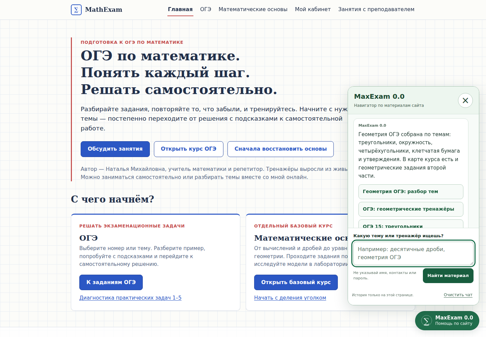
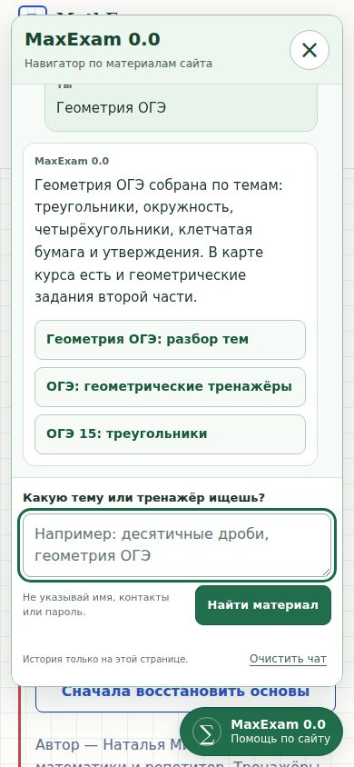

# MaxExam public navigator — main integration, 2026-10-31

## Candidate identity

- Source PR: [#361](https://github.com/ladynata-cloud/math-exam-fipi/pull/361).
- Source head: `391f595ab3639fe24990911691d24192a58b44ab`.
- Current reconciled base: `139b944a70f2e8ba4d340d152d08807fad03e5da` (`main`, PR #374).
- Original preparation base: `c9bf66e2d95f48db0134d43cc590da89f8bc3053` (PR #377).
- Branch: `feat/public-assistant-main-20261031`.
- Task: [MATHEXAM_PUBLIC_ASSISTANT_V1](../tasks/MATHEXAM_PUBLIC_ASSISTANT_V1.md), HIGH.
- Replacement Draft PR: [#385](https://github.com/ladynata-cloud/math-exam-fipi/pull/385).
- Exact final head and complete current-head CI: recorded in that PR's handoff.

## Authorized current-main reconciliation — 2026-10-31

The owner's direct instruction authorizes a normal history-preserving merge of
the new `main` into the existing PR #385 branch, rebinding the task scope and
updating its documents. It permits the validation, continuation commits and
branch push needed to complete that update. It does not authorize merging
PR #385 into `main`, auto-merge, deployment or a HIGH-review exception.

### Identity and preservation

- Authoritative GitHub `refs/heads/main`, checked immediately before creation of
  the reconciliation commit at 2026-10-31T01:59:06Z, was
  `139b944a70f2e8ba4d340d152d08807fad03e5da`. Its sole parent is the former
  preparation base; the concurrent commit is the published Cone PR #374.
- Normal merge commit: `7d1ab4e33d6d0b0b342d1d86b507808d05d5a762`.
  Ordered parents: existing navigator head
  `40a43c89d0f3c8738aa15ede96dd43ee5ceece70`, then current main
  `139b944a70f2e8ba4d340d152d08807fad03e5da`.
- Clean merge tree: `69aac2c41c036793408248dba09ac95e39a47446`, identical to the
  locally computed and verified merge. Git combined the shared status document
  without conflicts; both branch histories are retained.
- The subsequent reconciliation edit is limited to four existing task paths:
  the scope manifest, task specification, this report and the current public
  navigator section of `PROJECT_STATUS.md`. No product files, checks, workflow,
  page manifest or allowed-file list are changed by this continuation.
- All 66 upstream paths other than the shared status document match new main
  exactly. The final public-PR delta still contains the same 641 paths, without
  added or lost paths. All 595 included HTML files and the three navigator
  runtime blobs match the previous navigator head exactly. Other status sections
  retain the clean merged contents.
- `tools/public-assistant-scope.json` changes only `base_sha`. The task and scope
  now name the same new base. The original strict base/placement/scope guards
  remain intact; the former stale-base failure is resolved by this rebinding.

### Fresh local checks on the reconciled composition

- Navigation data: **31/31**; admission and placement: **9/9**.
- Explicit new-base coverage: **832 original HTML files preserved**, **595
  included pages**, **641 allowed changed paths**. The sitemap coverage remains
  528 of 531 entries, with 67 additional reviewed public pages, two deferred
  textbook shells and two existing task-helper pages retained.
- Sitemap unit checks: **12/12**. Sitemap generation check: **531 URLs**. SEO:
  **30 entrances, 203 links, 560 canonical declarations and seven redirects**.
  All 531 sitemap pages keep self-canonical links; the catalogue check confirms
  **71 nonempty destinations available without JavaScript**.
- Public browser: **16/16 groups**, including 15 entry/viewport combinations,
  division single-submit continuation and saved notebook/draft, Vilenkin draft
  retention across reload, existing helpers, privacy/network/storage boundaries,
  keyboard isolation, mobile controls and private/iframe suppression. Three
  screenshots were produced in the permitted temporary directory. Synthetic
  scenarios only; zero model calls and no browser page errors.
- Cone content: **40 cards, 166 steps, 171 states, 20 negative controls**; all
  previous **554 cards** exact. Cone mathematics: **3,120 parameter cases**.
  Source catalogue: **7/7**; schema: **1,394 entries / 594 cards**; actual model
  geometry: **594 cards / 7,633 polygons / 21,113 segments**.
- Full stereo content and all incorporated historical guards: **594 cards,
  2,300 justified steps and 2,399 views**. In-memory bundle reproduction matches
  the committed 5,623,464 bytes, SHA256
  `2f129a9bab292fae765c674268448895d0419e70e0fd4fd30120fcae53569bc1`.
- `git diff --check` passes. No assertion, baseline, review hash or source pin
  was weakened or rebound to obtain these results.

The checks used Node 24.22.1, Playwright 1.62.1, Chrome 151.0.7922.34,
jsdom 26.1.0 and the already installed schema dependencies. Initial environment
attempts could not bind the sandbox localhost server or find Playwright's
default browser; the complete unchanged browser suite then passed with approved
local-server execution and the existing explicit Chromium executable. The first
Cone invocation lacked its external dependency path; the unchanged complete
test passed after selecting the installed dependencies. These setup failures are
not counted as successful test runs. Local Node differs from the Node 22 Cone
workflow; fresh cloud checks remain a separate requirement.

### Remaining gates and historical evidence

The shared Atanasyan first-steps source-pin failure is reproduced on this
composition by `python3 tools/atanasyan-first-steps/build.py --check`. The builder,
canonical source and selected first-steps bundle are byte-identical across the
former base, new main and original navigator head. Two cloud workflows invoke
this one failing guard: first-steps and Ichenskaya. The separate proposed fix in
PR #375 remains outside this synchronization scope.

Fresh retrieval completed the historical CI record for old head `40a43c89...`:
**43 workflows, 41 success, two failure, none pending**. The previously running
Atanasyan 7–9 workflow completed successfully. These are old-head results and
are not reused as approval of the new reconciliation commit or final head.

Exact final head, final tree and newly triggered cloud outcomes are recorded in
the current PR #385 handoff, avoiding a self-referential documentation commit.
Full Cone browser shards were not rerun locally in this continuation. Earlier
local layout observations below remain historical; no new layout fix or waiver
is claimed. External HIGH review, real-pupil/provider checks and production
deployment are not performed. The specialized local navigator preparation gate
passes on the new base; the overall release remains **HOLD** for the source-pin
disposition, current-head cloud gates, external HIGH review and separate owner
release authorization.

## Initial main-based transfer — historical preparation

The old branch was stacked on an earlier cabinet draft. Its dependencies and
newer learning/SEO updates are now published through #358/#369/#376/#368/
#378/#380/#382/#377. This candidate transfers only navigation code and required
compatibility support onto current main. No old trainer HTML is copied over a
newer version. That initial transfer used no branch merge or history rewriting.
The authorized reconciliation above subsequently retains both histories through
a normal merge; no force, reset or rebase is used.

Old cloud results: 40 workflows, 32 successes, seven failures, one cancelled.
These are historical diagnostics, not current release evidence. The seven
failure families included script-loader assumptions, closed-launcher obstruction,
page-header selectors, missing immutable scope objects and an ancillary CSS
export-parity change. The unrelated CSS change is omitted in this composition.

## Coverage and preserved boundaries

595 public pages receive one exact deferred script pair. The sitemap has 531
pages: 528 receive the navigator, two protected textbook shells stay unchanged,
and one retains its existing Peterson task helper. Another existing practice
helper page is outside the sitemap. The 67 extra eligible public documents are
recorded in `tools/public-assistant-pages.json` with discovery sources.

All 832 existing HTML files match base after removing the exact block. Existing
URLs, canonical/SEO metadata, lesson contents and course data are retained.
Protected textbooks remain link destinations. Private cabinets/board wrappers,
archives, sources, exports and redirects are excluded. The existing Peterson
and practice helpers retain their original interface and assistance accounting.

## Product boundaries

This is a prepared rules-and-catalogue navigator. It cannot see the current
exercise, check a submitted answer, converse as a general language model or
certify full textbook coverage. Ambiguous requests receive explicit choices.
No provider, model endpoint, paid resource or learner record is connected.
Input and answers stay in bounded page memory; clearing/pagehide discard them.
Independent site analytics remain a separate boundary, so no blanket claim that
other scripts cannot see page data is made.

## Verification

### Initial preparation and compatibility checks

The catalogue/browser follow-up below supersedes the 22-test/132-entry and
13-browser-group counts in this historical record. Each final-head cloud outcome
is recorded separately in PR #385.

- Navigation: 22/22 groups, 132 checked catalogue entries, current file/PDF/router
  targets, exact query allowlist, exam precedence, ambiguity and refusal/access
  handling. Explicit no-model/no-answer-inspection disclosure is tested.
- Coverage/admission/strict SEO exception: 9/9; all 595 inclusions and 832 base
  HTML blobs verified; current task file scope checked separately.
- Sitemap: 12/12; 531 exact self-canonicals; 30 SEO entrances, 203 local links,
  560 canonical declarations and seven consistent redirects. Base SEO source
  preservation passed on all 24 protected entrance pages.
- Actual SEO browser: six compatibility routes, 30 catalogue clicks at
  320/390/1280px and public/embedded NOD/NOK scenarios passed.
- Navigator browser: 13 groups, all manifest paths and aliases, 320/390 and
  short-screen layouts, safe rendering/links, no text requests/storage access,
  scoped keys, clear/pagehide, iframe/private suppression, unchanged drafts and
  preserved existing Peterson/practice helpers. Screenshots were inspected.
- Original OGE20–22 browser: three trainers at three widths passed, including
  actual settings clicks, retained work, keyboard and offline scenarios.
- Original special OGE browser: nine route/viewport cases passed; original
  header, saved work and provenance assertions remain.
- Guided division notebook and search-entry browsers passed on the current
  source: one-action progression, decimal presentation, old-v1 resume, drafts,
  hints, canonical/deep-link aliases and offline completion remain intact.
- Original affected route/DOM/picker fixtures passed after bounded URL-loader
  corrections. The Peterson picker remains byte-identical to current main and
  its six groups pass; no unused public-helper allowance remains there.
- Task6 focused/minimal/interactive: 39/39; original immutable scope preserved.
- Practical DOM/mathematics suites: seven file suites passed immediately; the
  two archive-dependent suites initially hit sandbox `unzip` restrictions, then
  their unchanged 14 tests passed under the normal execution permission.
- Profile link gate: 85 checks, zero failures or JavaScript errors. Profile15
  content/link gate: 12 lessons, six families, 124 steps and 32 links passed.
- Stereo generation reproduced the source with the exact block. Pogorelov
  offline export exactly matches base: 245493 bytes, SHA256
  `8193d76de7c5da604330f4d51f0208f31921386aafee32b9381f03e21a9035c3`.
- Syntax and `git diff --check` passed. No model was called.

### Local layout failures and cloud comparison

The complete contextual-OGE browser gate stops on an existing percentages layout:
`percentages/percent-of-number-and-whole.html` has scroll width324 at viewport320.
Five matched random seeds reproduce identical prompt/layout geometry on the
integrated page and the exact base HTML with the helper block removed:
header/practice/footer x24, width300, right324. That local invocation remains failed;
its later scenarios are not claimed as run. The formerly obstructed six-level
prerequisite controls were separately tested with the original center-hit
sequence and pass at320/360/1280. No unrelated percentage CSS or assertion was
changed to manufacture a pass.

The complete practical-OGE browser gate also stops on an existing diagnostic:
`practice-1-5-entry-diagnostic-2026.html` at320 has document/body width340.
It completes 11 cases, then fails on case12; the remaining27 are not reached.
The exact main HTML and stylesheet reproduce identical340px width and identical
mode-button rectangles (the teacher button ends at339.5px). The old PR's ancillary
wrapping change was not ported because it changed the source stylesheet without
its frozen downloadable counterpart. No offline archive or original assertion
was altered. That local invocation is reported failed, not passing.

The complete cloud gates passed on first integrated head
`5411b20823b68a361b0182875023ec89a3a33e8b`: the
[70-route contextual suite](https://github.com/ladynata-cloud/math-exam-fipi/actions/runs/41137717221)
and the full39-case practical suite in both
[OGE minimal](https://github.com/ladynata-cloud/math-exam-fipi/actions/runs/41137717164)
and [practical discovery](https://github.com/ladynata-cloud/math-exam-fipi/actions/runs/41137717223).
The latter also passes33-page links,13 tire3D cases,27 tire-feedback cases and126
prototype/viewport cases. Cloud success does not erase the local observations.

Both use Chromium151.0.7922.34/Playwright1.62.1, but the local Ubuntu24.04 font
environment differs from cloud Ubuntu26.04 with Liberation/FreeFont available.
The observed results establish environment-sensitive, pre-existing layout limits;
they do not prove that a particular font is the sole cause.

### First cloud pass and integration corrections

The [dedicated navigator](https://github.com/ladynata-cloud/math-exam-fipi/actions/runs/41137717290),
[public SEO](https://github.com/ladynata-cloud/math-exam-fipi/actions/runs/41137717456),
Task6, guided division, Vilenkin and the public OGE suites above passed on the
first integrated head. Four later compatibility changes preserve the original
assertions and are rerun on the final head:

- Unified learning exposed three retained fixture loaders that treated the new
  root-relative script URLs as operating-system paths. Correct browser-URL
  resolution admits only existing in-repository, same-origin assets. Original
  continuation, supplement and119-route inventory checks remain. The complete
  failed CI step now passes all24 commands locally: continuation9/9,
  supplements16/16 and the unchanged119-route inventory, among the other gates.
- Profile task14's independent geometry gate hashes the entire surrounding HTML.
  Its source guard now removes only the one exact approved script block. The
  original geometry and surrounding-HTML hashes are unchanged; duplicate,
  malformed, reordered, wrong-version and executable-attribute variants fail.
  Independent mutation review also led to a placement guard: an otherwise exact
  block moved into inline JavaScript or another part of the document is rejected.
  The global coverage gate applies the same original insertion boundary, including
  the explicitly reviewed implicit-head pages. Existing HTML needed no correction.
  The existing geometric oracle and all remaining independent-renderer checks
  pass locally. No geometry, renderer, curriculum or storage source was edited.

Two source-provenance failures are inherited from main: Atanasyan first steps
and Ichenskaya both stop at the same outdated full-course source pin. Exact
main reproduces the mismatch; the canonical source, builder, selected records
and test files are unchanged by this task. Existing Draft
[PR #375](https://github.com/ladynata-cloud/math-exam-fipi/pull/375), head
`84664313af0ba374efff38aae1066d9338da8af5`, already contains the independently
checked fix and has18 passing workflows. That broader assistant PR is unmerged
and has its own review/release conditions. Its source-pin changes are not
duplicated here. Publication of it, or another separately approved source fix,
requires fresh composition and validation of this navigator on the new main.

The final PR body records all completed, failed and pending current-head cloud
checks, including the separate board synchronization check; the first head is not reused as
final-head approval. External HIGH review, production rollout and live pupil
activation have not run. The owner has not granted a review exception or an
exact-base/head release decision.

The first head's Profile expressions-board cloud job failed at the original
dynamic-circle/control-revocation assertion. All46 relevant files and the entire
board-server tree match main, and its wrapper does not load this navigator.
Two full unchanged local runs on exact main and two on the exact PR all pass.
This is a non-reproduced intermittent cloud failure in unchanged code, not a
proven failing baseline or a waived assertion. The strict final-head gate remains
required; no delay, product workaround or weaker assertion was added.

### Independent internal review

A separate agent reviewed navigation, referral/privacy, widget isolation,
coverage, strict SEO admission and generator/export boundaries. It found four
P2 defects: explicit EGE level losing to pathname, role-first tutor refusals,
inflected login errors counted as difficulty and competing exams silently
resolved. All four were fixed and independently reproduced as passing.
Final internal verdict: PASS at2026-10-30 22:04UTC (31October05:04 Novosibirsk).
This is internal review, not an external HIGH verdict.

Supplemental independent review of the compatibility commit confirms the three
URL loaders retain their original checks, and the source-placement guards reject
relocated/malformed blocks while retaining the original geometry hashes. Both
the existing source and exact main pass those guards. Runtime UI/catalogue blobs
below remain unchanged through the compatibility commit.

Reviewed runtime blobs: data.js `df31ce32945bbcb45aace303d83d471fca652f1f`,
widget.js `c92c51efe21ba7cc100422c798c1e1a2b3694d72`,
widget.css `3b91089b66f6bb464197c597de99a39663f5af41`.
These identities bind the original integration through the compatibility commit.
Later catalogue revisions are bound separately below and in the final PR handoff.

### Catalogue and browser follow-up on `89f13c038beb5de5b9b3bf2ba65bd0acc453ba27`

The existing PR #385 and its concurrent compatibility commit are retained. This
follow-up changes eight files; all four corrected learner/geometry fixtures and
both strengthened global placement-check files remain byte-identical to 89f13c0.
No second branch/PR, wholesale runtime replacement or older HTML is published.

- Catalogue: 134 entries. All 132 prior IDs and their data remain, except OGE13 now
  uses its verified direct destination while its old redirect stays unchanged.
  The two additions are the Vilenkin unit 6 prime table and Ichenskaya grade 7 collection.
- Russian number signs and exam-level shorthand preserve the requested task.
  Different explicit numbers prompt clarification without copying the first
  number into every choice. A numbered exam request retains priority over a
  prime-factor topic match. Advanced objects do not select elementary arithmetic;
  word-start matching keeps ordinary queries containing `постепенно` working.
- The navigation suite passes 26/26 groups. Independent review closed three P2
  findings, then passed 25 additional final probes and 528 old-title/context
  comparisons. Reviewed data blob: `7a0c01f858c8e5a2bfc070ddfa33eae3493da194`.
  Widget JavaScript/CSS retain their earlier reviewed blobs; no HTML changes
  occur in this follow-up.
- The expanded browser suite passes 16/16 groups on Playwright 1.62.1 and
  Chrome 151.0.7922.34. It covers 15 combinations of current arithmetic entry,
  division, Vilenkin, OGE and EGE pages at 320/390/1280px, in addition to the
  retained privacy, mobile obstruction, keyboard and existing-helper scenarios.
- Actual division checks preserve its draft, notebook markup, prompt and stored
  work while chatting, then verify advancement after one Enter. Actual Vilenkin
  checks preserve the condition, hash, draft and stored work, including reload.
  These bounded journeys do not claim every-task or all managed-mode coverage.
- The workflow screenshot variable is now accepted by the browser test, and an
  upload step is configured for desktop, 390px and 320px screenshots. The local
  screenshots were inspected. Its first cloud execution exposed the temporary
  directory mismatch documented below. The mobile launcher remains 54px.
- Fresh composition checks retain 595 inclusions, all 832 base HTML blobs and
  641 scoped changed paths. Global admission/placement tests now total 9, retaining
  the concurrent guard improvements; sitemap tests total 12. Source/SEO data,
  learner state, protected shells and offline exports remain unchanged.

Independent review also confirmed that all existing browser assertions remain.
The concurrent compatibility fixes are reviewed and rerun on this composition,
not replaced by independently prepared duplicates. Final cloud outcomes and
exact final commit identity belong to the PR handoff. Internal review is not an
external HIGH verdict, and no merge or deployment permission is inferred.

### Further review of `5cd1ae77f02a4fc1452bc64ec99fd2dbd598d9a2`

This fast-forward contribution arrived while the preceding head's CI was running.
It preserves the prepared widget, all HTML and the compatibility fixes. Its new
catalogue and draft-preservation journeys are retained and independently checked;
cancelled older-head workflows are not treated as final-head passes.

Focused review found four remaining routing boundaries: retaining a numbered
request when choosing the EGE level; clarifying number lists/ranges with omitted
repeated markers; keeping vectors/roots and other advanced objects out of basic
times-nine/column-arithmetic routes; and honoring an explicit textbook author or
grade before the prime-table shortcut. These are bounded navigation corrections,
not new mathematical solving or model capabilities. The catalogue retains134
entries and the original learner/source files remain unchanged.

All31 navigation groups pass, including the original26 and five regressions for
these boundaries and the retained OGE1–5 bundle. Independent review also passes
29 focused probes. Reviewed blobs: data.js
`46e182af541e280f76e49670079614ab00c3db0c`; data-test
`0983326a66ca6edbc7b1ceb237ac7b35e4b6b3f0`. The full16-group browser suite passes
on these exact files and creates all three PNGs through the screenshot alias
with the unchanged default temporary-directory guard. Global coverage/placement
remains9/9, with595 inclusions,832 preserved HTML files and641 accounted paths.

The dedicated [5cd cloud run](https://github.com/ladynata-cloud/math-exam-fipi/actions/runs/41140489457)
passed all16 functional browser groups, then failed while saving screenshots:
the configured runner-owned temporary directory differed from Node's default
temporary directory. Concurrent follow-up
`66e715dc7486d29476bcfa313156d639b99b2d6c` aligns both the screenshot and upload
destinations at `/tmp/public-helper-screenshots`. That correction is preserved,
without publishing a duplicate alternative. The original containment check and
pinned upload action are unchanged; no path allowance or test is weakened.

The earlier [Task19 run on89f](https://github.com/ladynata-cloud/math-exam-fipi/actions/runs/41139461657)
failed one desktop linked-highlight assertion on attempt1 and passed the single
unchanged failed-job rerun on attempt2. The same strict check also passes on5cd's
first attempt. This is intermittent acceptance evidence; a pointer/focus timing
cause is a hypothesis, not a proven baseline defect. No Task19 source, assertion
or delay was changed. The earlier expressions-board failure is retained above.

The final PR handoff binds the corrected catalogue, tests and workflow to the
published head and records their actual local/cloud results. The two inherited
source-pin failures, external HIGH review and exact release authorization remain
separate conditions; this follow-up does not normalize those source hashes or
import another task's review exception.

### Production reconciliation before release

Read-only HTTP checks returned200 for the live homepage, canonical short division
trainer, sitemap and robots. Each response exactly matched current base main;
no public navigator was present. This establishes the starting publication,
not deployment of this candidate.

### Visual evidence

## Rollback

Remove the exact marked inclusion from the manifest pages; verify original HTML
blobs and rerun coverage, SEO and affected browser checks. No learner storage or
assistant-service ledger migration/deletion belongs to this UI rollback.
