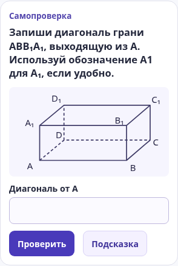
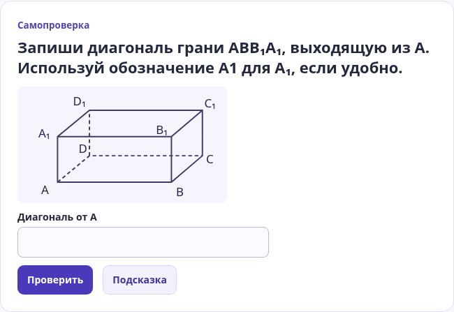
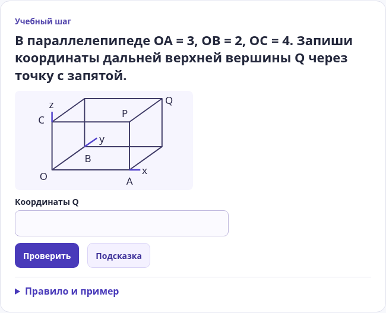

# Видимость чертежей в «Основах и методах»

- Задача: [PROFILE_DIAGRAM_VISIBILITY_20261116](../tasks/PROFILE_DIAGRAM_VISIBILITY_20261116.md).
- Дата проверки: 16 ноября 2026, Asia/Novosibirsk.
- База: `5f25f75b6e7178ad1d492c7bcb28ed9e63c97bae`.
- Уровень: `SMALL`.
- Локальный результат: `PROFILE_DIAGRAM_VISIBILITY_PASS`.
- Статус: исправление подготовлено для Draft PR; публикация в эту задачу не разрешена.

## Причина и исправление

Общая функция создавала SVG с классом `alphabet-diagram`, а правила рисования
были привязаны к `.az-diagram`. Поэтому закрытые контуры получали стандартную
чёрную заливку, рёбра и окружности теряли оформление, подписи B₁ и D сливались
с фигурой. Также не применялось ограничение ширины рисунка.

К SVG добавлен существующий класс `az-diagram`; прежний `alphabet-diagram`
сохранён. Версия URL `diagrams.js` обновлена. При визуальном просмотре найдена
ещё одна помеха: верхнее наклонное ребро координатного параллелепипеда
пересекало букву P. Только текст P смещён с `(151, 37)` на `(138, 34)`;
координаты вершин, рёбер и математические условия не изменены.

Один автономный комплект пересобран штатной командой:

```sh
node scripts/build-trainer-downloads.mjs --only=ege-profil-methods-atlas --downloads-only
```

## Подтверждённые аналогичные задания

| Шаблон | Условий | Навыки |
| --- | ---: | --- |
| `box` | 9 | `space-drawing/find-face`, `projection`, `line-plane-angle` |
| `coordinate-box` | 2 | `coordinate-method/axes` |
| `triangle` | 3 | `plane-constructions/height` |
| `parallel` | 5 | `plane-constructions/parallel`, первые два условия `written-solution/justify-step` |
| `tangent` | 3 | `plane-constructions/radius` |
| `diameter` | 1 | последнее условие `written-solution/justify-step` |
| **Итого** | **23** | **8 навыков, 6 шаблонов** |

## Сверка с опубликованными ресурсами до исправления

В 03:52 по Новосибирску выполнены обычные HTTPS-запросы с проверкой TLS.
Три ресурса под `/ege-profil/azbuka-metodov/` вернули HTTP 200 и побайтово
совпали с указанной базой. Ошибка присутствовала в опубликованной версии.
Это проверка выбранных файлов, а не всего сайта.

| Ресурс | Байт | SHA-256 опубликованного файла |
| --- | ---: | --- |
| `index.html` | 4187 | `ca431bfc04a2522e8695207ce1a8f81a0ac4e202cae5b5a7bce26d30f3abcafe` |
| `diagrams.js` | 2780 | `7efc2d77ab62c44bed3620ca4e61ad623fc6a9a4e60b1ce0d3bf3b415da9acd4` |
| `styles.css` | 8545 | `ec8ba9be6e8c406ae26e0f2299ea91b0f6fde9539ad2bb543752d4c5c7b8eab4` |

Запись `PROJECT_STATUS.md` о публикации этапов 5–6 через PR #608 уже
уточняет более раннюю запись о подготовке этого автономного комплекта.
В текущей задаче добавлена только новая запись о данном исправлении.

## Проверки окончательного варианта

| Проверка | Фактический результат |
| --- | --- |
| `node --test tools/profile-alphabets.test.cjs` | 10/10, без ошибок |
| `node tools/trainer-download-stage2.browser.cjs ege-profil-methods-atlas` | `TRAINER_DOWNLOAD_ADAPT_OK`: 1 комплект, 2 открытия через `file://`, 2 вида панели |
| Все 23 условия в браузере по локальному HTTP | 92 вида: 320/390/768/1280 px |
| Все 23 условия в отдельном HTML и HTML из настоящего ZIP | 92 вида: обе формы на 320/1280 px, сеть отключена |
| Совокупный визуальный прогон | 184/184 вида; ошибок JavaScript и внешних запросов из автономных копий нет |
| Графика | `fill: none`, видимый stroke; полный набор подписей в границах SVG; у `box` скрытые рёбра пунктирные |
| Координатная подпись P | Текст не пересекает соседние горизонтальное и наклонное рёбра |
| Ширина и компоновка | SVG не шире 300 px, на 320 px помещается в карточку; горизонтального переполнения нет |
| Сохранение и ответ в указанной самопроверке | Черновик `AB` восстановлен после reload; неверный `AB` отклонён; верный `AB1` принят |
| Условия, ответы и состояние | `data.js`, `routes.js`, `catalog.js`, `engine.js`, `app.js`, `styles.css`, `function-atlas.js`, `parameter-plane.js` побайтово совпадают с базой |
| Состав ZIP | Те же 5 файлов; изменён только HTML. README, GIF, PNG и промпт побайтово сохранены |
| HTML внутри ZIP | Побайтово равен отдельному скачиваемому HTML |
| Генерация | Другие комплекты и `trainers-manifest.json` не изменились |
| Пробелы и границы diff | `git diff --check` пройден; только файлы этой задачи |

Браузер окончательного локального прогона — Chromium Headless Shell
139.0.7258.5. Первая попытка запуска обычного системного Chromium остановилась
до открытия страницы: среда не разрешила сокет служебного процесса
(`socket() failed: Operation not permitted`). Проверки затем полностью
выполнены доступным Headless Shell через предусмотренный параметр
`CHROMIUM_EXECUTABLE_PATH`; тесты и TLS не ослаблялись.

## Визуальные свидетельства

Самопроверка с B₁ на ширине 320 px:



Та же карточка на ширине 1280 px:



Подпись P отделена от ребра:



## Проверенные артефакты

| Файл | SHA-256 |
| --- | --- |
| `ege-profil/azbuka-metodov/diagrams.js` | `085b9d00552bf55caa772e3f6b8b046559ba2ac5fea4b016f070936fa019ee4f` |
| `ege-profil/azbuka-metodov/index.html` | `8f4fb07d3073c4060d727b176c1de85e52612a6a9c811695c2d87fedab9ea34e` |
| `downloads/trainers/ege-profil-methods-atlas/ege-profil-methods-atlas.html` | `10316411d2e96539a457bfa12d0195eb03427acba2db243f6c60751509133a68` |
| `downloads/trainers/ege-profil-methods-atlas/ege-profil-methods-atlas-package.zip` | `b57956d018fe447883b67fdd02f766f2ef2f756f3319a2b81fd9815ce18b1a3c` |

## Ревью, ограничения и передача

Внутреннее независимое ревью проверило общий класс, кеширование, сохранность
комплекта и рисунки. Замечание о пересечении P с ребром исправлено, после чего
повторён полный прогон 184 видов. Это техническое ревью внутри текущей работы,
а не внешний provider verdict или разрешение на публикацию.

Внешний аудит и проверка с реальным учеником не выполнялись. Полные наборы
посторонних курсов и серверов не запускались: их код не менялся. Итоговые
коммит, номер Draft PR и облачные проверки фиксируются в передаче PR, без
самоссылочного коммита документации.

Слияние, автообъединение и публикация не выполнены. По `AGENTS.md`, присланному
в текущем разговоре, для этого требуется отдельное разрешение владельца.
Откат возможен единым обратным изменением этой правки и автономного комплекта;
миграция или удаление ученических данных не требуются.
