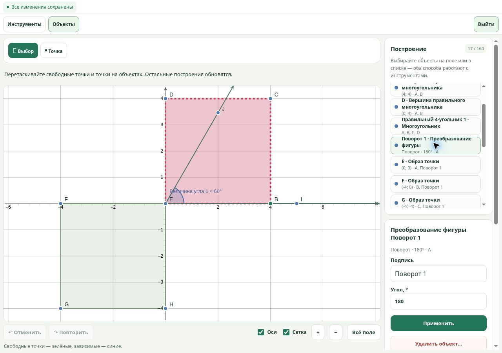
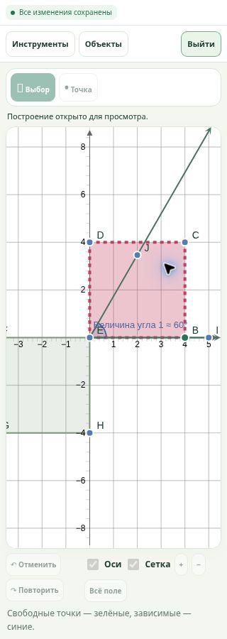

# SpaceMath: инструменты для урока — 10 ноября 2026

Статус: DRAFT / RELEASE HOLD. Реализовано продолжение SpaceMath по прямой просьбе владельца. Слияние, auto-merge и публикация не разрешены этой задачей.

## Основа и границы

Пакет основан на PR #528, коммит `4f0bafa7f7225b3eaf38beab2e5bc73544109c4d`, дерево `a55d02b50189bcbd87580adacc9abc3051c09d00`. Сохраняет развитие #527 (точки на объектах, векторы, касательные, таблицы) и #528 (корни/пересечения прямых и парабол), добавляет практические инструменты построения. Повторно включены принятые исправления уведомлений о сохранении из #519: временная потеря связи не объявляется отклонением записи, реальные отклонённые действия сохраняют предупреждение после следующих записей и перезагрузки.

Применяется ADR 0015: один математический движок, существующий транспорт и журнал. Review level HIGH — новые сохраняемые типы геометрии и оформление. Никаких реальных ученических данных; ручной урок использует только «Тест А» и «Тест Б» на отдельном локальном сервере.

## Что реализовано

| Инструмент | Поведение |
|---|---|
| Отрезок заданной длины | Начальная точка, точка направления, длина; зависимый конец сохраняет длину при движении исходных точек |
| Угол заданной величины | Две стороны-луча, зависимая точка и измерение; заданный знак определяет направление |
| Правильный многоугольник | 3–30 сторон по выбранной стороне; все вершины пересчитываются от двух опорных точек |
| Преобразование фигуры | Поворот, гомотетия, отражения и перенос; один параметр управляет всеми вершинами образа |
| Преобразование окружности/линии/вектора | Прямые зависимые образы без фиктивных вспомогательных точек, в том числе окружность с очень малым радиусом |
| Центр окружности | Зависимая точка для дальнейших построений |
| Вид объекта | Показывать/скрывать объект и подпись, цвет, толщина, тип линии, прозрачность заливки; сохраняется и синхронизируется |
| Узкое рабочее окно | Инструменты и объекты раскрываются по запросу; локальный режим большого чертежа с выходом/Escape доступен и наблюдателю |

Составное построение создаётся одной операцией и отменяется одним Undo. Скрытые вспомогательные объекты продолжают участвовать в зависимостях. Изменение вида рабочего окна не меняет геометрию, права, общий масштаб или журнал.

## Математическая проверка

Модель строго проверяет новые типы, ссылки, диапазоны и оформление. Проверены регулярные многоугольники, общие преобразования, вырождения и восстановление прежних ID. При коэффициенте гомотетии 0 окружность становится неопределённой; после возврата ненулевого коэффициента восстанавливается.

Исправлены выявленные независимым проверяющим численные дефекты:

- Общее вращение окружности и точки на ней могло из-за округления создавать две касательные вместо одной. Сохранено доказуемое отношение принадлежности через общий дескриптор преобразования.
- Ненулевой вектор при underflow мог превращаться в ложный нулевой вектор. Теперь такой результат неопределён, настоящий нулевой вектор поддержан.
- На координатах около 999999 отрезок длины `6e-11` мог фактически получаться примерно вдвое длиннее. Длина и направление представимого перемещения теперь проверяются с относительной точностью `1e-8`. Непредставимое построение явно неопределённо, без подмены длины или привязки. Точное расстояние в один ULP, обычные построения и представимые малые осевые отрезки проходят.

Независимая проверка финальной модели: 96 целевых проверок без ошибок. Проверены модель `8cf21533757cd335f8f9d31964a5ac8e0a87bf4e`, construction batches `16f9aacaa182c03d2563322a4b45b4cabdf373d3`, редактор `ee42d51a78af572dde5905e5d9196e4974dcb591`. Это отдельный агент проверки кода, без утверждения о внешнем провайдере или физическом мобильном устройстве.

## Фактическая проверка браузером

В управляемом браузере проведён синтетический урок преподавателя с двумя учениками:

1. Созданы A(0;0), B(3;0), квадрат ABCD. Вершины C(3;3), D(0;3) проверены в списке и на поле.
2. Квадрат повёрнут целиком на 90°, затем общий угол изменён на 180°. У ученика-наблюдателя проверены координаты образов и запрет редактирования.
3. Созданы отрезок длины 5 и угол 60°. В списке показаны конец (5;0), зависимая точка (1,5;2,598) и измерение ≈60°.
4. Изменены цвет, штрих, толщина и заливка квадрата. Результат реально отображён SVG.
5. Управление передано ученику А. Он изменил B на (4;0); преподаватель и ученик Б получили C(4;4), G(-4;-4). Отрезок остался длины 5; угол остался 60°.
6. Проверены Undo/Redo и скрытие A: квадрат и все зависимые образы сохранены.
7. Экран 320×900 выявил реальный недостаток: локальный фокус внутри iframe оставлял большую панель урока над рисунком. Исправлено разворачивание основного окна SpaceMath на всю область доски. Режим остаётся локальным и доступным наблюдателю.

Финальный экран 320×900: панель SpaceMath 320×864 под строкой состояния 36 px; сам рисунок 302×592,6875 px. Выход по Escape возвращает интерфейс урока. Экран 1280×900 принят с рисунком и редактором общего угла. Повторный вход и просмотр последней записи восстановили все 17 объектов, включая скрытую A.

Дополнительно исправлена гонка: отклонённый запрос большого чертежа во время неудавшейся навигации завершает фокус и у дочернего окна, без записей в журнал. Полный автоматизированный браузерный сценарий запускается в GitHub Actions на коммите этого пакета; статус этого запуска указан в PR, а не выводится из успеха основы.

## Проверки и воспроизводимость

- Полный серверный набор: **429/429 PASS**.
- Формулы, модель, graph solutions, batches, редактор, workspace, bridge, assets: **136/136 PASS**, включая регрессию отказа навигации при позднем запросе большого чертежа.
- Новый `tools/spacemath-classroom.browser.cjs` включён в существующий сценарий `tools/unified-board.browser.cjs`: реальные клики, параметры, SVG, передача управления, readonly, история, перезагрузка страницы/сервера, 320/1280, отсутствие записей от локального фокуса.
- Существующая регрессия восьми учеников сохранена. Отключение связи, одновременные штрихи, отклонённые устаревшие действия и восстановление очереди остаются в полном сценарии.
- Локальный запуск отдельного Chromium ограничен средой (`socket() failed: Operation not permitted`). Он не засчитан как успешная браузерная проверка; интерактивная проверка проведена в управляемом браузере, полный автоматизированный прогон — GitHub CI.
- При настройке стенда заполнение URL через автоматизированный ввод не давало событие change; обычный ввод клавиатурой и Tab подключили локальный сервер. Это ограничение способа тестового ввода, а не отказ сервера или дефект математической модели.

## Оставшиеся ограничения

- Это 2D-конструктор; CAS, 3D, импорт/экспорт `.ggb` и совместимость с полным набором команд GeoGebra не реализованы.
- Корни/пересечения графиков пока ограничены прямыми и параболами. Общие численные решения для тригонометрических, кусочных и других функций не заявлены.
- Преобразование целых графиков функций не входит в новый инструмент преобразования фигур.
- Измерение угла показывает неразвёрнутый угол 0–180°; направление заданного угла задаётся знаком. Рефлексные измерения не реализованы.
- Сохраняются ограничения 160 объектов и 64 КиБ канонического состояния. Пакетное построение сверх лимита отклоняется целиком.
- Физический телефон, реальные касания/стилус и реальный ученический урок не проверялись. 320×900 и 1280×900 — размеры области браузера.

## Выпуск и откат

Пакет полезен для следующей приёмки, но не объявляет доску полной заменой GeoGebra. До выпуска проверить точную композицию зависимостей и установить совместимый читатель новых типов на сервер **до** включения новых записей редактором. При откате сохранить совместимый читатель и исходные журналы, отключить новые инструменты; не удалять сохранённые построения. Все PR остаются черновиками до отдельного решения владельца.
