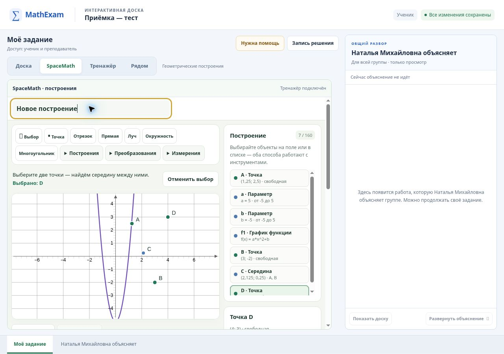
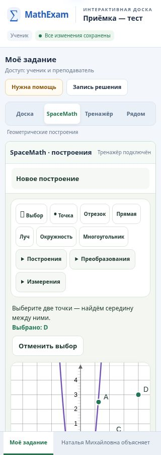

# Триединая доска: независимая браузерная приёмка

Дата: 10 ноября 2026, Новосибирск / 9 ноября UTC.
PR: [#519](https://github.com/ladynata-cloud/math-exam-fipi/pull/519), **Draft**.

**Решение владельца: не объединять PR и не публиковать доску до отдельного
решения о выпуске.** Автоматическая задача выпуска приостановлена. Приёмка
проведена на изолированном стенде и в GitHub Actions с синтетическими участниками;
реальные ученические данные и production-комнаты не использовались.

Этот отчёт продолжает [проверки разными моделями](unified-board-multimodel-review-20261109.md).
Новые проверки выполнены текущим исполнителем через браузер и тестовые сценарии;
новый независимый прогон трёх моделей или внешний аудит Claude не заявляется.

## Версия и GitHub Actions

- База локальной ручной проверки: `833856e60fcdc3f82715d85a222581a0e21656f2`.
- Исходный кандидат: `11aae69b5372b0d2352811e99917141d6314957e`.
  Все 18 workflow завершились успешно. [Полный прогон доски](https://github.com/ladynata-cloud/math-exam-fipi/actions/runs/42683048085)
  подтвердил 426 серверных проверок, 65 проверок модели/редактора/bridge,
  регрессию восьми учеников и совместный сценарий триединой доски.
- Первая правка: `2517b8f50d037807ff8831e4c8bc6a866b1b7193`.
  [Повторный прогон](https://github.com/ladynata-cloud/math-exam-fipi/actions/runs/42703254302)
  обнаружил реальный дефект восстановления предупреждения после перезагрузки.
  Он не списан на среду и не скрыт ослаблением проверки.
- Финальная версия кода: `ab4f1cf7d1bcfd120f65b633b9afc3c3894337a3`.
  [Финальный полный прогон](https://github.com/ladynata-cloud/math-exam-fipi/actions/runs/42705061495): **PASS**.
  В журнале: 426/426 серверных, 65/65 модельных проверок,
  `GROUP_BOARD_BROWSER_OK` (8 учеников, Chromium 151.0.7922.34),
  `UNIFIED_BOARD_BROWSER_READY` (учитель и 2 ученика).
- Фактический checkout CI: `9aee5a557ed6febb0a6bd73f2b27df3f15311585`,
  тестовое объединение head `ab4f1cf7` с обновившейся базой
  `c8a4f1fc61dd07038e30764f8cedf0725b767539`. Это служебный merge-ref CI,
  не объединение PR владельцем. Все семь файлов в таблице ниже сверены
  по Git blob с этим checkout: идентичны проверенным локальным файлам.
- [Артефакт финального CI](https://github.com/ladynata-cloud/math-exam-fipi/actions/runs/42705061495/artifacts/13712788077)
  содержит снимки и синтетические записи. Срок хранения CI — 7 дней;
  два ручных снимка сохранены в репозитории вместе с этим отчётом.

Все перечисленные новые браузерные сценарии завершились PASS, включая
восстановление предупреждений, два одновременных штриха с разными авторами,
перезапуск сервера, отсутствие ключей доступа в URL вложенных окон и отсутствие
ошибок страниц в автоматическом прогоне. Синтаксис изменённых JS-файлов и
`git diff --check` также пройдены.

Документация и два снимка добавлены после кода отдельным коммитом. При оценке
готовности необходимо различать проверенную версию кода и коммит отчёта.

| Файл | Git blob проверенной версии |
| --- | --- |
| `trainers/group-board.js` | `77e1c4885d28ff532db275c28b73fbf8d8d204e5` |
| `tools/unified-board.browser.cjs` | `ad4741e8d2ef59430e3cee06763311a5c8795b16` |
| `trainers/spacemath/model.js` | `22f60e98dd8df04ddfa4b0abae0161a23c190e8a` |
| `trainers/spacemath/app.js` | `c2070e9a7edbebc84ac183a569ae69b50990ffe9` |
| `trainers/spacemath/expression.js` | `a3b076f663de0e7a001695537aad5b8590bd7e18` |
| `trainers/group-trainer-frame.js` | `981480dbbab1c909c9d498e03cd0f78056c2afe1` |
| `board-server/group-lessons.js` | `896d031b0ee583a03fe873b36c6a5e099a175502` |

## Реальные ошибки и исправления

| Воспроизведение | До исправления | Исправление и повторная проверка |
| --- | --- | --- |
| Ответ 503 на периодическое чтение комнаты, затем восстановление API | Сообщение утверждало, что действие не сохранено, даже если не было правки. После восстановления зелёный статус сохранения соседствовал с устаревшей красной ошибкой. | Сбой чтения помечается как временное сообщение о связи. Успешное чтение убирает именно его. Ручная повторная проверка пройдена; добавлен браузерный сценарий. |
| Сервер отклоняет построение; затем успешно сохраняется тренажёр или перезагружается вкладка | Предупреждение исчезало, хотя отклонённое действие оставалось в локальной очереди восстановления. После перезагрузки статус ошибочно сообщал, что всё сохранено. | Успешные последующие действия не стирают предупреждение. При загрузке оно восстанавливается вместе с очередью; статус сообщает «Есть отклонённые действия». Добавлены проверки последующей записи, перезагрузки и доступности скачивания. |

Дополнительно два целевых DOM-прогона настоящего `group-board.js` проверили
перезагрузку, 503, восстановление связи и следующую успешную запись: с пустой
очередью отклонений и с существующим отклонённым действием — оба PASS.
Это дополнительные регрессии, они не включены повторно в число 65.

## Совместный урок: учитель и два ученика

Ручной сценарий выполнялся через видимые элементы трёх отдельных браузерных
вкладок. API использовался только стендом; ученические действия не заменялись
прямой подстановкой состояния. Для автоматических проверок отказов и прав
использовались также намеренно некорректные запросы и перехват сетевых ответов.

| Область | Фактически проверено | Результат и граница вывода |
| --- | --- | --- |
| Рукописные записи | Чёрный штрих ученика, зелёная пометка учителя, отображение обоим и восстановление после перезапуска | Ручной PASS. Автоматический сценарий дополнен одновременными штрихами учителя и ученика в одной работе с проверкой обоих авторов и изоляции второй работы. |
| Построения | Точка A(1,25; 2,5), точка B(3; −2), середина C(2,125; 0,25); выбор инструмента и объектов при 320×900 | Ручной PASS. Вычисление середины соответствует координатам. Два ученика одновременно добавили точки в разные личные работы; обе работы сохранились независимо. |
| Графики | `a*x^2+b`, изменение a до 5 учеником, b до −5 учителем, общий масштаб | Ручной PASS: параметры, рисунок и масштаб синхронизировались и восстановились. Это проверка конкретного графика, не доказательство корректности всех допустимых выражений. |
| Управление | Учитель сначала наблюдает, явно забирает управление SpaceMath, меняет модель и возвращает управление | Ручной PASS. Во время управления учителем поля ученика отключены. Серверные проверки отклоняют запись наблюдателя (403) и устаревшую версию модели (409). |
| Второй ученик | Собственная точка и отдельная работа; общий показ работы первого | Ручной PASS: наблюдатель видит общую модель, менять её не может; собственное построение сохраняется отдельно. |
| Тренажёр | Вставка «Числовой прямой» после записей и графика, решение `7 + (−5) = 2`, правильный ответ у ученика и учителя | Ручной PASS. Вставка и переключения «Доска / SpaceMath / Тренажёр / Рядом» не уничтожили другие материалы. Восьмиученическая регрессия также проверяет адаптер линейных неравенств. |
| История | Переход к первому событию, позднему событию и выход в текущую работу | Ручной PASS: старый кадр доступен только для чтения; выход возвращает актуальные материалы. CI проверяет ожидание подтверждения последней правки до загрузки истории. |
| Связь и восстановление | API временно отвечает 503; интерфейс теряет связь и блокирует правки; после восстановления соединяется автоматически | После исправления ручной PASS: временное предупреждение исчезает, сохранённое содержимое остаётся. Реальная автономная работа без сервера не заявляется. |
| Сохранение | Перезапуск тестового сервера и повторный вход в свежих вкладках | Ручной PASS: оба цвета штрихов, график с a=5/b=−5 и выполненный тренажёр восстановились. CI отдельно проверяет сохранение материалов и версий после рестарта сервера. |
| Гонки запросов | Потеря подтверждения записи, повтор, устаревшая очередь, одновременные записи | Восьмиученический сценарий проверяет дедупликацию и сохранность более новой правки учителя; триединый сценарий — отдельное авторство двух одновременных штрихов. Это заданные сценарии гонок, не нагрузочное испытание. |

## Размеры 320×900 и 1280×900

В ручном стенде размер именно рабочего iframe составлял 320×900 или 1280×900.
На мобильном размере измерены `clientWidth = scrollWidth = 320` у документа
доски и `298 = 298` у вложенного SpaceMath. Горизонтального переполнения всей
страницы не обнаружено. Числовая прямая использует собственную горизонтальную
прокрутку; её не следует смешивать с переполнением страницы.

Переключение режимов, меню «Построения», выбор середины и объектов работают
при 320×900. Однако верхние панели занимают значительную часть высоты; полный
чертёж и некоторые настройки требуют вертикальной прокрутки внутри рабочего
окна. Это оставшееся ограничение удобства, особенно для продолжительного урока
на телефоне. Требование «весь чертёж сразу на первом экране» не подтверждено.

Снимки синтетического урока без ссылок приглашения и ключей доступа:





Это браузерные размеры, не испытание физического смартфона. Касания, стилус,
виртуальная клавиатура iOS/Android и разные мобильные браузеры не проверялись.

## Ограничения среды

- Локальный стандартный запуск Chromium не стартовал из-за запрета создания
  socket (`Operation not permitted`). Это ограничение среды, не ошибка доски
  и не успешная браузерная проверка. Полный headless-прогон выполняется в CI.
- Во время ручного испытания облачная вкладка показала `Error code: 9`, а
  управляемый preview оказался остановлен. Причина сбоя рендерера не установлена;
  нехватка памяти не заявляется как факт. После перезапуска preview и открытия
  свежих вкладок сохранённая комната восстановилась. Сбой не замаскирован как
  потеря данных продукта или успешная проверка непрерывного соединения.
- Отключение API моделировалось ответом 503, а отдельные сценарии CI —
  перехватом/прерыванием запросов. Физическое отключение сети и длительная
  деградация реального сервера не испытывались.

## Оставшиеся ограничения продукта

- SpaceMath этой ветки — двумерный школьный редактор, без CAS, 3D, коник,
  импорта/экспорта GGB и экспорта изображения. Точка с ограничением движения
  по объекту отсутствует в проверенном PR #519; расширения других PR сюда
  не засчитываются.
- Преобразования применяются к точкам; фигуры строятся по преобразованным
  вершинам. Численные графики могут пропускать изолированные значения и
  оставлять консервативные зазоры около разрывов. Ограничения парсера, числа
  графиков (12) и вычислительного бюджета остаются.
- Модель SpaceMath редактирует один явный контроллер. Совместное наблюдение
  не означает одновременное изменение одного построения несколькими людьми.
- В каталоге совместных тренажёров два проверенных адаптера; произвольный
  тренажёр сайта ещё не получает синхронизацию автоматически.
- Обычная доска поддерживает перо, ластик, цвет, толщину и отмену. Текстовые
  блоки, изображения и PDF не входят в этот пакет.
- Отклонённая сервером правка не становится частью сохранённой истории.
  Её можно скачать для восстановления; локальная очередь хранится в
  `sessionStorage` текущей вкладки. Проверено сохранение при перезагрузке этой
  вкладки, а не гарантированное восстановление очереди после закрытия браузера.
- Не проведены нагрузочная проверка, длительный реальный урок, приёмка
  production-сервера и проверка обновления его версии. AI-помощник не запускался.

## Заключение

**Браузерная функциональная приёмка пройдена.** Блокирующих дефектов в
проверенных сценариях не осталось. Кандидат готов к рассмотрению владельцем
для контролируемого пилота; длительный реальный урок и production-проверка
остаются отдельными этапами. Узкий экран требует прокрутки, SpaceMath пока
существенно ограничен по сравнению с GeoGebra. Исправления и доказательства
остаются в Draft PR; решение о выпуске не принято, публикация не выполнялась.

```text
EXECUTIVE STATUS
Task: UNIFIED_INTERACTIVE_BOARD_20261109 — independent browser acceptance
PR: #519, Draft, not merged or deployed
Base: local 833856e60fcdc3f82715d85a222581a0e21656f2; final CI c8a4f1fc61dd07038e30764f8cedf0725b767539
Head: ab4f1cf7d1bcfd120f65b633b9afc3c3894337a3 (runtime; documentation follows)
Gate: PASS — run 42705061495; merge-ref 9aee5a557ed6febb0a6bd73f2b27df3f15311585
Tests: 426 server + 65 model/editor/bridge; browser suites; independent manual synthetic lesson
Failures: two real save/connection notice defects fixed; first regression failure retained as evidence
Not run: production, real-pupil lesson, physical mobile devices, load test, new multi-model/external review
Scope deviations: none; only acceptance fixes and regression coverage
Recommendation: retain Draft pending owner release decision; note narrow-screen scrolling limitation
Next user decision: whether and when to release this checked candidate
```
